# Redesign baseline: every screen before the redesign

The measured "before" of every screen in the web app, taken before the redesign
([#3800](https://github.com/PersonalClaw/PersonalClaw/issues/3800)) changes any of them. Every
redesign PR quotes its screen's section: the figures, the density analysis, the critique and the
checklist answers, so an improvement shows up as a number that moved. This report is Gate A, which
closes phase 1 ([#3804](https://github.com/PersonalClaw/PersonalClaw/issues/3804)).

The rules it measures against are in the redesign brief, [`web/REDESIGN.md`](../../web/REDESIGN.md),
and the screen specs in [`information-architecture.md`](information-architecture.md).
[`web/PRODUCT.md`](../../web/PRODUCT.md) and [`web/DESIGN.md`](../../web/DESIGN.md) win every
conflict.

Measured at commit `9b6feeaa1` on 2026-10-18: 70 screens, each in light and dark, at 1280
and 390 px wide. The snapshots are in [`baseline/`](baseline/) and every figure is in
[`baseline/figures.json`](baseline/figures.json). That commit is the tree just before the first
phase 2 changes (the shared form controls, the token layers and the chat's split into regions)
landed on `main` the same day, so it is their "before" too.

## Quoting a section

Every screen has the same five headings: Snapshots, Figures, Density, Critique and Checklist. A
redesign PR links its screen's section, copies the Figures table as its "before", and sets the same
figures from a fresh capture beside it. The id on the first line of each section names the screen to
the capture script:

```bash
node docs/screenshots/baseline.mjs --home /tmp/pc-baseline --only chat-turn
```

`--only` prints the named screens' figures and writes nothing. To regenerate the whole report's
snapshots and figures, run the script with no `--only` against the two homes below. The prose is
not regenerated: it is the baseline's reading of these snapshots, and a later PR adds its own.

## How it was measured

**The homes.** A scratch home seeded with `demo-home` (four projects, ten tasks, five knowledge
items, memory notes and one completed research loop), with the offline scripted model answering from
[`baseline-chat.json`](../screenshots/baseline-chat.json). Before it captures anything, the script
sends one chat turn through the composer and creates one READY code session through `POST
/api/loops`, so every screen sees the same home. Onboarding is captured on a second home seeded
`empty`, because an onboarded home sends `#/onboarding` to Home. Two things on screen come from the
seeded home, not from the design: the scripted model is not chosen as the default model, so the
toolbar's model chip reads "Choose a model" on every screen (an owner with a default model sees no
chip there), and the bell carries one notification from the seed.

**The captures.** [`docs/screenshots/baseline.mjs`](../screenshots/baseline.mjs) walks
`ROUTES`, `SETTINGS_ROUTES`, `VIEW_ROUTES` and `NON_NAV_ROUTES` from
[`web/e2e/routes.ts`](../../web/e2e/routes.ts), the two shell routes and the three detail routes. It
loads each route cold in Playwright's Chromium at 1280×900 and 390×844, light and dark, at device
scale 1, against this commit's built `web/dist`. [`scripts/baseline_images.py`](../../scripts/baseline_images.py)
then reads each snapshot's pixels and reduces it to a 128-colour palette.

The recipe, from the repository root after `make web-build`. Several screens print paths (the
workspace, the backups folder, the command the core tool server starts), so the gateways run from an
export of the checkout at a neutral path, with homes and a `HOME` that name nobody:

```bash
mkdir -p /tmp/pc-baseline-checkout /tmp/pc-baseline-user
git archive HEAD | tar -x -C /tmp/pc-baseline-checkout
cp -R web/dist /tmp/pc-baseline-checkout/web/dist
(cd /tmp/pc-baseline-checkout && uv sync --locked --python 3.13)
```

```bash
cd /tmp/pc-baseline-checkout
HOME=/tmp/pc-baseline-user PERSONALCLAW_HOME=/tmp/pc-baseline \
  PERSONALCLAW_WORKSPACE=/tmp/pc-baseline/workspace PERSONALCLAW_BIND_HOST=127.0.0.1 \
  PERSONALCLAW_SCRIPTED_MODEL_SCRIPT=$PWD/docs/screenshots/baseline-chat.json \
  .venv/bin/personalclaw gateway --no-open --port 10200 --json-ready --seed demo-home --seed-replace
```

```bash
cd /tmp/pc-baseline-checkout
HOME=/tmp/pc-baseline-user PERSONALCLAW_HOME=/tmp/pc-baseline-onboarding \
  PERSONALCLAW_WORKSPACE=/tmp/pc-baseline-onboarding/workspace PERSONALCLAW_BIND_HOST=127.0.0.1 \
  .venv/bin/personalclaw gateway --no-open --port 10201 --json-ready --seed empty --seed-replace
```

Then, from the repository root:

```bash
node docs/screenshots/baseline.mjs --home /tmp/pc-baseline --onboarding-home /tmp/pc-baseline-onboarding
```

The script finds each gateway from the record it keeps in its home and refuses the default home.
`--out DIR` writes an "after" capture somewhere other than the committed baseline. The Electron leg
of the idle measurement needs the Electron binary, which `npm ci` leaves undownloaded when install
scripts are off: `node node_modules/electron/install.js`.

**The work surface's share.** The work region is the shell's main area minus the top band (the
toolbar's floating corner controls and the page header), minus the composer's height when the screen
has one, minus a docked right pane. Its area over the viewport's is the share. At 1280 the rail is
open, which is what the brief's target assumes: at least ~75% with the rail open (`web/REDESIGN.md`
§4). At 390 the rail is a closed drawer.

**The other figures.**

- **Settled:** cold load until the page shows its content and nothing visible is busy.
  **Actionable:** until a control in the work area can be used. "never" means nothing in the work
  area can be acted on.
- **Controls and words:** what is visible in the viewport, split between the work area and the
  chrome (rail, top band, composer, right pane).
- **Text treatments:** distinct size, weight and colour combinations of visible text. **Font
  sizes:** distinct sizes. **Button treatments:** distinct button looks (fill, border, radius,
  height and type).
- **Counters reading 0:** visible elements whose whole text is "0" (`web/REDESIGN.md` §3 rule 3).
- **Ink:** the share of pixels that are not the page's background. In dark the rail is its own tone,
  so dark ink counts the rail's fill and reads higher than light. **Coral:** the share in the
  coral-and-red hue band, held to "under ~10% of a screen" (§3 rule 7). The danger red sits in the
  same band, so a screen showing an error counts it too.

**Density.** The ui-density skill in the brief's review-skills table has no licence and is installed
per machine, so it was not run here. Its four dimensions are written by hand from the figures and the
snapshots: visual (ink and chrome per area), information (useful facts per area), design (distinct
treatments) and temporal (time until the owner can act). Each names what carries no value right now.
A dense screen can be right and a sparse one wrong.

**Critique.** Impeccable's `critique` method, per screen, against `web/PRODUCT.md`, `web/DESIGN.md`
and the brief: Nielsen's ten heuristics scored 0 to 4 (status, real-world match, control,
consistency, error prevention, recognition, efficiency, minimalism, recovery, help), an anti-pattern
verdict, what works, and two to four priority issues tagged P0 (stops the job) to P3 (polish). The
design review was written from the snapshots and the source without the detector's output, as the
method asks. The deterministic detector (`npx impeccable@4.6.0 detect web/src`, the pinned release)
ran once over `web/src`, and each screen lists the findings in its own source files.

**Not covered here.** The other widths (320, 412, 768, 1024 and 1440 px), 200% text zoom,
keyboard-only operation, reduced motion and each surface's state matrix belong to the one UI quality
check ([#3811](https://github.com/PersonalClaw/PersonalClaw/issues/3811),
[#3941](https://github.com/PersonalClaw/PersonalClaw/issues/3941)). A surface's "before" for those
is that check's first run.

## Once per report

### Raw controls

`npm run audit:consistency` at the measured commit. These are the totals
[#3806](https://github.com/PersonalClaw/PersonalClaw/issues/3806) and
[#3811](https://github.com/PersonalClaw/PersonalClaw/issues/3811) ratchet down from. The
committed inventory, [`consistency-audit.json`](consistency-audit.json), is still its 2026-09-01
copy, which counted 265 raw buttons and 147 raw inputs. This change records the regenerated totals
and leaves the file to the PRs that change it.

| Raw control | Count |
|---|---|
| `<button>` outside `web/src/ui/` | 240 |
| `<input>`, `<textarea>` and `<select>` | 136 |
| Ad-hoc dialog markup | 0 |
| **Total** | **376**, in 105 of 823 files scanned |

The inventory ranks these first:

| File | Score | What it holds |
|---|---|---|
| `web/src/pages/code/CodeCockpitPage.tsx` | 30 | 13 raw-button, 4 raw-input |
| `web/src/pages/loops/LoopPlanReview.tsx` | 24 | 8 raw-button, 8 raw-input |
| `web/src/pages/code/CodePlanReview.tsx` | 23 | 7 raw-button, 9 raw-input |
| `web/src/pages/ChatPage.tsx` | 22 | 8 raw-button, 6 raw-input |
| `web/src/pages/projects/ProjectsSection.tsx` | 22 | 9 raw-button, 4 raw-input |
| `web/src/app/onboarding/EssentialsStep.tsx` | 20 | 4 color |
| `web/src/pages/settings/MemoryPanel.tsx` | 20 | 7 raw-button, 6 raw-input |
| `web/src/pages/loops/LoopCockpitPage.tsx` | 18 | 8 raw-button, 2 raw-input |
| `web/src/pages/knowledge/KnowledgeDetail.tsx` | 17 | 6 raw-button, 5 raw-input |
| `web/src/pages/knowledge/KnowledgeListPage.tsx` | 17 | 7 raw-button, 3 raw-input |

### Design detector

`npx impeccable@4.6.0 detect web/src` reports 55 findings. 7 are in test
files, where the "UI" is a fixture string, so they are false positives. Of the rest,
28 sit in shared files and are listed here; 20 sit in one screen's own
source and are listed in that screen's critique.

| Rule | Severity | Findings |
|---|---|---|
| `design-system-font-size`: Font size outside DESIGN.md | advisory | 23 |
| `design-system-color`: Color outside DESIGN.md | advisory | 13 |
| `design-system-font`: Font outside DESIGN.md | warning | 5 |
| `design-system-radius`: Radius outside DESIGN.md | advisory | 3 |
| `side-tab`: Side-tab accent border | warning | 2 |
| `overused-font`: Overused font | warning | 1 |
| `broken-image`: Broken or placeholder image | warning | 1 |

In shared files:

- `web/src/design/fonts.css`: overused-font, design-system-font ×3 (lines 18, 18, 36, 46)
- `web/src/design/gradients.ts`: design-system-color ×4 (lines 8, 8, 25, 37)
- `web/src/design/tokens.css`: side-tab, design-system-font-size ×6, design-system-radius ×3, design-system-font (lines 693, 698, 699, 700, 701, 702, 708, 711, 712, 713, 816)
- `web/src/ui/composer/liveMarkdown.ts`: design-system-font (lines 121)
- `web/src/ui/content/exporters.ts`: design-system-color ×4, design-system-font-size (lines 42, 45, 47, 48, 51)
- `web/src/ui/genui/components.tsx`: design-system-font-size (lines 71)
- `web/src/ui/widget/widgetSrcdoc.ts`: design-system-font-size ×2 (lines 341, 453)

### Idle cost of the default look

The default identity, the window focused, nothing running, measured over 5 s after the page settled.
Frames are `requestAnimationFrame` callbacks the page scheduled. The Electron leg is a plain Electron
44 window on the same gateway (the renderer the desktop app runs the dashboard in, without its own
gateway, tray and preload), with each process's CPU from `app.getAppMetrics()` as a share of one
core. Its frame counts follow this machine's 120 Hz display.

| | Home | Chat | Settings (the control) |
|---|---|---|---|
| Frame callbacks in 5 s, Chromium | 304 | 300 | 0 |
| Running CSS or motion animations, Chromium | 1 | 1 | 1 |
| Frame callbacks in 5 s, Electron | 601 | 600 | 0 |
| Renderer CPU, Electron | 0.45% | 0.72% | 0.14% |
| Renderer idle wakeups per second | 73 | 64 | 64 |
| GPU process CPU, Electron | 1.09% | 0.97% | 0.68% |

What keeps the frames coming:

- **Home:** the Agent world's canvas (`web/src/pages/dashboard/world/AgentWorld.tsx`) repaints every
  frame with nothing in orbit.
- **Chat:** the empty state's claw mark (`ClawMark` with `animated blob`, in `web/src/pages/ChatPage.tsx`)
  runs two endless motion loops, a rotation and a shape morph, which keep the motion frame loop
  alive.
- **Every page:** the gateway's "connected" dot in the toolbar (`web/src/ui/SystemWidget.tsx`) runs
  the endless CSS `status-pulse`. It schedules no frame callbacks, so Settings counts 0, but the
  compositor redraws it all day.

The epic's exit criterion is no animation-frame callbacks with the default identity, the window
focused and no turn running ([#3802](https://github.com/PersonalClaw/PersonalClaw/issues/3802),
[#3811](https://github.com/PersonalClaw/PersonalClaw/issues/3811)). Home and Chat miss it.

### Headline figures

- The rail is 196 px wide at 1280, 15.3% of the window. The estimate this report replaces was ~14%.
- 63 of the 70 screens give the work surface 79.4% of the window at 1280, and the app host's
  not-installed page 79.8%: the rail and a 56 px page header are all the chrome they have.
  Onboarding and the companion are full screen, so the whole window is work.
- Four miss the brief's ~75%: Files at 48.6% (its Explorer pane is docked open), Chat with a turn
  at 61.7%, and Home and the empty Chat at 64.7%. On Home and both chats the composer takes 156 px.
  At 390 the Explorer covers almost all of Files, which leaves its work surface 7.7%.
- In Chat with a turn, the top band and the composer take 27.1% of the window's height at 1280
  (the estimate was ~25%) and 49.3% at 390.
- Seven screens show counters reading 0: Settings › Memory (8), Learning, the Settings home and
  Mission Control (4 each), Knowledge and its graph (2 each), and Settings › System (1).
- No screen scrolls sideways at 390. Coral stays under 3.5% of every snapshot.
- Mission Control never becomes actionable: with nothing waiting, its work area holds no control.
- Times come from one cold load per capture, so read them to the nearest couple of hundred
  milliseconds. One gap is real: the Settings home took about 2.4 s to become actionable in both
  light passes and 0.3 to 0.7 s in the dark passes that ran straight after them. Its first visit
  after a quiet spell pays for work the gateway then caches.

### Every screen at a glance

| Screen | Id | Work share, 1280 / 390 | Actionable at 1280, light / dark | Controls at 1280, work / chrome | Coral, most | Score | Worst issue |
|---|---|---|---|---|---|---|---|
| [Home](#home) | `dashboard` | 64.7% / 70.1% | 720 ms / 892 ms | 19 / 33 | 0.1% | 23/40 | P1 |
| [Chat](#chat) | `chat` | 64.7% / 60.7% | 299 ms / 306 ms | 10 / 40 | 0.7% | 22/40 | P1 |
| [Projects](#projects) | `projects` | 79.4% / 93.4% | 371 ms / 417 ms | 5 / 29 | 0.5% | 25/40 | P1 |
| [Knowledge](#knowledge) | `knowledge` | 79.4% / 87.2% | 324 ms / 298 ms | 22 / 37 | 0.8% | 21/40 | P1 |
| [Tasks](#tasks) | `tasks` | 79.4% / 87.2% | 440 ms / 375 ms | 39 / 31 | 1.2% | 26/40 | P1 |
| [Inbox](#inbox) | `inbox` | 79.4% / 93.4% | 324 ms / 287 ms | 5 / 29 | 3.2% | 23/40 | P1 |
| [Triggers](#triggers) | `triggers` | 79.4% / 93.4% | 323 ms / 425 ms | 10 / 27 | 1.8% | 26/40 | P1 |
| [Files](#files) | `files` | 48.6% / 7.7% | 274 ms / 274 ms | 0 / 46 | 0.6% | 23/40 | P1 |
| [Artifacts](#artifacts) | `artifacts` | 79.4% / 93.4% | 266 ms / 322 ms | 19 / 26 | 2.7% | 26/40 | P1 |
| [Terminal](#terminal) | `terminal` | 79.4% / 93.4% | 269 ms / 332 ms | 1 / 29 | 1.7% | 26/40 | P1 |
| [Agents](#agents) | `agents` | 79.4% / 93.4% | 265 ms / 275 ms | 8 / 29 | 0.5% | 27/40 | P2 |
| [Tools](#tools) | `tools` | 79.4% / 93.4% | 421 ms / 399 ms | 23 / 28 | 0.6% | 25/40 | P1 |
| [Skills](#skills) | `skills` | 79.4% / 87.2% | 317 ms / 389 ms | 11 / 30 | 0.7% | 28/40 | P1 |
| [Learning](#learning) | `learning` | 79.4% / 93.4% | 330 ms / 324 ms | 4 / 27 | 0.5% | 21/40 | P1 |
| [Workflows](#workflows) | `workflows` | 79.4% / 87.2% | 316 ms / 377 ms | 7 / 29 | 0.9% | 26/40 | P1 |
| [Prompts](#prompts) | `prompts` | 79.4% / 87.2% | 328 ms / 372 ms | 3 / 31 | 2.1% | 26/40 | P2 |
| [Store](#store) | `apps` | 79.4% / 87.2% | 271 ms / 329 ms | 3 / 30 | 3.4% | 27/40 | P1 |
| [Settings](#settings) | `settings` | 79.4% / 93.4% | 2440 ms / 680 ms | 22 / 26 | 0.6% | 27/40 | P1 |
| [Settings › Account](#settings--account) | `settings-account` | 79.4% / 93.4% | 166 ms / 230 ms | 10 / 28 | 0.1% | 26/40 | P2 |
| [Settings › Design](#settings--design) | `settings-design` | 79.4% / 93.4% | 131 ms / 326 ms | 20 / 28 | 2.1% | 26/40 | P2 |
| [Settings › Chat](#settings--chat) | `settings-chat` | 79.4% / 93.4% | 166 ms / 219 ms | 9 / 28 | 0.4% | 27/40 | P2 |
| [Settings › Providers](#settings--providers) | `settings-providers` | 79.4% / 93.4% | 223 ms / 222 ms | 8 / 28 | 0.3% | 23/40 | P1 |
| [Settings › Models](#settings--models) | `settings-models` | 79.4% / 93.4% | 319 ms / 381 ms | 10 / 28 | 0.1% | 24/40 | P1 |
| [Settings › Search](#settings--search) | `settings-search` | 79.4% / 93.4% | 222 ms / 220 ms | 5 / 28 | 0.1% | 25/40 | P1 |
| [Settings › Prompts](#settings--prompts) | `settings-prompts` | 79.4% / 93.4% | 116 ms / 121 ms | 9 / 28 | 0.1% | 23/40 | P1 |
| [Settings › Memory](#settings--memory) | `settings-memory` | 79.4% / 93.4% | 217 ms / 219 ms | 31 / 28 | 0.2% | 21/40 | P1 |
| [Settings › Evaluations](#settings--evaluations) | `settings-evals` | 79.4% / 93.4% | 119 ms / 120 ms | 6 / 28 | 0.1% | 21/40 | P1 |
| [Settings › Agent defaults](#settings--agent-defaults) | `settings-agent` | 79.4% / 93.4% | 225 ms / 176 ms | 7 / 28 | 0.1% | 23/40 | P1 |
| [Settings › Speech & Transcription](#settings--speech--transcription) | `settings-voice` | 79.4% / 93.4% | 172 ms / 173 ms | 8 / 28 | 0.9% | 25/40 | P1 |
| [Settings › Apps](#settings--apps) | `settings-apps` | 79.4% / 93.4% | 171 ms / 174 ms | 3 / 28 | 0.4% | 28/40 | P2 |
| [Settings › Inbox](#settings--inbox) | `settings-inbox` | 79.4% / 93.4% | 118 ms / 116 ms | 6 / 28 | 0.3% | 26/40 | P1 |
| [Settings › Documents](#settings--documents) | `settings-documents` | 79.4% / 93.4% | 179 ms / 175 ms | 1 / 28 | 0.1% | 29/40 | P2 |
| [Settings › Notifications](#settings--notifications) | `settings-notifications` | 79.4% / 93.4% | 116 ms / 117 ms | 11 / 28 | 0.1% | 27/40 | P2 |
| [Settings › Security](#settings--security) | `settings-security` | 79.4% / 93.4% | 118 ms / 123 ms | 2 / 28 | 0.2% | 23/40 | P1 |
| [Settings › Secrets](#settings--secrets) | `settings-secrets` | 79.4% / 93.4% | 167 ms / 215 ms | 6 / 28 | 0.1% | 26/40 | P1 |
| [Settings › Devices](#settings--devices) | `settings-devices` | 79.4% / 93.4% | 170 ms / 167 ms | 4 / 28 | 1.8% | 29/40 | P2 |
| [Settings › Sender trust](#settings--sender-trust) | `settings-sender-trust` | 79.4% / 93.4% | 166 ms / 167 ms | 1 / 28 | 1.4% | 29/40 | P2 |
| [Settings › Guardrails](#settings--guardrails) | `settings-guardrails` | 79.4% / 93.4% | 171 ms / 171 ms | 7 / 28 | 0.1% | 26/40 | P2 |
| [Settings › External Access](#settings--external-access) | `settings-external-access` | 79.4% / 93.4% | 171 ms / 186 ms | 6 / 28 | 0.1% | 27/40 | P2 |
| [Settings › Audit log](#settings--audit-log) | `settings-audit` | 79.4% / 93.4% | 495 ms / 425 ms | 33 / 28 | 0.1% | 26/40 | P1 |
| [Settings › System](#settings--system) | `settings-system` | 79.4% / 93.4% | 126 ms / 117 ms | 2 / 28 | 0.2% | 27/40 | P2 |
| [Settings › Doctor](#settings--doctor) | `settings-doctor` | 79.4% / 93.4% | 173 ms / 165 ms | 4 / 28 | 0.1% | 25/40 | P2 |
| [Settings › Diagnostics](#settings--diagnostics) | `settings-diagnostics` | 79.4% / 93.4% | 135 ms / 173 ms | 12 / 28 | 0.1% | 25/40 | P2 |
| [Settings › Tool-output projection](#settings--tool-output-projection) | `settings-tool-output` | 79.4% / 93.4% | 120 ms / 124 ms | 4 / 28 | 0.1% | 24/40 | P2 |
| [Settings › AI feedback](#settings--ai-feedback) | `settings-feedback` | 79.4% / 93.4% | 169 ms / 218 ms | 4 / 28 | 0.2% | 27/40 | P2 |
| [Settings › Usage](#settings--usage) | `settings-usage` | 79.4% / 93.4% | 224 ms / 170 ms | 5 / 28 | 0.5% | 26/40 | P2 |
| [Settings › Routing & Efficiency](#settings--routing--efficiency) | `settings-routing` | 79.4% / 93.4% | 170 ms / 181 ms | 10 / 28 | 0.1% | 26/40 | P2 |
| [Settings › Legibility](#settings--legibility) | `settings-legibility` | 79.4% / 93.4% | 230 ms / 225 ms | 3 / 28 | 0.2% | 26/40 | P2 |
| [Settings › Workflows](#settings--workflows) | `settings-workflows` | 79.4% / 93.4% | 123 ms / 122 ms | 6 / 28 | 0.2% | 22/40 | P2 |
| [Settings › Autonomous loops](#settings--autonomous-loops) | `settings-loops` | 79.4% / 93.4% | 127 ms / 124 ms | 4 / 28 | 0.1% | 25/40 | P2 |
| [Settings › Ambient surfaces](#settings--ambient-surfaces) | `settings-ambient` | 79.4% / 93.4% | 275 ms / 119 ms | 4 / 28 | 0.4% | 26/40 | P2 |
| [Settings › Companion apps](#settings--companion-apps) | `settings-companion` | 79.4% / 93.4% | 220 ms / 170 ms | 7 / 28 | 0.1% | 27/40 | P2 |
| [Settings › Watched sources](#settings--watched-sources) | `settings-sources` | 79.4% / 93.4% | 174 ms / 166 ms | 5 / 28 | 0.2% | 24/40 | P2 |
| [Settings › Packs](#settings--packs) | `settings-packs` | 79.4% / 93.4% | 215 ms / 169 ms | 5 / 28 | 0.8% | 25/40 | P1 |
| [Settings › Archive](#settings--archive) | `settings-archive` | 79.4% / 93.4% | 128 ms / 118 ms | 0 / 28 | 0.1% | 20/40 | P2 |
| [Settings › Import / Export](#settings--import--export) | `settings-portability` | 79.4% / 93.4% | 126 ms / 120 ms | 5 / 28 | 1.5% | 28/40 | P2 |
| [Settings › Backups](#settings--backups) | `settings-durability` | 79.4% / 93.4% | 217 ms / 269 ms | 7 / 28 | 0.4% | 25/40 | P1 |
| [Settings › Updates](#settings--updates) | `settings-updates` | 79.4% / 93.4% | 415 ms / 409 ms | 8 / 28 | 0.1% | 27/40 | P2 |
| [Knowledge › Graph](#knowledge--graph) | `knowledge-graph` | 79.4% / 87.2% | 279 ms / 330 ms | 1 / 36 | 3.0% | 24/40 | P1 |
| [Knowledge › Reading](#knowledge--reading) | `knowledge-reading` | 79.4% / 93.4% | 322 ms / 278 ms | 0 / 28 | 0.1% | 17/40 | P2 |
| [Mission Control](#mission-control) | `mission-control` | 79.4% / 93.4% | never / never | 0 / 26 | 0.1% | 20/40 | P1 |
| [Notifications](#notifications) | `notifications` | 79.4% / 93.4% | 379 ms / 381 ms | 2 / 28 | 0.4% | 26/40 | P1 |
| [Discover](#discover) | `discover` | 79.4% / 93.4% | 332 ms / 327 ms | 11 / 26 | 0.3% | 26/40 | P1 |
| [App host › not installed](#app-host--not-installed) | `app-host-not-installed` | 79.8% / 93.8% | 328 ms / 276 ms | 1 / 26 | 1.7% | 25/40 | P2 |
| [App host › contributed UI](#app-host--contributed-ui) | `app-host-contributed-ui` | 79.4% / 93.4% | 178 ms / 170 ms | 1 / 26 | 0.1% | 23/40 | P1 |
| [Onboarding](#onboarding) | `onboarding` | 100% / 100% | 620 ms / 691 ms | 5 / 0 | 0.9% | 28/40 | P2 |
| [Companion](#companion) | `companion` | 100% / 100% | 278 ms / 281 ms | 3 / 0 | 0.8% | 24/40 | P1 |
| [Loop cockpit](#loop-cockpit) | `loop-cockpit` | 79.4% / 87.2% | 338 ms / 376 ms | 3 / 31 | 0.5% | 22/40 | P1 |
| [Code session](#code-session) | `code-session` | 79.4% / 87.2% | 270 ms / 272 ms | 8 / 31 | 0.8% | 24/40 | P1 |
| [Chat with a turn](#chat-with-a-turn) | `chat-turn` | 61.7% / 50.7% | 277 ms / 289 ms | 2 / 48 | 0.2% | 24/40 | P1 |

## Rail destinations

The 18 destinations in the rail, in its order (`ROUTES` in `web/e2e/routes.ts`).

### Home

`#/dashboard` · id `dashboard`.

#### Snapshots

| 1280, light | 1280, dark |
|---|---|
| 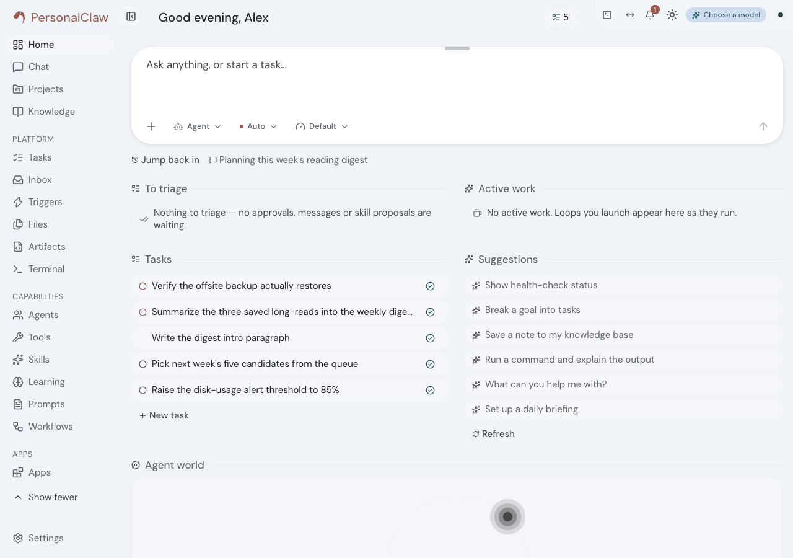 | 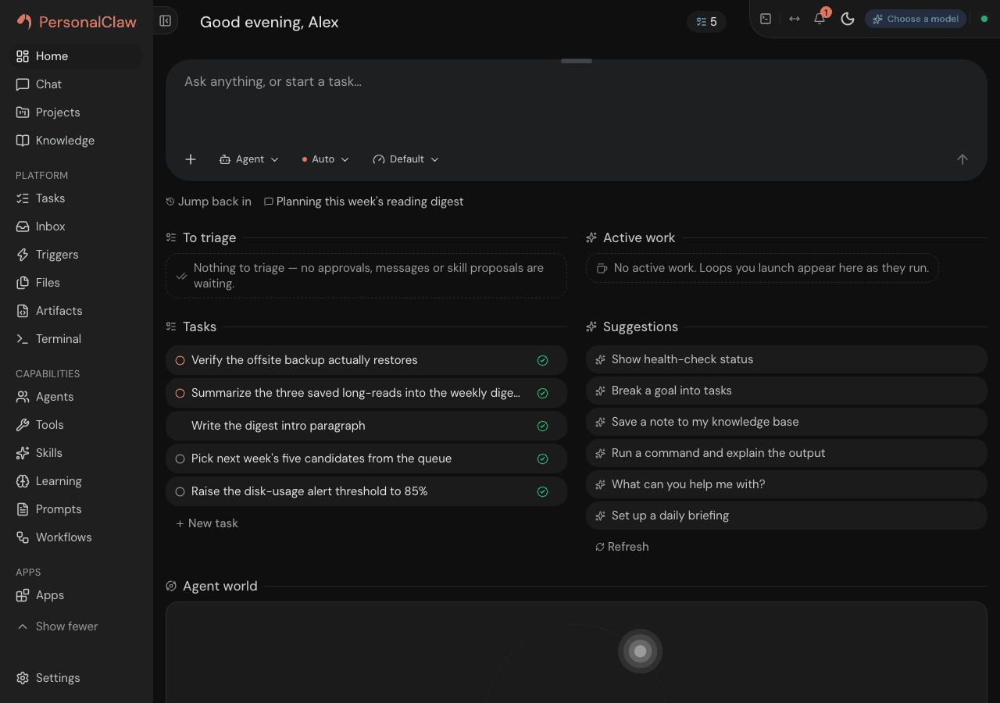 |

| 390, light | 390, dark |
|---|---|
| 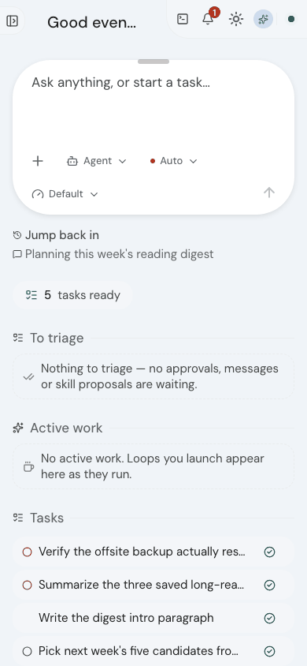 | 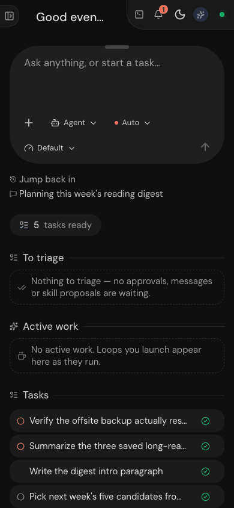 |

#### Figures

| | 1280 × 900 | 390 × 844 |
|---|---|---|
| Work surface share | 64.7% | 70.1% |
| Rail | 196 px (15.3%) | closed drawer |
| Top band (toolbar and page header) | 56 px | 56 px |
| Composer | 156 px | 196 px |
| Right pane | none | none |
| Settled, light / dark | 717 ms / 890 ms | 828 ms / 769 ms |
| Actionable, light / dark | 720 ms / 892 ms | 833 ms / 773 ms |
| Controls visible | 19 in the work area; rail 19, top 8, composer 6 | 10 in the work area; top 6, composer 6 |
| Words visible | 110 in the work area; rail 24, top 8, composer 9 | 67 in the work area; top 4, composer 9 |
| Text treatments / font sizes | 11 / 5 | 8 / 5 |
| Button treatments | 16 | 11 |
| Counters reading 0 | 0 | 0 |
| Ink, light / dark | 17.9% / 32.5% | 25.4% / 26.2% |
| Coral, light / dark | 0.1% / 0.1% | 0.1% / 0.1% |
| Scrolls sideways | no | no |

#### Density

- **Visual:** The work surface is 64.7% of the window at 1280 and 70.1% at 390, under the ~75% floor in `web/REDESIGN.md` §4, because the launcher composer takes a 156 px band at the top (14.7%) beside a 15.3% rail. Ink is 17.9%, and the first row of bands spends it on two empty boxes, "To triage" and "Active work", while "Agent world" opens an empty orbit at the fold.
- **Information:** The work area holds 110 words and 19 controls, and without a click the owner learns that nothing waits, nothing runs and five tasks are open. Seven of those controls are the six Suggestions chips and Refresh, which say nothing about the owner's work, and the header's "5" carries no label at 1280.
- **Design:** 11 text treatments in 5 sizes and 16 button treatments, against the four button tiers and the icon button in `web/DESIGN.md` §5. Coral is 0.1%, right for a page where nothing is alive, and the only warm marks are the priority circles on two task rows.
- **Temporal:** Actionable in 720 ms, the slowest of these nine screens in every capture (the others land between 231 and 440 ms). After that the bands cascade in through `EntranceGroup` and `AgentWorld` keeps a `requestAnimationFrame` loop painting below the fold with no agent alive; with nothing waiting, the primary job takes no step.

#### Critique

**Score 23/40** (status 2, real-world match 2, control 3, consistency 2, error prevention 3, recognition 3, efficiency 2, minimalism 1, recovery 3, help 2). **Anti-patterns:** a hero-metric strip (`HeroPulse`, the header's "5"), ambient glow in `AgentWorld` (three additive glow passes per node), and uppercase tracked eyebrows in the rail ("PLATFORM", "CAPABILITIES", "APPS", shared with every screen).

- **Working:** The empty bands state facts instead of zeros. "Nothing to triage" names what it covers (approvals, messages and skill proposals) and "No active work" says where loops will appear, which is `web/REDESIGN.md` §3 rule 3 done right.
- **[P1] Home is a feed of twelve bands, not the three groups.** The launcher, Jump back in, To triage, Active work, Tasks and Suggestions sit above the fold, and Agent world, Discover, Pinned artifacts, Desktop live view, Browse live view and Recent activity below it, so what finished is the last band on the page. The owner scrolls past suggestions and an ambient scene to learn what ran overnight. Rebuild Home as Needs You, Running Now and Recent/Completed (the screen specs in `docs/design/information-architecture.md`), and cut what "What leaves Home" lists, including the "5" (one needs-you badge in the toolbar replaces it) and the Suggestions outside the empty state.
- **[P1] The launcher composer is the largest element.** At 1052 by 156 px it outweighs every band and holds the work surface to 64.7%, though Home's job is to show what needs the owner and starting a thread is one action among several. Give the header "New thread" with ⌘N, as the screen spec's header does, and let the composer live in the thread.
- **[P2] `AgentWorld` animates all day with nothing alive.** Its canvas repaints every frame below the fold of the page the owner keeps open, which breaks `web/REDESIGN.md` §8 item 9 and the default look in `web/DESIGN.md` §7, and it repeats Active work as a picture. Take it out of the default identity; Running Now rows carry the same facts.
- **[P2] One circle means priority here and status on `#/tasks`.** "Verify the offsite backup actually restores" carries a red circle for Critical on Home and an in-progress glyph on `#/tasks`, and "Write the digest intro paragraph" carries none, because medium priority is hidden. The owner learns two meanings for one mark. Use one status glyph on both screens and write priority as a word.

**Detector:** no findings in this screen's own source files.

#### Checklist

1. **The one thing:** see what needs the owner, what is running and what finished. **Largest element:** no, the launcher composer (1052 by 156 px) is; "To triage" is a 514 by 58 px empty box.
2. **Fails "needed right now":** the header's "5", the six Suggestions chips and Refresh, "Agent world", and the bands below the fold (Discover, Pinned artifacts, Desktop live view, Browse live view).
3. **Can move:** the "5" to the toolbar's one needs-you badge, shown only for what waits; Suggestions and Discover to the palette and the empty state; the "Choose a model" chip in the shell corner to the status line (shared with every screen).
4. **Scope homes:** the composer, a thread's input, sits on Home; the page header holds a greeting where the title and its New thread and View actions belong; the chats Jump back in offers belong in the sidebar under their projects, which lists none today (shared with every screen).

### Chat

`#/chat` · id `chat`.

#### Snapshots

| 1280, light | 1280, dark |
|---|---|
| 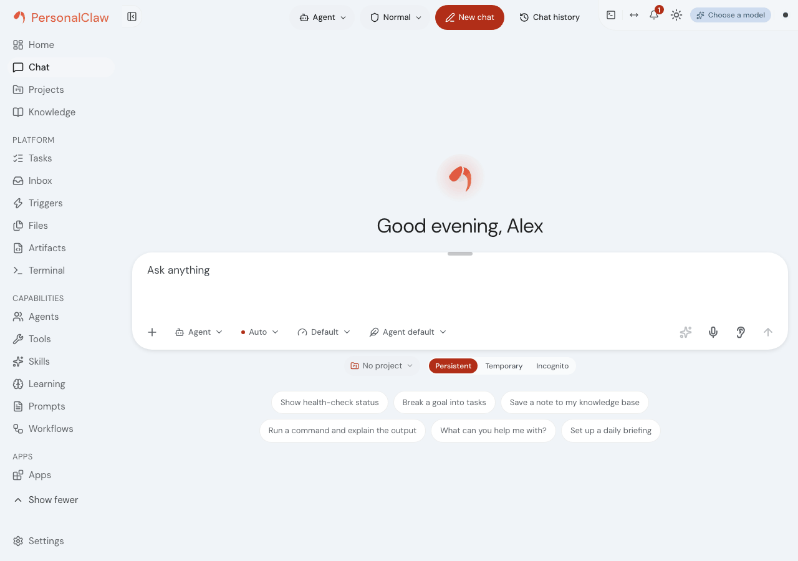 | 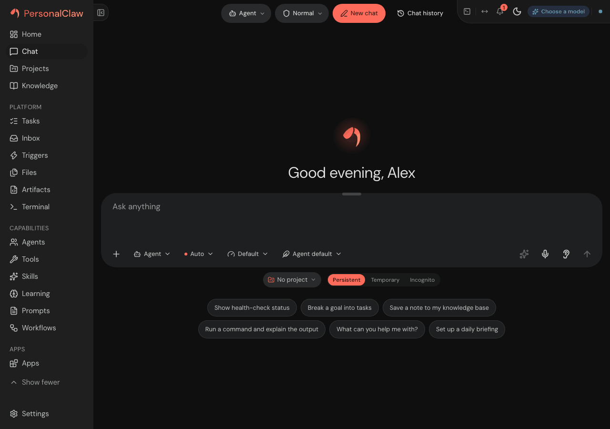 |

| 390, light | 390, dark |
|---|---|
| 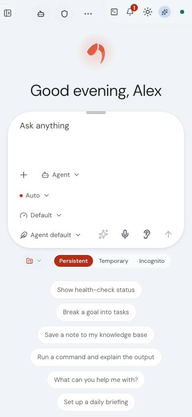 | 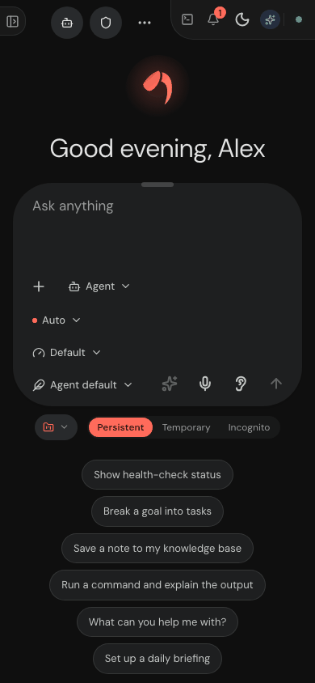 |

#### Figures

| | 1280 × 900 | 390 × 844 |
|---|---|---|
| Work surface share | 64.7% | 60.7% |
| Rail | 196 px (15.3%) | closed drawer |
| Top band (toolbar and page header) | 56 px | 56 px |
| Composer | 156 px | 276 px |
| Right pane | none | none |
| Settled, light / dark | 296 ms / 302 ms | 319 ms / 310 ms |
| Actionable, light / dark | 299 ms / 306 ms | 325 ms / 317 ms |
| Controls visible | 10 in the work area; rail 19, top 11, composer 10 | 10 in the work area; top 9, composer 10 |
| Words visible | 41 in the work area; rail 24, top 10, composer 7 | 39 in the work area; top 1, composer 7 |
| Text treatments / font sizes | 12 / 6 | 5 / 4 |
| Button treatments | 17 | 12 |
| Counters reading 0 | 0 | 0 |
| Ink, light / dark | 19.9% / 35.3% | 44.0% / 46.7% |
| Coral, light / dark | 0.6% / 0.6% | 0.7% / 0.7% |
| Scrolls sideways | no | no |

#### Density

- **Visual:** The work surface is 64.7% at 1280 and 60.7% at 390, where the composer's footer wraps into four rows and the composer grows to 276 px, a third of the height. At 1280 the composer runs 1052 px wide, past the 720 to 780 px reading column of `web/REDESIGN.md` §5 convention 1, and the space above it holds only the animated mark and the greeting.
- **Information:** Every setting the first turn will use is on screen, split across the header (Agent, Normal), the composer footer (Agent, Auto, Default, Agent default) and the row under it (No project, Persistent). The work area's 41 words and 10 controls are that row, the greeting and six suggestion chips, and the footer pills show bare values whose dimension lives only in their `aria-label`.
- **Design:** 12 text treatments in 6 sizes and 17 button treatments, the most of these nine screens on both counts. Coral is 0.6%, spent on "New chat" (a primary that recreates the page the owner is on), the selected "Persistent", the model pill's dot and the halo behind the mark.
- **Temporal:** Actionable in 299 ms, and the job is one step, type and send. The idle page never settles, since `ClawMark` with `animated blob` rotates on a 7 s loop and morphs its halo on an 8 s loop while no turn runs.

#### Critique

**Score 22/40** (status 2, real-world match 2, control 3, consistency 1, error prevention 3, recognition 2, efficiency 2, minimalism 2, recovery 3, help 2). **Anti-patterns:** decorative glow on an inactive thing (the coral radial halo behind the idle mark), and uppercase tracked eyebrows in the rail (shared with every screen).

- **Working:** The memory mode is picked before the first turn, in plain words ("Persistent", "Temporary", "Incognito") under the composer, so the owner knows what the chat will keep before typing.
- **[P1] Configuration sits in the thread header.** "Agent" (the task mode) and "Normal" (the permission mode) are header pills, and "New chat" is the header's coral primary on a page that is already a new chat. The four rules in `docs/design/information-architecture.md` keep configuration out of a thread header, and "What leaves Home and the thread header" moves all three, the modes to the composer and the Execution Boundary control and New chat to ⌘N and the sidebar. Until then the owner looks in two places to know what the next turn may do. Leave the header to the thread's own actions.
- **[P1] Two pills say "Agent" and mean different things.** The header's "Agent" is the task mode and the composer's "Agent" picks the agent, beside separate pills for the model ("Auto"), the effort ("Default") and the reply style ("Agent default"). `web/REDESIGN.md` §3 rule 5 asks for one agent-and-model pill that carries effort only for a model that declares it. Merge the three into that pill and give the task mode and the reply style their names on screen.
- **[P2] The idle page animates forever.** The rotating mark and its morphing coral halo run with nothing alive, against the Glow-Is-Alive Rule and the default look in `web/DESIGN.md` §7 and against `web/REDESIGN.md` §8 item 9, and the motion tells the owner something is working when nothing is. Show a still mark or none, and leave the agent orb to the head of a turn.
- **[P2] The composer ignores the reading column.** At 1280 it is 1052 px wide, so the owner types across a wider line than the reply will read in, and at 390 its pills wrap into four rows and take 276 of 844 px. Hold the composer to the reading column and keep its footer on one row, with the one agent-and-model pill, the task mode and the reply style.

**Detector:** 2 in this screen's own source: `web/src/pages/ChatPage.tsx` (design-system-font-size ×2; lines 4594, 4604).

#### Checklist

1. **The one thing:** start a turn. **Largest element:** yes, the composer (1052 by 156 px at 1280, 358 by 276 px at 390).
2. **Fails "needed right now":** "New chat" on a new chat, the animated mark and its halo, the display-size greeting, and "Chat history", which stands in for the threads the sidebar does not list.
3. **Can move:** "New chat" to ⌘N and the sidebar; "Chat history" to the sidebar and the palette; "Agent" (task mode) and "Normal" to the composer and the Execution Boundary control.
4. **Scope homes:** the task and permission modes sit in the thread header instead of beside the composer; the model's health, "Choose a model", sits in the shell corner instead of the status line (shared with every screen); the project picker and the memory mode under the composer are in place.

### Projects

`#/projects` · id `projects`.

#### Snapshots

| 1280, light | 1280, dark |
|---|---|
| 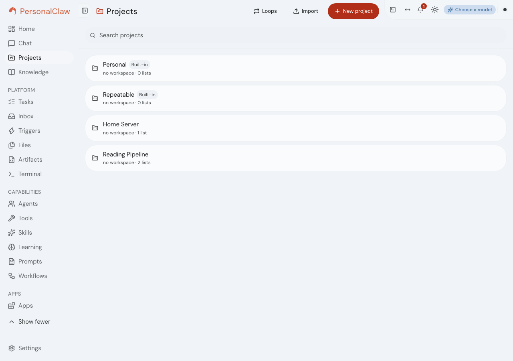 | 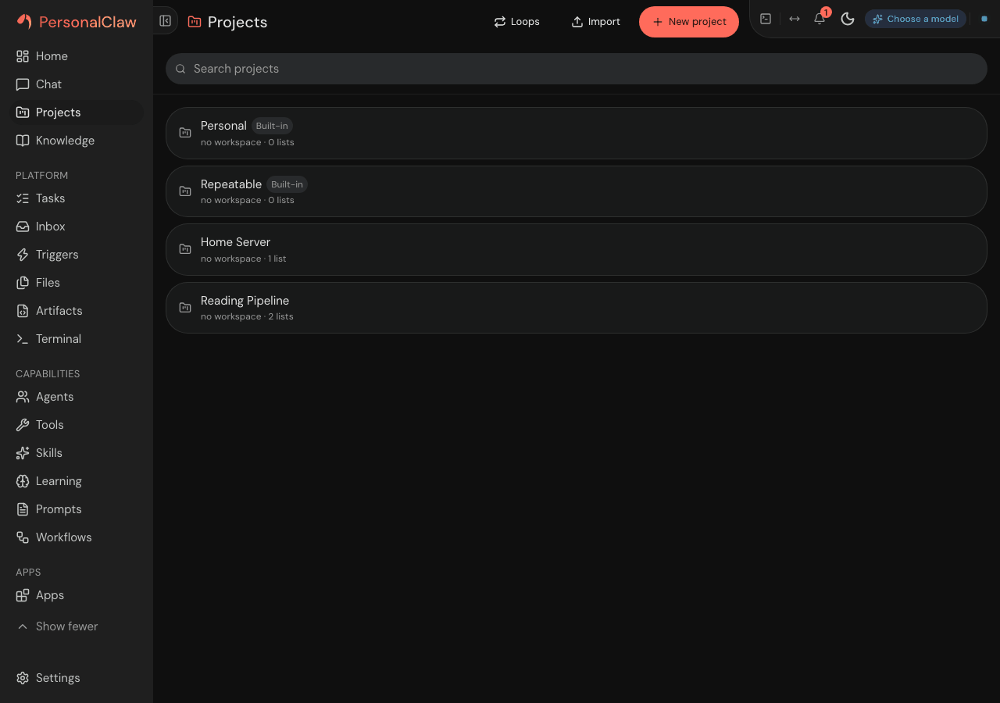 |

| 390, light | 390, dark |
|---|---|
| 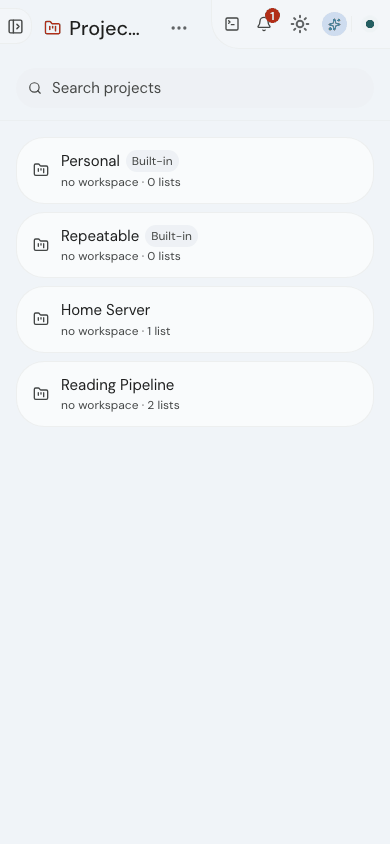 | 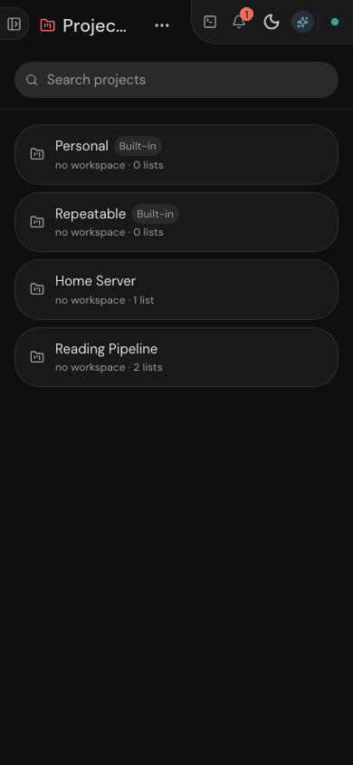 |

#### Figures

| | 1280 × 900 | 390 × 844 |
|---|---|---|
| Work surface share | 79.4% | 93.4% |
| Rail | 196 px (15.3%) | closed drawer |
| Top band (toolbar and page header) | 56 px | 56 px |
| Composer | none | none |
| Right pane | none | none |
| Settled, light / dark | 369 ms / 415 ms | 360 ms / 363 ms |
| Actionable, light / dark | 371 ms / 417 ms | 362 ms / 365 ms |
| Controls visible | 5 in the work area; rail 19, top 10 | 5 in the work area; top 7 |
| Words visible | 28 in the work area; rail 24, top 9 | 28 in the work area; top 2 |
| Text treatments / font sizes | 10 / 4 | 4 / 3 |
| Button treatments | 11 | 7 |
| Counters reading 0 | 0 | 0 |
| Ink, light / dark | 2.1% / 20.8% | 2.0% / 8.0% |
| Coral, light / dark | 0.4% / 0.5% | 0.1% / 0.1% |
| Scrolls sideways | no | no |

#### Density

- **Visual:** The work surface is 79.4% at 1280 and 93.4% at 390, yet ink is 2.1% in light against 20.8% in dark. Four rows end 427 px down, more than half the work area under them is bare canvas, and in light the row surface sits a faint tone off the canvas, so even the rows barely register.
- **Information:** The work area's 28 words and 5 controls give four names, two "Built-in" chips and "no workspace" with a task-list count on every row. Nothing says which project has a loop running, a thread waiting on the owner or anything new, and "0 lists" on two rows is a zero count that `zeroCounters` misses because it is not a bare "0".
- **Design:** 10 text treatments in 4 sizes and 11 button treatments. Coral is 0.4%, on "New project" and on the title's folder icon, which is decoration, and the row text takes literal sizes (`text-[0.9375rem]`, `text-[0.75rem]`) instead of `data-type` roles.
- **Temporal:** Actionable in 371 ms, after which the rows rise in on a staggered spring on every visit, against `web/REDESIGN.md` §3 rule 12. Opening a project takes two clicks, one to peek and one to expand the peek to the project page.

#### Critique

**Score 25/40** (status 1, real-world match 3, control 3, consistency 2, error prevention 3, recognition 3, efficiency 2, minimalism 3, recovery 3, help 2). **Anti-patterns:** coral on a decorative thing (the title's folder icon), and uppercase tracked eyebrows in the rail (shared with every screen).

- **Working:** The list is calm and honest about what can be removed. There is one row per project with search above it, and "Built-in" marks the two projects that carry no Delete, so the owner never meets a destructive control that would be refused.
- **[P1] The rows say nothing about the work inside.** There are no threads, no running or waiting pip and no last activity, so the owner opens each project to learn whether anything happened. The IA makes projects and their threads the dominant part of the sidebar, each thread with a static pip, while the rail lists "Projects" as one of 17 entries with no project under it. Put the projects and their threads in the sidebar, and give each row here its threads, a pip and its last activity.
- **[P2] "Loops" is a second path from the page header.** It jumps to `#/loops/history` from the header of another page, against `web/REDESIGN.md` §3 rule 2, and in the IA a goal loop is a thread in its project, so the path dissolves once threads sit under their projects. Reach loops from the palette until then, and keep the header to "New project" and an overflow holding "Import".
- **[P2] Zero counts and absent facts on every row.** "0 lists" on Personal and Repeatable and "no workspace" on all four rows give the owner nothing to act on, against `web/REDESIGN.md` §3 rule 3. Show the workspace folder and the list count only when they exist.
- **[P3] The list arrives in motion and fades into the canvas.** The staggered entrance replays on every sidebar click, against rule 12, and the light rows are a faint tone on a faint tone. Render the rows in place and give them one clear step of the surface ramp.

**Detector:** no findings in this screen's own source files.

#### Checklist

1. **The one thing:** pick the project to work in, knowing what is going on in it. **Largest element:** yes, the project list, though more than half the work area under it is empty.
2. **Fails "needed right now":** "Import", "Loops", "no workspace" and "0 lists" on the rows, and the coral folder icon in the title.
3. **Can move:** "Import" to an overflow menu and the palette; "Loops" to the palette.
4. **Scope homes:** the projects themselves, which the IA puts in the sidebar, and "Loops", navigation in a page header; Delete sits on its row and in the context menu, in place.

### Knowledge

`#/knowledge` · id `knowledge`.

#### Snapshots

| 1280, light | 1280, dark |
|---|---|
| 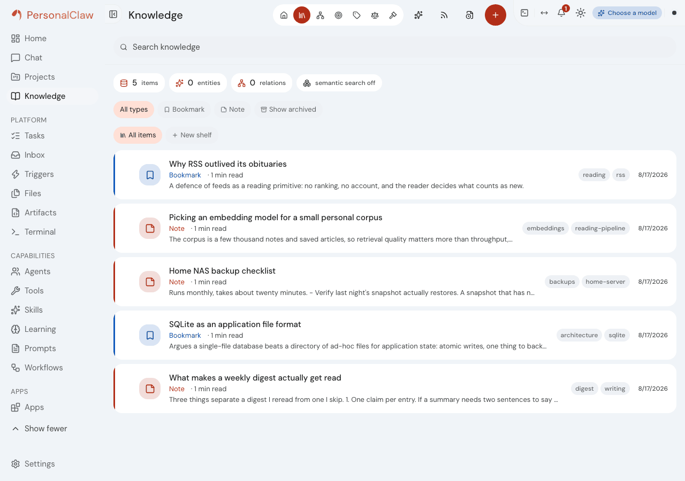 | 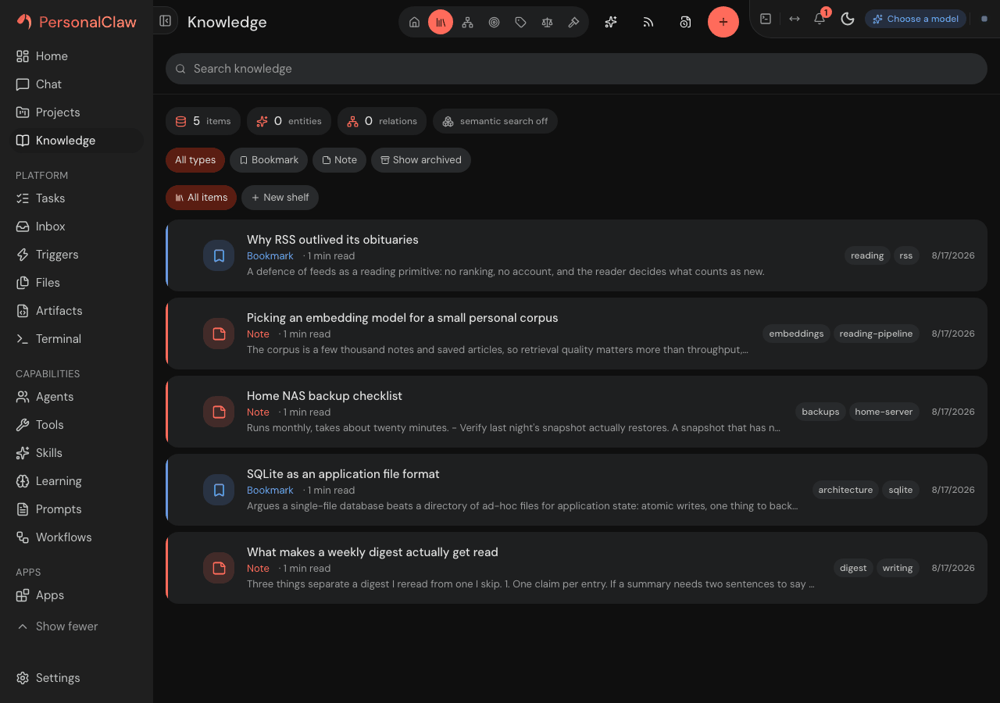 |

| 390, light | 390, dark |
|---|---|
| 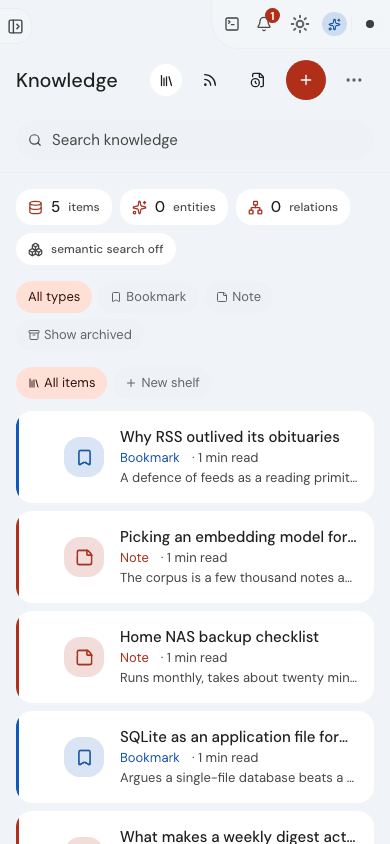 | 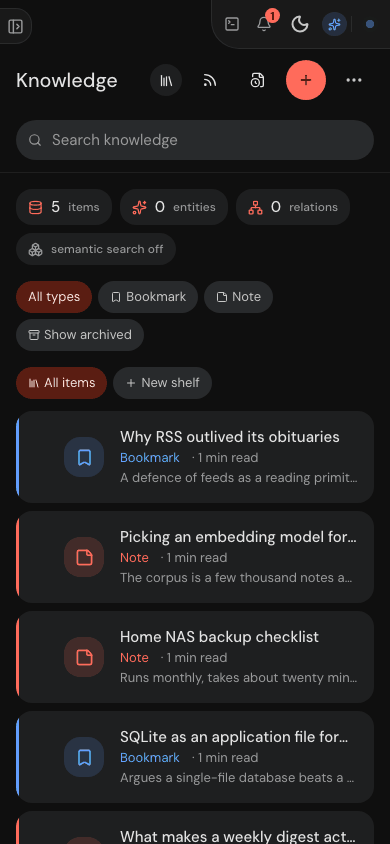 |

#### Figures

| | 1280 × 900 | 390 × 844 |
|---|---|---|
| Work surface share | 79.4% | 87.2% |
| Rail | 196 px (15.3%) | closed drawer |
| Top band (toolbar and page header) | 56 px | 108 px |
| Composer | none | none |
| Right pane | none | none |
| Settled, light / dark | 322 ms / 294 ms | 326 ms / 282 ms |
| Actionable, light / dark | 324 ms / 298 ms | 328 ms / 284 ms |
| Controls visible | 22 in the work area; rail 19, top 18 | 12 in the work area; top 11 |
| Words visible | 283 in the work area; rail 24, top 5 | 210 in the work area; top 2 |
| Text treatments / font sizes | 15 / 4 | 9 / 4 |
| Button treatments | 16 | 13 |
| Counters reading 0 | 2 | 2 |
| Ink, light / dark | 44.3% / 39.0% | 55.2% / 47.6% |
| Coral, light / dark | 0.3% / 0.4% | 0.7% / 0.8% |
| Scrolls sideways | no | no |

#### Density

- **Visual:** The work surface is 79.4% at 1280 (87.2% at 390, where the header grows to 108 px) and ink is 44.3%, the heaviest of these nine screens. The first item starts 225 px into the work area, under the search, a stat strip and two chip rows, and each 92 px row then says its type three times, in a 3 px coloured stripe, a tinted icon tile and a coloured label.
- **Information:** The work area carries 283 words and 22 controls, the most words of these nine, and the rows earn theirs, since title, type, an excerpt line, two tags and a date let the owner choose what to read without opening anything. The stat strip earns nothing, with "0 entities" and "0 relations" (`zeroCounters` 2) beside "5 items" over a list of five, and the top band's 18 controls carry 5 words because ten of them are icons.
- **Design:** 15 text treatments in 4 sizes and 16 button treatments. Coral is 0.3% of the screen, and beyond "Add knowledge" and three selections at once (the Library view, "All types", "All items") it marks the Note type three times over and the stat icons, while info blue decorates Bookmark, which `web/DESIGN.md` §2 rules out.
- **Temporal:** Actionable in 324 ms, then the rows rise in with `ListRow`'s stagger. Reading an item is one click to its peek pane.

#### Critique

**Score 21/40** (status 2, real-world match 2, control 3, consistency 2, error prevention 3, recognition 1, efficiency 2, minimalism 1, recovery 3, help 2). **Anti-patterns:** coloured side-stripes (`ListRow`'s accent, shared with every list built on it), coral on decorative things (the Note label and tiles, the stat icons), a semantic colour as decoration (blue on Bookmark), and uppercase tracked eyebrows in the rail (shared with every screen).

- **Working:** The list is a real reading list. The excerpt line and the tags, which filter on a click, let the owner pick from the list alone, and "semantic search off" says plainly that search is keyword-only, with the reason and the fix in its hint.
- **[P1] Eleven controls in the page header, ten of them bare icons.** Home, Library, Graph, Intents, Tags, Conflicts and Decisions, then Regenerate intelligence, Sources, Reports and Add knowledge, with no visible names. `web/REDESIGN.md` §3 rule 4 allows three, and the Library spec gives Add, View and an overflow. Keep "Add knowledge" as the one primary, put the views behind one View control (the graph is a view toggle in the IA), and move Sources, Reports and Regenerate intelligence to the overflow and the palette.
- **[P1] Counters at 0 head the list.** "0 entities" and "0 relations" sit in the first row of the work area beside "5 items" counting a visible list, against `web/REDESIGN.md` §3 rule 3, so the owner reads a stat strip before reaching anything to curate. Drop the strip and keep "semantic search off" as a status the owner can act on, in the search field's hint or the status line.
- **[P2] Type is coded three times, in coral and blue.** Stripe, tile and label all say Note or Bookmark, which breaks the Tone-Not-Line Rule and the One Voice Rule, and with every row already coloured a failed or unreachable item cannot stand out. One neutral type icon and the word are enough.
- **[P2] Knowledge stands alone where the IA has a Library.** Knowledge, Files and Artifacts are three rail entries, where the IA makes them tabs of one Library, each a fixed-width list beside a flexible detail; this list spans 1052 px and its detail opens as a peek pane. Shared with Files and Artifacts. Make Knowledge the Library's first tab, with the detail beside the list.

**Detector:** no findings in this screen's own source files.

#### Checklist

1. **The one thing:** find and curate what the agent knows. **Largest element:** yes, the item list, though it starts 225 px into the work area.
2. **Fails "needed right now":** "0 entities", "0 relations", "5 items", the shelf row holding only "All items" and "New shelf", and Regenerate intelligence and Reports as always-visible header icons.
3. **Can move:** Sources, Reports and Regenerate intelligence to an overflow menu and the palette; the seven view icons into one View control; "semantic search off" to the search field's hint or the status line.
4. **Scope homes:** the stat strip, page-level status, sits inside the work surface; "Knowledge" sits in global chrome as its own rail entry instead of a Library tab; tags and context-menu actions are on their rows, in place.

### Tasks

`#/tasks` · id `tasks`.

#### Snapshots

| 1280, light | 1280, dark |
|---|---|
| 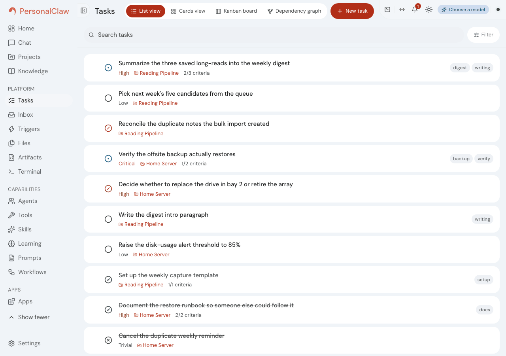 | 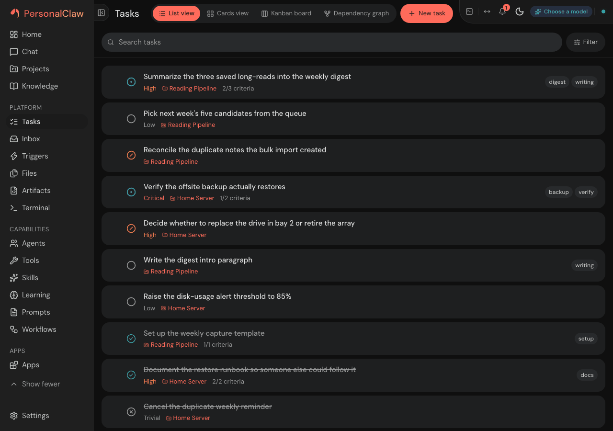 |

| 390, light | 390, dark |
|---|---|
| 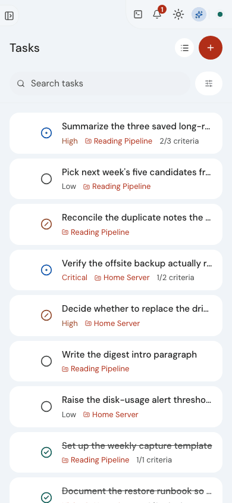 | 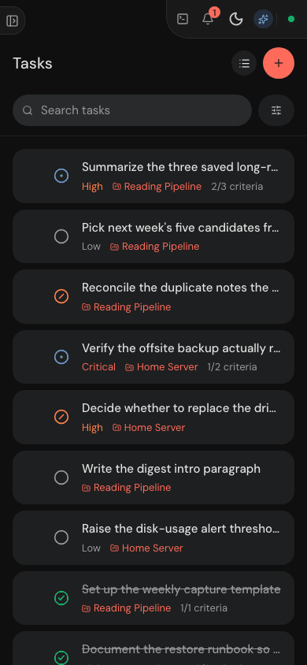 |

#### Figures

| | 1280 × 900 | 390 × 844 |
|---|---|---|
| Work surface share | 79.4% | 87.2% |
| Rail | 196 px (15.3%) | closed drawer |
| Top band (toolbar and page header) | 56 px | 108 px |
| Composer | none | none |
| Right pane | none | none |
| Settled, light / dark | 437 ms / 373 ms | 376 ms / 381 ms |
| Actionable, light / dark | 440 ms / 375 ms | 377 ms / 383 ms |
| Controls visible | 39 in the work area; rail 19, top 12 | 29 in the work area; top 8 |
| Words visible | 128 in the work area; rail 24, top 15 | 112 in the work area; top 2 |
| Text treatments / font sizes | 15 / 4 | 8 / 4 |
| Button treatments | 16 | 14 |
| Counters reading 0 | 0 | 0 |
| Ink, light / dark | 37.5% / 19.4% | 38.8% / 35.0% |
| Coral, light / dark | 0.8% / 0.9% | 1.0% / 1.2% |
| Scrolls sideways | no | no |

#### Density

- **Visual:** The work surface is 79.4% at 1280 (87.2% at 390) and ink is 37.5%, with ten card rows at a 76 px pitch filling the viewport. Each row opens on a 50 px blank lead, the slot of a selection checkbox that appears only on hover.
- **Information:** 128 words and 39 controls in the work area, the most controls of these nine screens. Each row gives status, priority, project, criteria progress ("2/3 criteria") and tags, so the owner sees what is in progress and what is blocked without a click, while closed tasks keep full height and weight under a strike-through (three of the ten rows in view).
- **Design:** 15 text treatments in 4 sizes and 16 button treatments. Coral is 0.8%, on the project link of all ten rows, on "High" and "Critical", on the blocked glyph and on two header fills ("List view" and "New task"), and only the last two are coral's job under `web/REDESIGN.md` §3 rule 7.
- **Temporal:** Actionable in 440 ms, then the rows rise in on a stagger. Opening a task is one click, and completing one needs a right-click, since Complete lives only in the row's context menu.

#### Critique

**Score 26/40** (status 3, real-world match 3, control 3, consistency 2, error prevention 3, recognition 3, efficiency 2, minimalism 2, recovery 3, help 2). **Anti-patterns:** coral on inactive things (the project links, the priority words), and uppercase tracked eyebrows in the rail (shared with every screen).

- **Working:** The two-line row is dense and readable. Criteria progress ("1/2 criteria") beside priority and project tells the owner how far a task has come without opening it, and each project name filters the list on a click.
- **[P1] Tasks has three paths and no home.** The rail's Tasks entry, Home's Tasks band and each project's task lists all reach the same tasks, against `web/REDESIGN.md` §3 rule 2, while the IA puts tasks inside each project as a board or list view, with "All tasks" in the palette. The owner meets the same list in three places and learns none of them as the place. Make tasks a view of their project and "All tasks" a palette entry.
- **[P1] Coral on every row.** Every project link is coral, "High" and "Critical" are red and the blocked glyph is coral, though none is an action, a focus, a selection or live work (`web/REDESIGN.md` §3 rule 7; semantic colours never decorate, `web/DESIGN.md` §2). With ten coral links in view, "New task", the one coral thing that matters, does not stand out. Set project and priority in neutral ink and keep the click.
- **[P2] Completing a task is easier from Home than from here.** Home's Tasks band shows a complete control on each row, while this list hides Complete in the right-click menu and shows the selection checkbox only on hover, and `web/REDESIGN.md` §4 says nothing is hover-only. Put the same complete control on the row, with a key, and keep the checkbox visible once the row has focus.
- **[P2] Five always-visible controls in the page header.** "List view", "Cards view", "Kanban board", "Dependency graph" and "New task" exceed `web/REDESIGN.md` §3 rule 4. Fold the four views into one View control beside "New task".

**Detector:** no findings in this screen's own source files.

#### Checklist

1. **The one thing:** see where each task stands and pick the next one. **Largest element:** yes, the task list.
2. **Fails "needed right now":** the three closed tasks at full row height, and three of the four view tabs.
3. **Can move:** "Cards view", "Kanban board" and "Dependency graph" into one View menu; the closed tasks into one folded line at the end of the list.
4. **Scope homes:** the page itself, which belongs inside each project; Complete, which sits only in the context menu instead of on its row; the project and tag filters are on their rows, in place.

### Inbox

`#/inbox` · id `inbox`.

#### Snapshots

| 1280, light | 1280, dark |
|---|---|
| 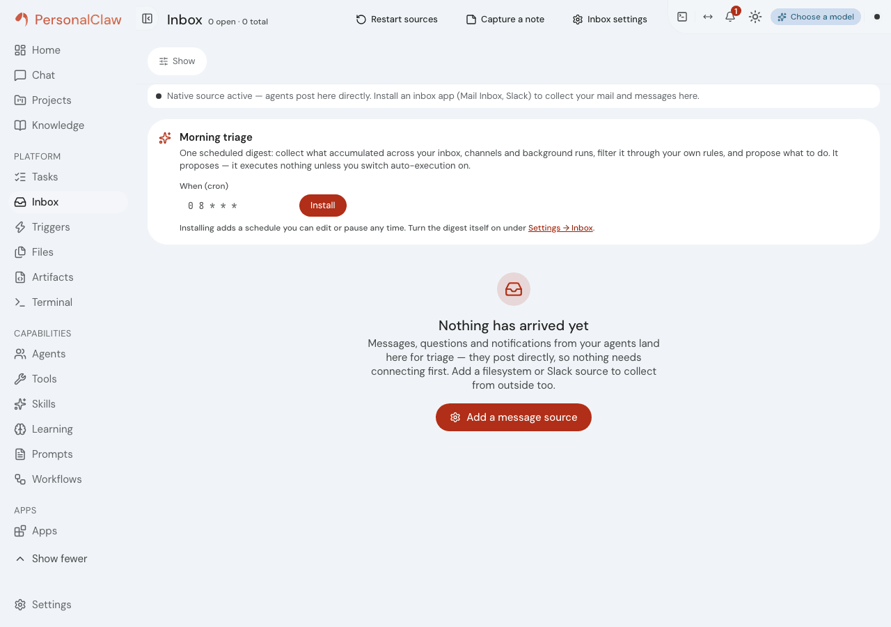 | 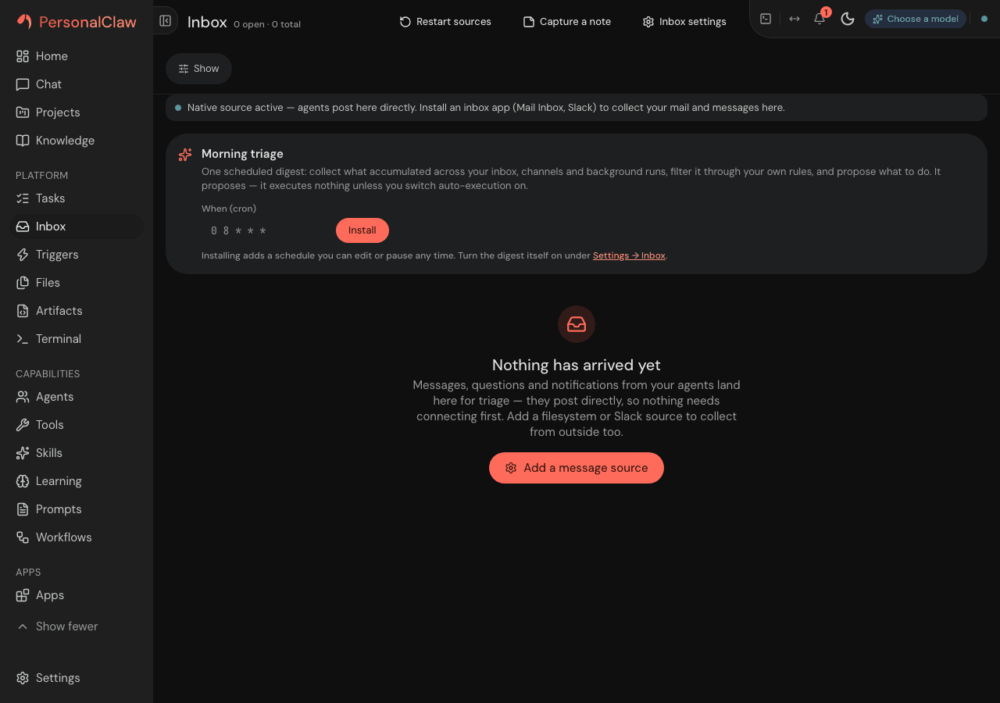 |

| 390, light | 390, dark |
|---|---|
| 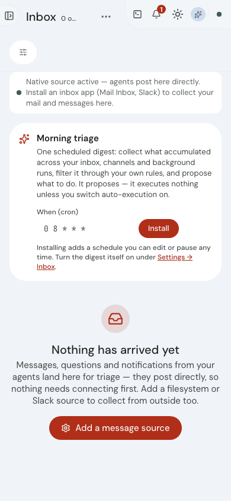 | 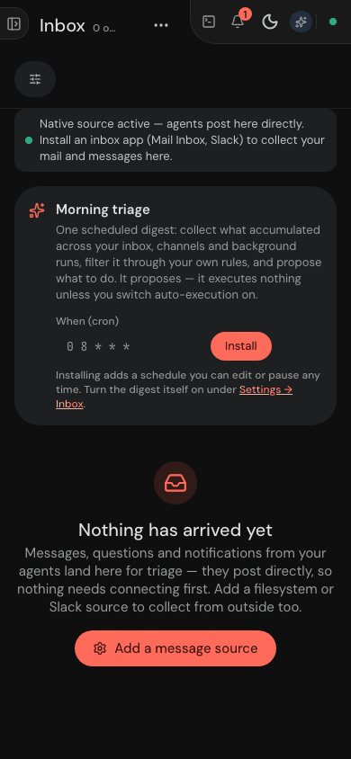 |

#### Figures

| | 1280 × 900 | 390 × 844 |
|---|---|---|
| Work surface share | 79.4% | 93.4% |
| Rail | 196 px (15.3%) | closed drawer |
| Top band (toolbar and page header) | 56 px | 56 px |
| Composer | none | none |
| Right pane | none | none |
| Settled, light / dark | 322 ms / 283 ms | 276 ms / 275 ms |
| Actionable, light / dark | 324 ms / 287 ms | 278 ms / 331 ms |
| Controls visible | 5 in the work area; rail 19, top 10 | 5 in the work area; top 7 |
| Words visible | 123 in the work area; rail 24, top 17 | 122 in the work area; top 7 |
| Text treatments / font sizes | 14 / 4 | 10 / 4 |
| Button treatments | 12 | 9 |
| Counters reading 0 | 0 | 0 |
| Ink, light / dark | 22.3% / 36.8% | 41.7% / 42.9% |
| Coral, light / dark | 0.9% / 1.0% | 3.2% / 3.2% |
| Scrolls sideways | no | no |

#### Density

- **Visual:** The work surface is 79.4% at 1280 (93.4% at 390) and ink is 22.3%, spent on a source banner, the "Morning triage" install card and an empty state, none of them a message. At 390 coral reaches 3.2%, the highest of these nine screens, as two solid buttons and a coral icon tile fill the narrow column.
- **Information:** 123 words in the work area and 17 in the header, with 5 work controls, tell the owner one fact, that the inbox is empty ("0 open · 0 total"). The bell in the shell corner reads 1 at the same moment, so the one thing waiting is not on the page whose job is what waits.
- **Design:** 14 text treatments in 4 sizes and 12 button treatments. Two solid coral buttons share one column ("Install" and "Add a message source"), joined by the coral "Settings → Inbox" link and the coral empty-state tile, and the schedule is a monospace "0 8 * * *" with no plain reading.
- **Temporal:** Actionable in 324 ms (287 ms in dark). With nothing here the primary job takes no step, and reaching the one unread notification takes the bell, a different surface.

#### Critique

**Score 23/40** (status 1, real-world match 2, control 3, consistency 2, error prevention 3, recognition 3, efficiency 2, minimalism 1, recovery 3, help 3). **Anti-patterns:** coral on decorative things (the empty-state icon tile, shared with the Files and Artifacts empty states, and the settings link), and uppercase tracked eyebrows in the rail (shared with every screen).

- **Working:** The empty state tells the truth about connection. "Nothing has arrived yet" says agents post here directly, so the owner knows nothing needs connecting before the first item can arrive.
- **[P1] The Inbox reads 0 while the bell reads 1.** The title counts "0 open · 0 total", against `web/REDESIGN.md` §3 rule 3, and the unread notification lives in the bell's own shade and page, while the IA makes notifications a filter of the Inbox that the bell opens (#3818). The owner has two inboxes to check, and the one named Inbox gives false comfort. Fold notifications into the Inbox as a filter and drop the count at 0.
- **[P2] Setup crowds the triage page.** The "Native source active" banner, the "Morning triage" install card, "Add a message source" as the empty state's action, and "Restart sources" and "Inbox settings" in the header are five ways into configuration on a page for triage, where the IA calls configuration a rare visit. Let Settings › Inbox own the sources and the digest, and keep "Capture a note" and an overflow in the header.
- **[P2] Two primaries in one column.** "Install" and "Add a message source" are both solid coral, so the page offers two first actions and the eye has no single place to go (`web/REDESIGN.md` §3 rule 7). Keep one primary at most on an empty Inbox and make the other secondary.
- **[P3] The digest's schedule is raw cron.** "When (cron)" asks the owner to read "0 8 * * *", while `#/triggers` shows the same kind of schedule as "At 8:00 AM PDT". Show the plain reading beside the field, in the words Triggers already uses.

**Detector:** 1 in this screen's own source: `web/src/pages/inbox/ForeignContent.tsx` (side-tab; lines 43).

#### Checklist

1. **The one thing:** triage what the agents sent. **Largest element:** no, the "Morning triage" install card (1052 by 180 px) is, with nothing to triage and the one unread item in the bell.
2. **Fails "needed right now":** "Restart sources", the "Native source active" banner, the "Morning triage" card, and "0 open · 0 total".
3. **Can move:** "Restart sources" and "Inbox settings" to an overflow menu and Settings › Inbox; the source state to the status line.
4. **Scope homes:** the source state, a connection fact, sits on the page instead of the status line; the unread notification sits in global chrome instead of the Inbox's own filter; the digest's schedule is set here instead of with the other automations.

### Triggers

`#/triggers` · id `triggers`.

#### Snapshots

| 1280, light | 1280, dark |
|---|---|
| 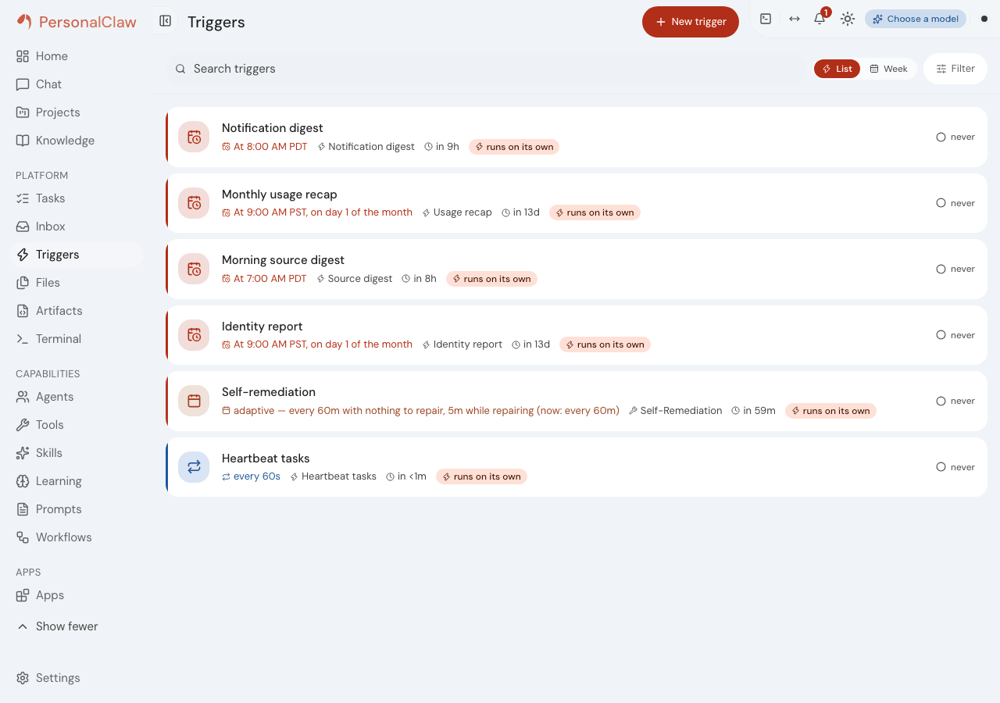 | 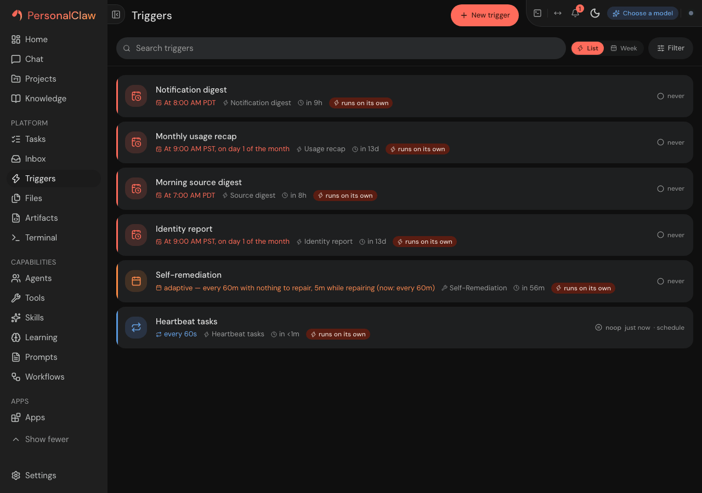 |

| 390, light | 390, dark |
|---|---|
| 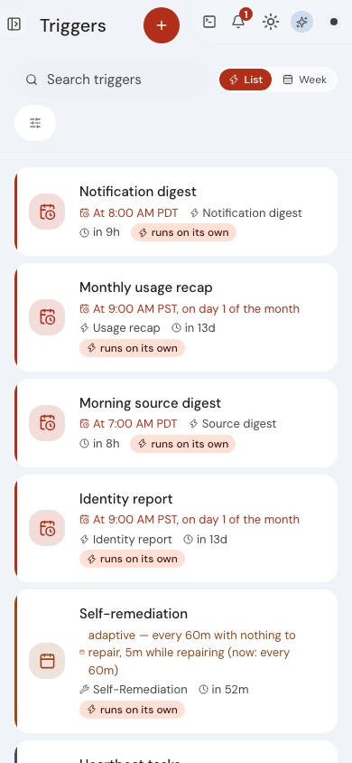 | 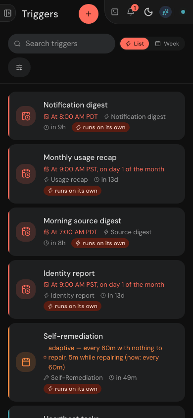 |

#### Figures

| | 1280 × 900 | 390 × 844 |
|---|---|---|
| Work surface share | 79.4% | 93.4% |
| Rail | 196 px (15.3%) | closed drawer |
| Top band (toolbar and page header) | 56 px | 56 px |
| Composer | none | none |
| Right pane | none | none |
| Settled, light / dark | 320 ms / 423 ms | 373 ms / 369 ms |
| Actionable, light / dark | 323 ms / 425 ms | 375 ms / 371 ms |
| Controls visible | 10 in the work area; rail 19, top 8 | 10 in the work area; top 7 |
| Words visible | 113 in the work area; rail 24, top 7 | 96 in the work area; top 2 |
| Text treatments / font sizes | 16 / 4 | 8 / 4 |
| Button treatments | 13 | 13 |
| Counters reading 0 | 0 | 0 |
| Ink, light / dark | 43.5% / 42.6% | 39.3% / 36.5% |
| Coral, light / dark | 0.8% / 0.8% | 1.6% / 1.8% |
| Scrolls sideways | no | no |

#### Density

- **Visual:** The work surface is 79.4% at 1280 (93.4% at 390) and ink is 43.5%, second only to Knowledge among these nine. Six rows at an 85 px pitch fill 500 px, and each says its schedule kind three times, in a 3 px coloured stripe, a tinted 40 px icon tile and coloured schedule text.
- **Information:** 113 words and 10 controls in the work area. Each row gives the schedule in words, the next run ("in 10h"), the autonomy and the last run, so the owner checks what fires overnight without a click, but the action label repeats the name ("Identity report" runs "Identity report"), "runs on its own" is identical on all six rows, and no row says which thread it reports to.
- **Design:** 16 text treatments, the most of these nine screens, in 4 sizes, and 13 button treatments. Coral is 0.8% (1.6% at 390), small in area but spread over stripes, tiles, schedule text and six "runs on its own" chips, none of them an action.
- **Temporal:** Actionable in 323 ms in light and 425 ms in dark, then the rows rise in with `ListRow`'s stagger. Running or pausing a trigger means opening it first, since the row's context menu offers only Open and Edit.

#### Critique

**Score 26/40** (status 3, real-world match 3, control 3, consistency 2, error prevention 3, recognition 3, efficiency 2, minimalism 2, recovery 3, help 2). **Anti-patterns:** coloured side-stripes (`ListRow`'s accent, shared with every list built on it), coral on decorative things (schedule text, icon tiles, the autonomy chips), and uppercase tracked eyebrows in the rail (shared with every screen).

- **Working:** Every row says when it fires next in plain time ("in 59m", "in <1m") beside the schedule in words ("At 9:00 AM PST, on day 1 of the month"), so the owner can check the night's runs at a glance.
- **[P1] Colour codes the schedule kind, so nothing can stand out.** Clock schedules are coral, the adaptive one orange and the interval blue, each in stripe, tile and text, which leaves a running or failed trigger no colour to claim. That defeats `web/REDESIGN.md` §3 rule 7 and the Tone-Not-Line Rule in `web/DESIGN.md` §2. Make the rows neutral and keep colour for a running pip and a failure.
- **[P1] The row drops the fact that builds trust.** The Automations spec asks for each item's next run, its last result and the thread it reports to, and the rows show the first two, then spend their width on a repeated action name and an identical autonomy chip. The owner cannot tell where a digest's output lands without opening it. Add where each one reports, show the action only when it differs from the name, and show autonomy on the row only when it is the exception.
- **[P2] Automations are split across the rail.** Triggers is a Platform entry, Workflows a Capabilities entry, and the Inbox installs a digest schedule of its own, while the IA has one Automations destination (#3816) and `web/REDESIGN.md` §3 rule 10 nests a place under the destination it belongs to. Merge them into one Automations list.
- **[P2] No action on the row.** Run now, pause and disable all need the detail, while `web/REDESIGN.md` §4 puts item things on their row and in its context menu. Add Run now and a pause switch to the row and to its menu.

**Detector:** no findings in this screen's own source files.

#### Checklist

1. **The one thing:** trust what runs without the owner, by seeing what fires next and what happened last. **Largest element:** yes, the trigger list.
2. **Fails "needed right now":** the repeated action labels, the six identical "runs on its own" chips, and the coloured stripes and tiles.
3. **Can move:** the autonomy chip to the trigger's detail pane, shown on a row only when it is the exception.
4. **Scope homes:** Run now and pause are missing from their rows; "Triggers" sits in global chrome as its own rail entry apart from Workflows; "New trigger" in the header is in place.

### Files

`#/files` · id `files`.

#### Snapshots

| 1280, light | 1280, dark |
|---|---|
| 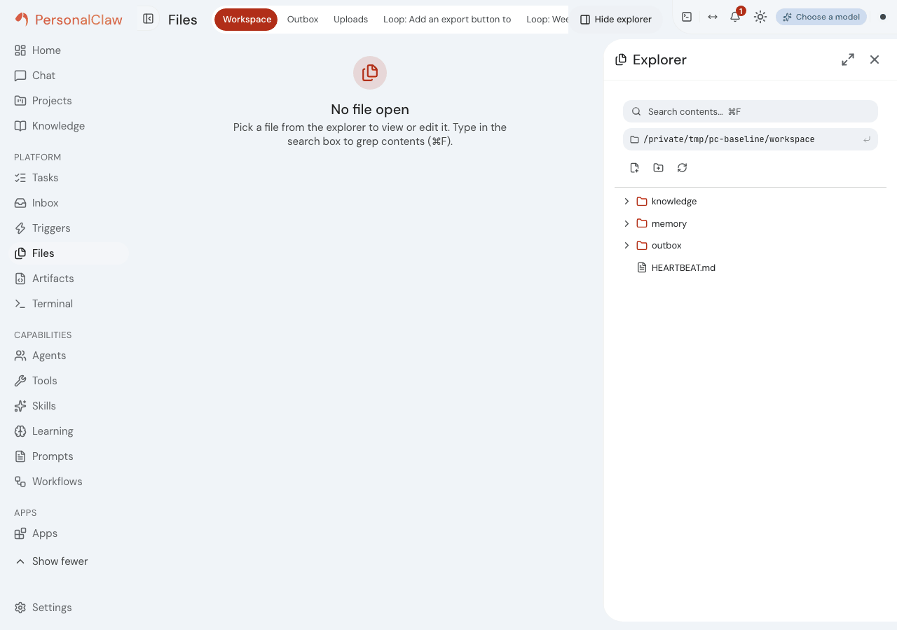 | 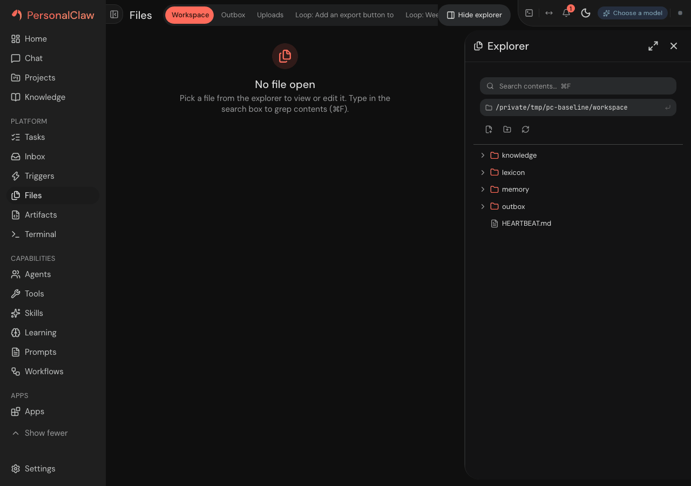 |

| 390, light | 390, dark |
|---|---|
| 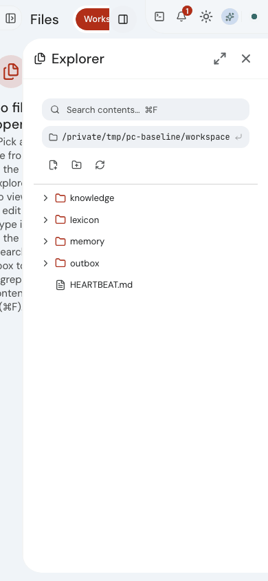 | 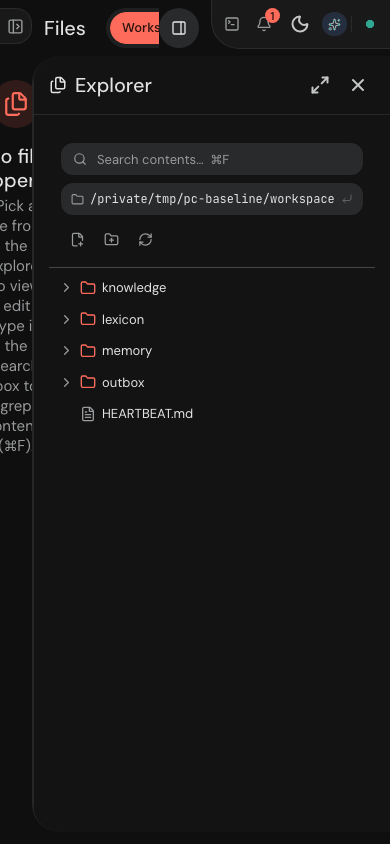 |

#### Figures

| | 1280 × 900 | 390 × 844 |
|---|---|---|
| Work surface share | 48.6% | 7.7% |
| Rail | 196 px (15.3%) | closed drawer |
| Top band (toolbar and page header) | 56 px | 56 px |
| Composer | none | none |
| Right pane | 420 px | 358 px |
| Settled, light / dark | 273 ms / 273 ms | 229 ms / 231 ms |
| Actionable, light / dark | 274 ms / 274 ms | 231 ms / 233 ms |
| Controls visible | 0 in the work area; rail 19, top 16, pane 11 | 0 in the work area; top 11, pane 12 |
| Words visible | 23 in the work area; rail 24, top 28, pane 5 | 23 in the work area; top 11, pane 6 |
| Text treatments / font sizes | 10 / 4 | 6 / 4 |
| Button treatments | 14 | 11 |
| Counters reading 0 | 0 | 0 |
| Ink, light / dark | 31.6% / 20.4% | 19.9% / 9.9% |
| Coral, light / dark | 0.3% / 0.3% | 0.6% / 0.6% |
| Scrolls sideways | no | no |

#### Density

- **Visual:** The work surface is 48.6% at 1280 because the Explorer pane is docked open by default (420 px, 30.8% of the window), and the 664 px left over holds only "No file open". At 390 it falls to 7.7%, the lowest of these nine screens, as the Explorer covers all but a 32 px strip at the left edge, where the empty state shows clipped.
- **Information:** The work area has 23 words and no controls, while the pane has 11 controls and the top band 16 with 28 words, most of them root tabs; at 390 those 23 words are fragments of the clipped empty state. Everything the owner can act on is in the pane and the header, and the root strip cuts loop names short ("Loop: Add an export button to", "Loop: Wee…") under "Hide explorer".
- **Design:** 10 text treatments in 4 sizes and 14 button treatments. Coral is 0.3%, on the selected "Workspace" root, which is selection, and on every folder icon and the empty-state tile, which are decoration, and the tree's three actions are bare icons.
- **Temporal:** Actionable in 274 ms, among the fastest of these nine. Opening a file means expanding folders in the pane and clicking one, and at 390 the viewer stays behind the pane until the owner closes it.

#### Critique

**Score 23/40** (status 2, real-world match 3, control 2, consistency 2, error prevention 3, recognition 2, efficiency 2, minimalism 2, recovery 3, help 2). **Anti-patterns:** coral on decorative things (the folder icons, and the empty-state tile shared with the Inbox and Artifacts empty states), and uppercase tracked eyebrows in the rail (shared with every screen).

- **Working:** Content search sits at the top of the tree with its key shown, "Search contents… ⌘F", and the empty state repeats the key, which is `web/REDESIGN.md` §5 convention 8 on a screen that needs it.
- **[P1] The list sits in the pane and an empty detail takes the page.** At 1280 the tree is squeezed into the 420 px pane while "No file open" fills 664 px, and the pane is open by default, though the right pane is the selection's detail and closed by default (`web/REDESIGN.md` §4). The owner browses in the narrow column and faces an empty wide one. Make the tree the Files tab's list in Library, on the left at a fixed width, with the viewer as the flexible detail.
- **[P1] At 390 the Explorer covers the page and clips it.** The pane leaves the work surface a 32 px strip (7.7% of the window) holding a clipped sliver of the empty state, and it cuts the root strip to "Works", and "Hide explorer" and the pane's × both close the same panel. The IA shows a list and its detail one at a time below 840 px, with Back between them, and `web/REDESIGN.md` §4 asks a compact window to stack without clipping. Show the tree full width, then the file in its place.
- **[P2] Every loop adds a tab to the page header.** Workspace, Outbox, Uploads and one "Loop: …" tab per loop share a strip that already overflows at 1280. The IA makes a thread's workspace files a toggle inside the thread (⌘⇧E) and keeps stored files here. Move the loop roots to their threads and put the remaining roots at the top of the tree.
- **[P3] The pane's controls are icons without names.** New file, new folder and refresh show as three bare icons, and the path bar repeats the root's full absolute path above a tree already rooted there. Name the actions, which each folder's menu already offers, and show the path relative to its root.

**Detector:** no findings in this screen's own source files.

#### Checklist

1. **The one thing:** find a stored file and open it. **Largest element:** no; at 1280 the empty "No file open" area (664 by 844 px) is, with the tree in the 420 px pane, and at 390 the Explorer (358 by 776 px) covers everything else.
2. **Fails "needed right now":** the full-size "No file open" state, the "Loop: …" root tabs, and the absolute path bar.
3. **Can move:** the loop roots to their threads and the palette; "Hide explorer" to a key shown in its tooltip; refresh into the tree's context menu.
4. **Scope homes:** the root strip, which scopes the tree, sits in the page header; loop workspaces sit here instead of in their threads; "Files" is its own rail entry instead of a Library tab (shared with Knowledge and Artifacts).

### Artifacts

`#/artifacts` · id `artifacts`.

#### Snapshots

| 1280, light | 1280, dark |
|---|---|
| 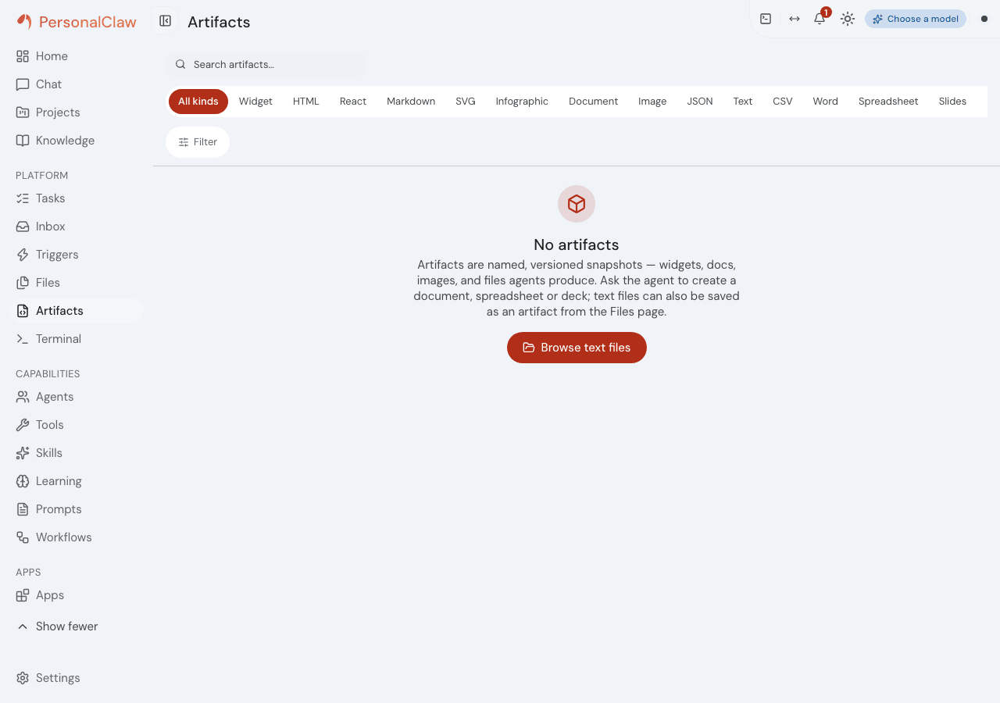 | 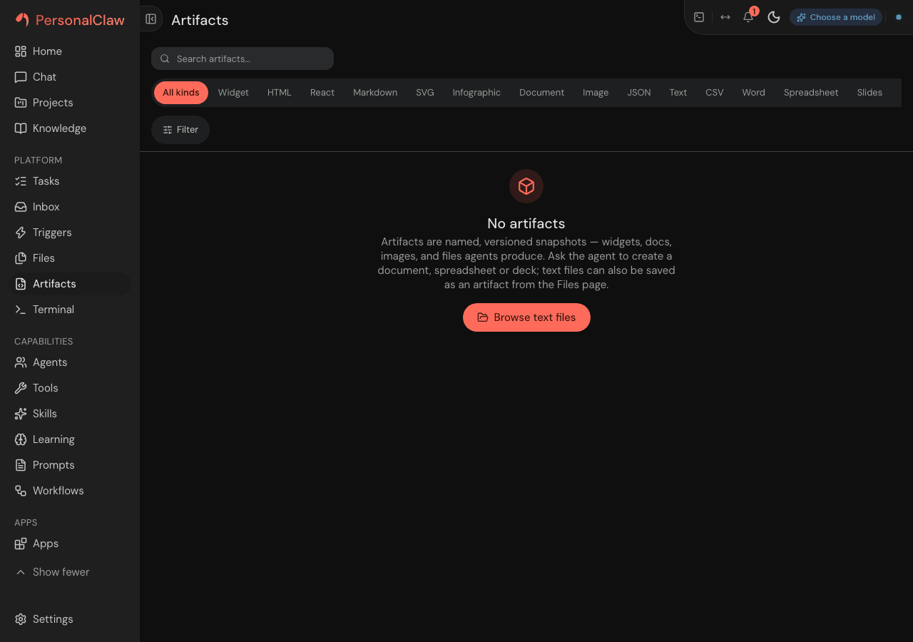 |

| 390, light | 390, dark |
|---|---|
| 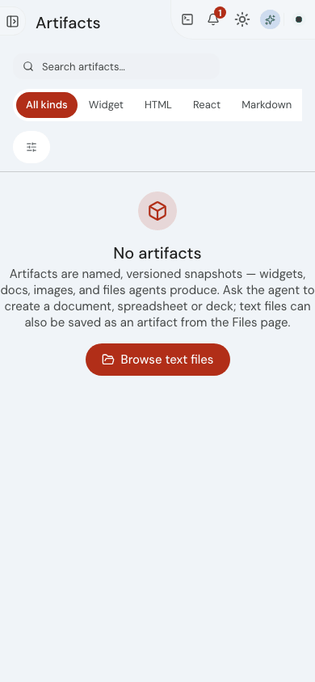 | 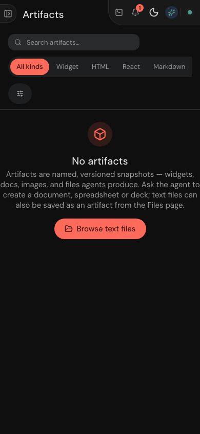 |

#### Figures

| | 1280 × 900 | 390 × 844 |
|---|---|---|
| Work surface share | 79.4% | 93.4% |
| Rail | 196 px (15.3%) | closed drawer |
| Top band (toolbar and page header) | 56 px | 56 px |
| Composer | none | none |
| Right pane | none | none |
| Settled, light / dark | 265 ms / 321 ms | 314 ms / 320 ms |
| Actionable, light / dark | 266 ms / 322 ms | 315 ms / 322 ms |
| Controls visible | 19 in the work area; rail 19, top 7 | 9 in the work area; top 6 |
| Words visible | 59 in the work area; rail 24, top 5 | 48 in the work area; top 2 |
| Text treatments / font sizes | 12 / 4 | 6 / 4 |
| Button treatments | 12 | 9 |
| Counters reading 0 | 0 | 0 |
| Ink, light / dark | 6.6% / 21.4% | 10.4% / 12.8% |
| Coral, light / dark | 0.8% / 0.8% | 2.6% / 2.7% |
| Scrolls sideways | no | no |

#### Density

- **Visual:** The work surface is 79.4% at 1280 (93.4% at 390) and ink is 6.6%. The header holds only the title, and under it a 156 px toolbar (search, a kind strip, Filter on its own row) takes the chrome to 212 of 900 px above an empty library.
- **Information:** 59 words and 19 controls in the work area, and every control but "Browse text files" is search, a kind tab or Filter, with nothing to search or filter. The owner learns two facts, that no artifacts exist and how one is made.
- **Design:** 12 text treatments in 4 sizes and 12 button treatments. Coral is 0.8% at 1280 and 2.6% at 390, on the selected "All kinds", the empty-state tile and "Browse text files", and the tile is decoration.
- **Temporal:** Actionable in 266 ms. The job has no object yet, and making one takes at least two steps on another page, since the only button leaves for `#/files` and asking the agent has no control here.

#### Critique

**Score 26/40** (status 3, real-world match 3, control 3, consistency 2, error prevention 3, recognition 3, efficiency 1, minimalism 2, recovery 3, help 3). **Anti-patterns:** coral on a decorative thing (the empty-state icon tile, shared with the Inbox and Files empty states), and uppercase tracked eyebrows in the rail (shared with every screen).

- **Working:** The empty state explains in one paragraph what an artifact is and names both ways to make one, so the owner is not left to guess why the page is empty.
- **[P1] A full filter bar over an empty library.** Fifteen kind tabs ("All kinds" through "Slides", with more scrolled out of view), Filter and search all render with zero artifacts, against `web/REDESIGN.md` §3 rule 1. The owner reads a row of formats before learning there is nothing. Show the toolbar once artifacts exist, and fold the kinds into the Filter menu at any count.
- **[P2] The empty state's one action leads away from the better path.** "Browse text files" sends the owner to Files, while the copy's first way, asking the agent for a document, spreadsheet or deck, has no control. Make the primary "Ask the agent", opening a new thread, and keep Files as a quiet link.
- **[P2] Artifacts stands alone where the IA has a Library tab.** Like Knowledge and Files it is its own rail entry, where the IA makes all of them tabs of one Library with Add, View and an overflow in the header, and this header has none of them. Make it the Library's Artifacts tab.
- **[P3] At 390 the toolbar stacks into two rows.** The kind strip shows five tabs and scrolls, and Filter drops to a row of its own, so 156 of 844 px are filter chrome. One row with search and Filter is enough.

**Detector:** 4 in this screen's own source: `web/src/pages/artifacts/ArtifactCard.tsx` (design-system-font-size ×3; lines 75, 84, 238); `web/src/pages/artifacts/ArtifactCompare.tsx` (broken-image; lines 128).

#### Checklist

1. **The one thing:** find and open something the agent made. **Largest element:** yes, the empty state, with the 1052 px kind strip above it as the widest element.
2. **Fails "needed right now":** the kind strip, Filter and search, with nothing to filter.
3. **Can move:** the 16 kinds into the Filter menu.
4. **Scope homes:** "Artifacts" sits in global chrome as its own rail entry instead of a Library tab; the rest is in place.

### Terminal

`#/terminal` · id `terminal`.

#### Snapshots

| 1280, light | 1280, dark |
|---|---|
| 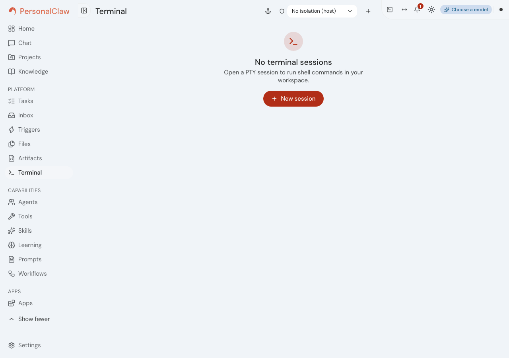 | 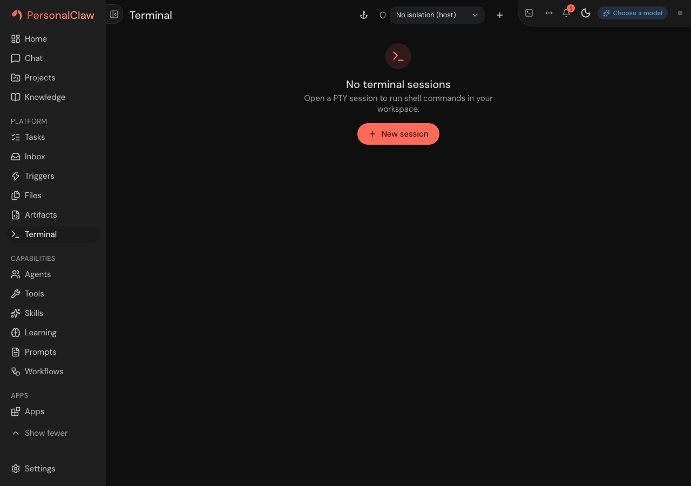 |

| 390, light | 390, dark |
|---|---|
| 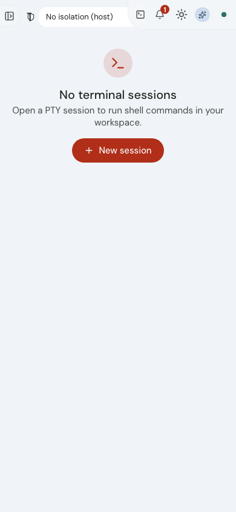 | 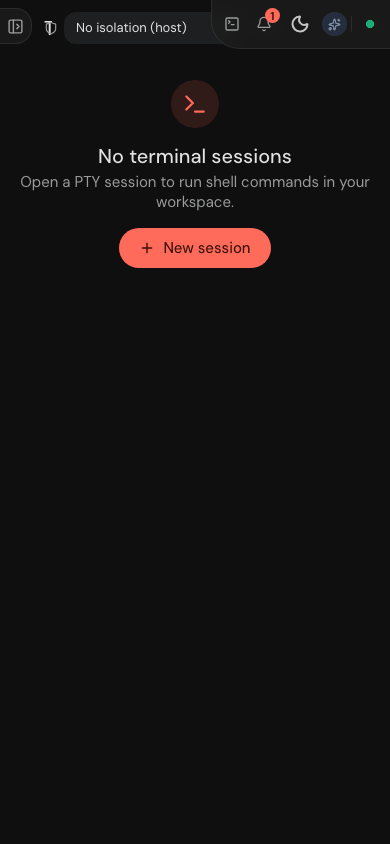 |

#### Figures

| | 1280 × 900 | 390 × 844 |
|---|---|---|
| Work surface share | 79.4% | 93.4% |
| Rail | 196 px (15.3%) | closed drawer |
| Top band (toolbar and page header) | 56 px | 56 px |
| Composer | none | none |
| Right pane | none | none |
| Settled, light / dark | 268 ms / 330 ms | 269 ms / 219 ms |
| Actionable, light / dark | 269 ms / 332 ms | 272 ms / 221 ms |
| Controls visible | 1 in the work area; rail 19, top 10 | 1 in the work area; top 8 |
| Words visible | 16 in the work area; rail 24, top 10 | 16 in the work area; top 7 |
| Text treatments / font sizes | 10 / 4 | 5 / 4 |
| Button treatments | 10 | 7 |
| Counters reading 0 | 0 | 0 |
| Ink, light / dark | 2.6% / 16.7% | 5.0% / 5.2% |
| Coral, light / dark | 0.5% / 0.5% | 1.7% / 1.7% |
| Scrolls sideways | no | no |

#### Density

- **Visual:** Ink is 2.6% in light (16.7% in dark, where the rail takes its own tone) over a work area of 79.4% of the window, with the open rail at 15.3%. The empty state fills the top 210 px and the lower three quarters of the work area are blank, while the 56 px top band carries 10 controls, six of them the shared toolbar corner.
- **Information:** The work area holds 1 control and 16 words, all of them the empty state's. The fact that decides the next session, its sandbox ("No isolation (host)"), sits in the header, and whether sessions survive a gateway restart is an anchor icon with no word.
- **Design:** 10 text treatments, 4 font sizes and 10 button treatments with a single control in the work area, so the shell chrome alone accounts for most of the button looks here and on every screen. Coral is 0.5% at 1280 and 1.7% at 390, the New session button plus a coral-tinted disc behind the empty-state glyph.
- **Temporal:** Actionable in 269 ms at 1280 and 272 ms at 390, with nothing left loading. A command takes two steps here (New session, then type), where the bottom drawer (⌘J) opens with a session already started.

#### Critique

**Score 26/40** (status 3, real-world match 3, control 3, consistency 2, error prevention 3, recognition 2, efficiency 2, minimalism 3, recovery 3, help 2). **Anti-patterns:** coral on a decorative fill (the empty-state icon disc, shared `EmptyState`); uppercase tracked rail section labels (shared with every screen).

- **Working:** The header states the sandbox the next session gets before anything opens, and `SandboxPicker` greys out a tier whose probe failed and gives the reason, so the owner cannot open a shell in a sandbox that is not running.
- **[P1] The terminal is a page and a drawer at once.** `#/terminal` has its own rail entry under PLATFORM, and the toolbar's Open terminal button on this same page opens the bottom drawer, a second terminal surface over the first. The owner keeps two homes for one tool in mind and has to remember which one holds a running shell. The IA makes the drawer the terminal on every page and this page its Open full view, so the rail entry goes and the page stays one click away in the drawer and in the palette (`web/REDESIGN.md` §3 rule 2, rule 10).
- **[P2] At 390 the header loses its title and its new-session button.** "Terminal" is gone, the sandbox select runs under the floating toolbar corner with its chevron hidden, and the "+" is not on screen. Once one session exists the empty state's button goes too, and the page shows no way to open a second. Give the corner its reserved width, and fold the sandbox choice into New session so the header holds the title and one action.
- **[P2] Session persistence is an unlabelled anchor.** The toggle shows its state (on, off, or unavailable on this host) only as a pressed tint and a tooltip, so the owner cannot tell from the header whether their shells survive a gateway restart. Put it in an overflow menu with its label and hint, mark each session tab when it will survive, and keep the setting beside durable workers in Settings › Agent, which reads the same claim.

**Detector:** 6 in this screen's own source: `web/src/pages/terminal/TerminalView.tsx` (design-system-color ×5, design-system-font-size; lines 63, 64, 184, 184, 231, 240).

#### Checklist

1. **The one thing:** run shell commands in a session on this machine or in a sandbox. **Largest element:** yes, the work area is the largest region at 79.4%, though in this state it holds a 210 px empty state over blank space.
2. **Fails "needed right now":** the anchor persistence toggle, which the owner sets once; the toolbar's Open terminal button on the terminal page itself; the width and theme controls in the toolbar corner (shared with every screen).
3. **Can move:** the persistence toggle to an overflow menu; the Terminal rail entry to the palette's Go to and the drawer's Open full; the theme and width controls to the palette (shared with every screen).
4. **Scope homes:** the sandbox select configures the next session and sits in the page header instead of on New session; the Terminal entry sits in the sidebar where the IA puts the terminal in the bottom drawer; the "Choose a model" chip sits in global chrome where the IA puts model choice in the composer (shared with every screen).

### Agents

`#/agents` · id `agents`.

#### Snapshots

| 1280, light | 1280, dark |
|---|---|
| 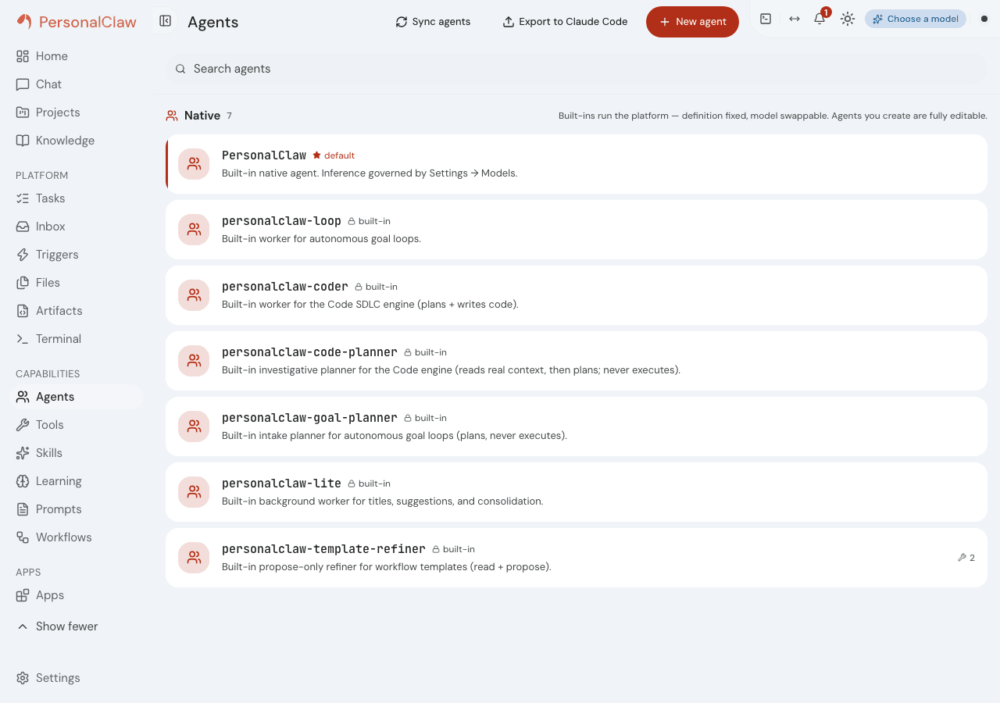 | 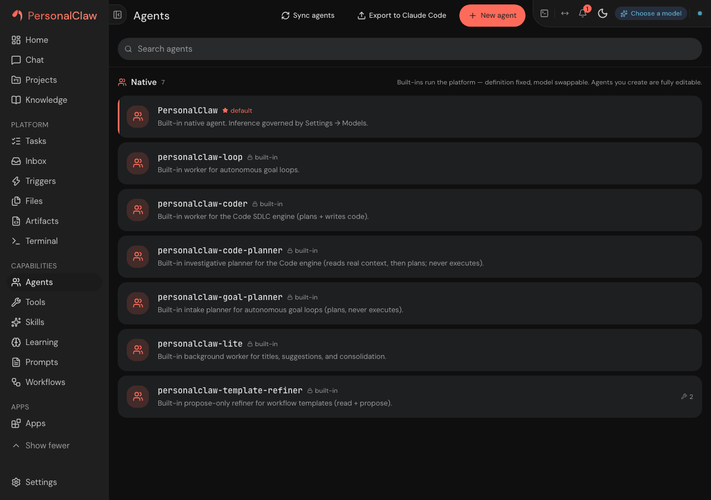 |

| 390, light | 390, dark |
|---|---|
| 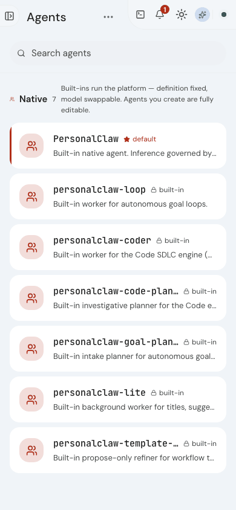 | 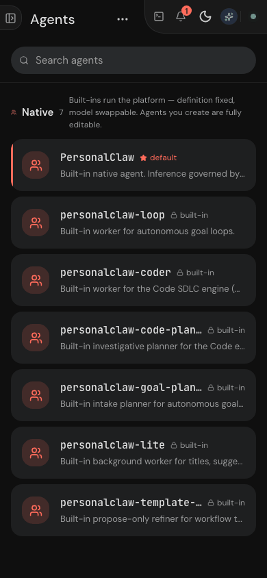 |

#### Figures

| | 1280 × 900 | 390 × 844 |
|---|---|---|
| Work surface share | 79.4% | 93.4% |
| Rail | 196 px (15.3%) | closed drawer |
| Top band (toolbar and page header) | 56 px | 56 px |
| Composer | none | none |
| Right pane | none | none |
| Settled, light / dark | 264 ms / 274 ms | 372 ms / 328 ms |
| Actionable, light / dark | 265 ms / 275 ms | 374 ms / 329 ms |
| Controls visible | 8 in the work area; rail 19, top 10 | 8 in the work area; top 7 |
| Words visible | 99 in the work area; rail 24, top 13 | 98 in the work area; top 2 |
| Text treatments / font sizes | 12 / 4 | 6 / 4 |
| Button treatments | 11 | 7 |
| Counters reading 0 | 0 | 0 |
| Ink, light / dark | 52.7% / 34.7% | 47.8% / 43.0% |
| Coral, light / dark | 0.5% / 0.5% | 0.3% / 0.4% |
| Scrolls sideways | no | no |

#### Density

- **Visual:** Ink is 52.7% in light, most of it the seven white row cards, over a work area of 79.4%. Each row is 1052 px wide and 76 px tall for one name and one line of text, opens on the same 40 px coral icon tile, and the list ends at y 752 with blank space below.
- **Information:** 8 controls and 99 words in the work area, against 10 controls in the top band. The owner learns which agent is the default and that all seven are built in, but no row names the model an agent runs on, the one thing the group caption calls swappable, because built-ins inherit Settings › Models and the row shows nothing when they do.
- **Design:** 12 text treatments, 4 font sizes and 11 button treatments; coral is 0.5%. Names are set in mono at 0.9375rem, a rung above DESIGN.md's mono size (0.8125rem), and the default row stacks a 3 px coral stripe, a coral star and coral "default" text.
- **Temporal:** Actionable in 265 ms at 1280 and 374 ms at 390, with the list complete on arrival. Changing an agent's model takes at least three steps (open the row, edit in the right pane, save).

#### Critique

**Score 27/40** (status 3, real-world match 3, control 3, consistency 2, error prevention 3, recognition 3, efficiency 2, minimalism 2, recovery 3, help 3). **Anti-patterns:** a coloured side-stripe (3 px coral on the default row, `ListRow`'s `accent`); coral on a decorative fill (the icon tile on every row); identical cards for every row; uppercase tracked rail section labels (shared with every screen).

- **Working:** The detail opens in a right pane (`SidePanel`) that is closed by default and remembers its width, so the list stays in place while the owner reads or edits one agent.
- **[P2] Coral marks rows that are not doing anything.** Every row carries a coral icon tile, and the default row adds the coloured side-stripe DESIGN.md forbids by name. Coral is meant for the active, the selected and the primary action, and here it decorates seven static definitions. Drop the tiles and the stripe, since the star and the word "default" already say which agent it is, and keep coral to New agent (`web/REDESIGN.md` §3 rule 7).
- **[P2] Rows hide what the owner comes to change.** The caption says built-ins have a swappable model, and no row shows a model, inherited or missing. The owner has to open each agent to learn what it runs on. Put the model on the row in caption mono, "inherits Settings › Models" when it does and a warning when nothing is bound, in the room the tile frees.
- **[P2] Two of three header slots go to rare actions.** Sync agents and the export action stay visible on every visit, while the usual action here is opening an agent. `web/REDESIGN.md` §3 rule 4 allows three controls, and rule 1 asks what each does for the owner right now. Keep New agent as the IA's single Add, and move Sync and export to an overflow menu and the palette.
- **[P3] At 390 names lose the part that tells them apart.** `personalclaw-code-plan…` and `personalclaw-goal-plan…` truncate at the suffix that distinguishes them, and the group caption wraps to three lines beside "Native 7". The 40 px tile takes the room the names need, and the caption belongs in a help tooltip or the detail.

**Detector:** 2 in this screen's own source: `web/src/pages/agents/AgentDetail.tsx` (design-system-font-size ×2; lines 169, 544).

#### Checklist

1. **The one thing:** see the agents, set the default, and open one to change its model, prompt or tools. **Largest element:** yes, the list of seven rows.
2. **Fails "needed right now":** Sync agents and the export action in the header; the coral icon tile on every row; the group caption beside "Native 7".
3. **Can move:** Sync agents and the export action to an overflow menu and the palette; the group caption to a help tooltip or the detail pane.
4. **Scope homes:** Agents has its own rail entry where the IA makes it a Capabilities tab (shared with Tools, Skills, Prompts and Apps); the "Choose a model" chip sits in global chrome (shared with every screen); the rows, the header and the detail pane are in place.

### Tools

`#/tools` · id `tools`.

#### Snapshots

| 1280, light | 1280, dark |
|---|---|
| 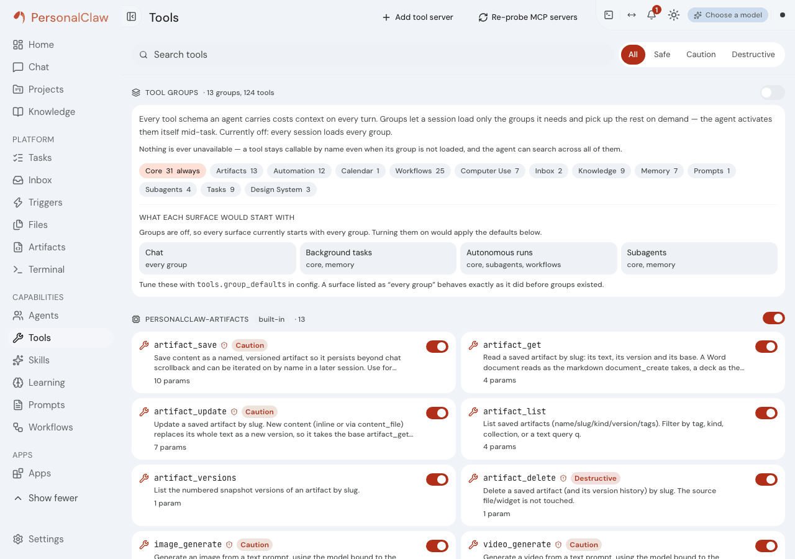 | 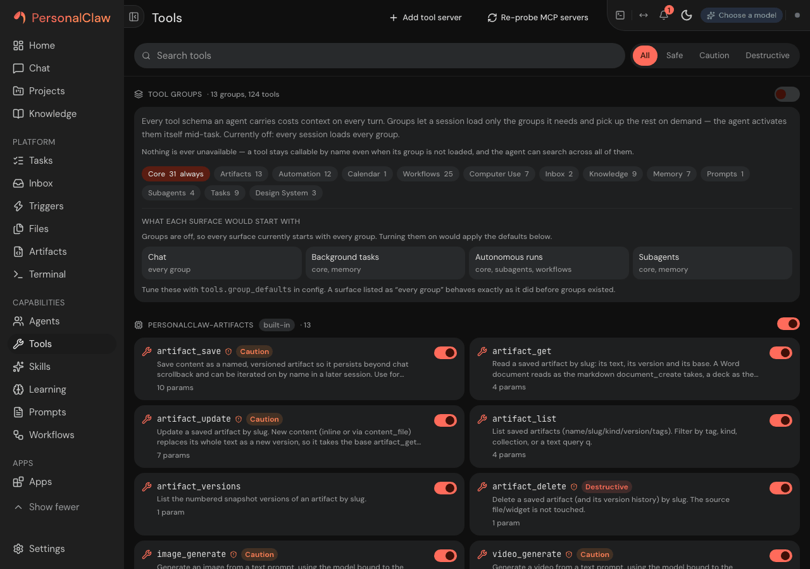 |

| 390, light | 390, dark |
|---|---|
| 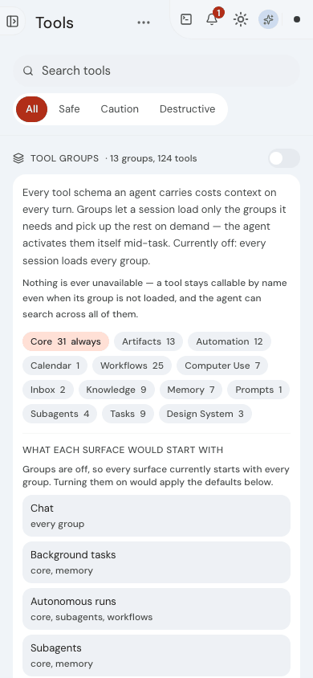 | 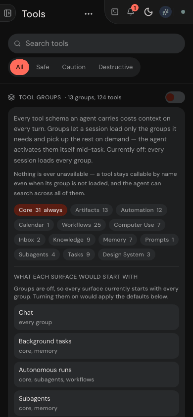 |

#### Figures

| | 1280 × 900 | 390 × 844 |
|---|---|---|
| Work surface share | 79.4% | 93.4% |
| Rail | 196 px (15.3%) | closed drawer |
| Top band (toolbar and page header) | 56 px | 56 px |
| Composer | none | none |
| Right pane | none | none |
| Settled, light / dark | 411 ms / 388 ms | 480 ms / 420 ms |
| Actionable, light / dark | 421 ms / 399 ms | 483 ms / 431 ms |
| Controls visible | 23 in the work area; rail 19, top 9 | 6 in the work area; top 7 |
| Words visible | 814 in the work area; rail 24, top 11 | 156 in the work area; top 2 |
| Text treatments / font sizes | 15 / 5 | 7 / 3 |
| Button treatments | 16 | 9 |
| Counters reading 0 | 0 | 0 |
| Ink, light / dark | 49.7% / 26.7% | 59.4% / 28.6% |
| Coral, light / dark | 0.5% / 0.6% | 0.3% / 0.4% |
| Scrolls sideways | no | no |

#### Density

- **Visual:** Ink is 49.7% in light over a work area of 79.4%. The Tool groups block is 340 px tall, and with the search row above it the first tool card starts 480 px into the 844 px work area, more than halfway down; at 390 the block fills the whole first screen and no tool is visible.
- **Information:** 23 controls and 814 words in the work area, the most words of any screen in this baseline; at 390, 6 controls and 156 words, none of them a tool. Each card does give a tool's risk and whether it is on, but most of the words go to two paragraphs on context cost, a footnote naming the config key `tools.group_defaults`, and descriptions cut at two lines.
- **Design:** 15 text treatments, 5 font sizes and 16 button treatments; coral is 0.5% but sits on every card as a coral wrench and a coral switch, and in light the Caution pill's warning orange is close to the brand coral (in dark it reads as its own hue). The page adds a coral-tinted chip ("Core 31 always") and uppercase tracked labels on the explainer and on every server group.
- **Temporal:** Actionable in 421 ms at 1280 and 483 ms at 390, the slowest of the Capabilities lists. Switching one tool off is search then flip, two steps; without search it is a scroll past the explainer and through 124 cards in server order.

#### Critique

**Score 25/40** (status 3, real-world match 2, control 3, consistency 2, error prevention 3, recognition 3, efficiency 2, minimalism 1, recovery 3, help 3). **Anti-patterns:** uppercase tracked eyebrows (`TOOL GROUPS`, `WHAT EACH SURFACE WOULD START WITH`, each server name); an identical card grid for 124 tools; coral on a decorative glyph (the wrench on every card); uppercase tracked rail section labels (shared with every screen).

- **Working:** The Safe, Caution and Destructive filter beside search shows every tool that can change or delete something in one click, and each card names its risk in a word with a shield glyph, so risk never rests on colour alone.
- **[P1] A configuration essay sits above the list.** Tool groups is a global loading policy with its own switch (off), two paragraphs, 13 group chips, four tiles of what each surface would start with, and a config-key footnote. It pushes the first tool more than halfway down the screen at 1280 and off the first screen at 390, to answer a question the owner settles once. Fold it to one line ("Tool groups off, 13 groups") that opens a sheet, and keep the policy in Settings (`web/REDESIGN.md` §3 rule 1, rule 13).
- **[P2] 124 tools as a two-column card grid.** Each card spends three lines on a name, a description cut mid-sentence and a parameter count, so the owner scans pairs of cards to find one name. The IA's Capabilities tab is a list beside a detail. Make each tool one dense row (name, risk, switch) under a collapsible server header, and leave the description and parameters to `ToolInspector` in the right pane, which already opens on click.
- **[P2] Coral on every card.** 124 coral wrenches and 124 coral switches, all on, make coral the norm on this page, so it stops pointing at anything. Make the wrench neutral, since the name already says it is a tool, and make Caution read as a warning distinct from the brand coral in light (`web/REDESIGN.md` §3 rule 7).
- **[P2] The header names one object two ways.** "Add tool server" and "Re-probe MCP servers" call the same thing by two names, and Add, the page's primary, renders as a ghost button while every other Capabilities page fills its primary in coral. Use one name (tool server), give Add the primary tier, and move Re-probe to an overflow menu.

**Detector:** no findings in this screen's own source files.

#### Checklist

1. **The one thing:** find a tool, see its risk, switch it on or off, and add or fix a tool server. **Largest element:** no. At 1280 the Tool groups block is the largest single block on the first screen, and at 390 it is the whole first screen.
2. **Fails "needed right now":** the Tool groups paragraphs, its 13 chips, the four start-with tiles and the `tools.group_defaults` footnote; the coral wrench on each card; the parameter count on every card.
3. **Can move:** the Tool groups block to Settings, with a one-line link here; Re-probe MCP servers to an overflow menu and the palette; parameter counts to `ToolInspector`.
4. **Scope homes:** the Tool groups switch is a global policy on a list page, and its home is Settings; Tools has its own rail entry where the IA makes it a Capabilities tab (shared with Agents, Skills, Prompts and Apps); each server's switch sits on its group header, which is in place.

### Skills

`#/skills` · id `skills`.

#### Snapshots

| 1280, light | 1280, dark |
|---|---|
| 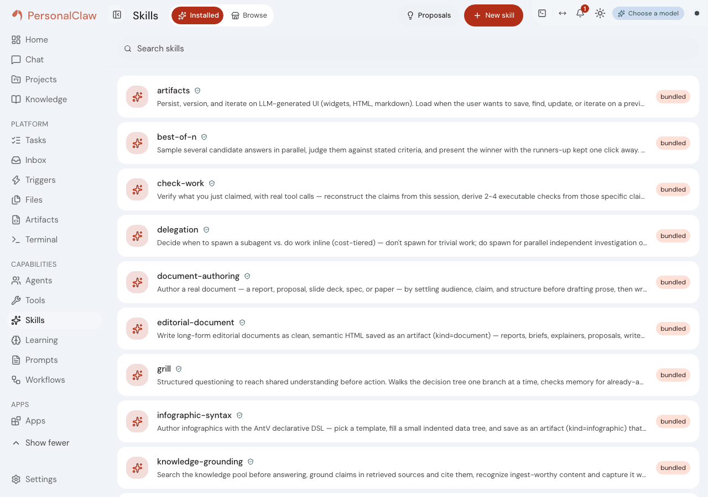 | 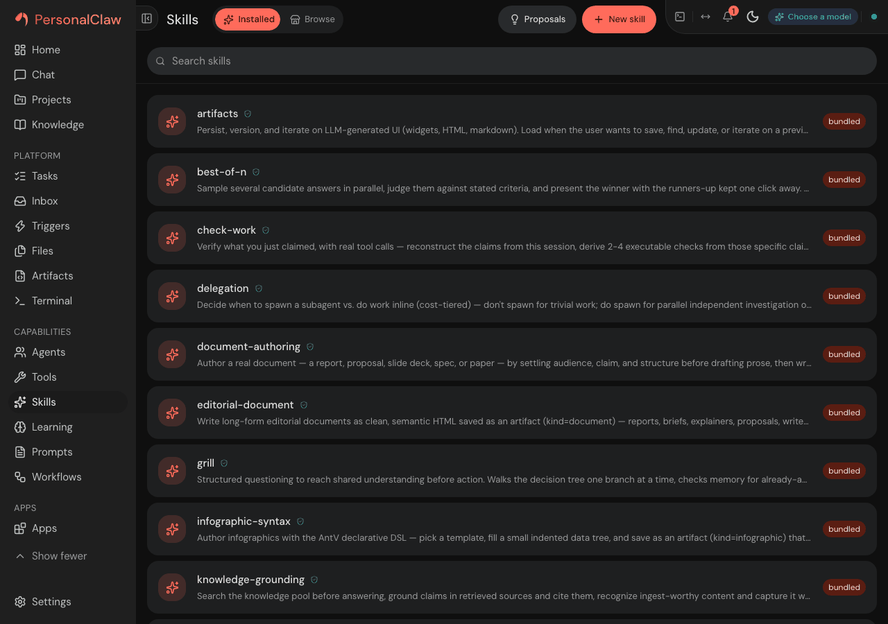 |

| 390, light | 390, dark |
|---|---|
|  |  |

#### Figures

| | 1280 × 900 | 390 × 844 |
|---|---|---|
| Work surface share | 79.4% | 87.2% |
| Rail | 196 px (15.3%) | closed drawer |
| Top band (toolbar and page header) | 56 px | 108 px |
| Composer | none | none |
| Right pane | none | none |
| Settled, light / dark | 316 ms / 380 ms | 369 ms / 372 ms |
| Actionable, light / dark | 317 ms / 389 ms | 370 ms / 374 ms |
| Controls visible | 11 in the work area; rail 19, top 11 | 9 in the work area; top 9 |
| Words visible | 486 in the work area; rail 24, top 10 | 453 in the work area; top 2 |
| Text treatments / font sizes | 11 / 4 | 5 / 4 |
| Button treatments | 14 | 10 |
| Counters reading 0 | 0 | 0 |
| Ink, light / dark | 40.7% / 22.4% | 42.6% / 37.7% |
| Coral, light / dark | 0.7% / 0.7% | 0.7% / 0.7% |
| Scrolls sideways | no | no |

#### Density

- **Visual:** Ink is 40.7% in light; the work area is 79.4% at 1280 and 87.2% at 390, where the header wraps to a second 52 px band. Nine 76 px rows fill the view, each 1052 px wide, opening on the same coral sparkle tile and closing on a coral "bundled" pill.
- **Information:** 11 controls and 486 words in the work area (9 and 453 at 390). The owner learns nine names and that all nine are bundled, while the description, the only text that says when the agent loads a skill, stops mid-word at 1280 and after five or six words at 390.
- **Design:** 11 text treatments, 4 font sizes and 14 button treatments; coral is 0.7%. Coral fills the Installed segment and New skill, which is correct, and also tints a static "bundled" label and an identical tile on every row; in dark the pill becomes a dark red fill with coral text that reads like an alert.
- **Temporal:** Actionable in 317 ms at 1280 and 370 ms at 390. Opening a skill is one click into the right pane; reviewing what the agent proposes is a header click into a separate Proposals view, and the other proposal kinds are on Learning.

#### Critique

**Score 28/40** (status 3, real-world match 3, control 3, consistency 2, error prevention 3, recognition 3, efficiency 3, minimalism 2, recovery 3, help 3). **Anti-patterns:** coral on inactive things (the "bundled" pill and the sparkle tile on every row); identical cards for every row; uppercase tracked rail section labels (shared with every screen).

- **Working:** The Proposals button drops its count when nothing waits. It reads "Proposals", never "Proposals (0)", which is `web/REDESIGN.md` §3 rule 3 applied in the header.
- **[P1] Proposals have two inboxes.** Skill proposals are reviewed here behind the Proposals button, while Learning lists every other kind and, when it has none of its own, sends the owner back here with "Review in Skill proposals". What waits on the owner is split by the store it came from, and they have to check both. Merge them into one review queue counted in Home's Needs You, and show the header button only while something waits (`web/REDESIGN.md` §3 rule 2).
- **[P2] Coral on every row says nothing.** "bundled" is a provenance label on all nine visible rows, drawn in coral, and each row repeats the same coral tile. Coral marks the default case here, so it no longer helps the eye find anything. Group the list by provenance under plain headers (bundled, yours, shared), drop the per-row pill and tile, and keep coral to New skill and the selected mode (`web/REDESIGN.md` §3 rule 7).
- **[P2] Descriptions are cut where they start to help.** Rows are 1052 px wide and still clip the one sentence that says when a skill applies, and at 390 five or six words survive. Clamp to two lines at wide widths, give the text the tile's 52 px on compact, and keep the full text in the right pane.
- **[P3] At 390 the mode switch folds to one sparkle icon.** Installed and Browse collapse into a single unlabelled pill, Proposals into a lightbulb and New skill into a coral disc, on a second header band that costs 52 px of work area. Browse belongs with the Store in the IA's Capabilities tabs, and without it the title and New skill fit on one line.

**Detector:** no findings in this screen's own source files.

#### Checklist

1. **The one thing:** find a skill, read what it does, and open it to edit or check it. **Largest element:** yes, the skill list.
2. **Fails "needed right now":** the "bundled" pill and the sparkle tile on every row; the Proposals button while nothing waits.
3. **Can move:** Proposals to Home's Needs You and the palette, shown here only while something waits; Browse to the Store tab.
4. **Scope homes:** proposals waiting on the owner sit behind a page-header button, where the IA's home for waiting work is Home's Needs You; Skills has its own rail entry where the IA makes it a Capabilities tab (shared with Agents, Tools, Prompts and Apps).

### Learning

`#/learning` · id `learning`.

#### Snapshots

| 1280, light | 1280, dark |
|---|---|
|  |  |

| 390, light | 390, dark |
|---|---|
|  |  |

#### Figures

| | 1280 × 900 | 390 × 844 |
|---|---|---|
| Work surface share | 79.4% | 93.4% |
| Rail | 196 px (15.3%) | closed drawer |
| Top band (toolbar and page header) | 56 px | 56 px |
| Composer | none | none |
| Right pane | none | none |
| Settled, light / dark | 321 ms / 323 ms | 322 ms / 273 ms |
| Actionable, light / dark | 330 ms / 324 ms | 324 ms / 274 ms |
| Controls visible | 4 in the work area; rail 19, top 8 | 4 in the work area; top 7 |
| Words visible | 190 in the work area; rail 24, top 6 | 94 in the work area; top 3 |
| Text treatments / font sizes | 19 / 7 | 11 / 6 |
| Button treatments | 12 | 9 |
| Counters reading 0 | 4 | 4 |
| Ink, light / dark | 41.4% / 55.8% | 47.9% / 47.4% |
| Coral, light / dark | 0.2% / 0.2% | 0.4% / 0.5% |
| Scrolls sideways | no | no |

#### Density

- **Visual:** Ink is 41.4% in light and 55.8% in dark over a work area of 79.4%. The first screen holds seven day tiles, four tiles that each read 0, and a 70 px card around one number (95.8), and the proposals the page exists for are not on it.
- **Information:** 4 controls and 190 words in the work area (4 and 94 at 390), from which the owner learns that capture ran once this week and nothing has been recorded. Six of seven day tiles say "not started", and the four count tiles, "0 proposals filed" and "the last 0 runs" spend their room saying zero.
- **Design:** 19 text treatments and 7 font sizes, tied for the most in this baseline, and 4 zero counters. Coral is 0.2%, on the Monthly segment (a selection, correct) and on Write it up, a disabled button drawn in washed-out coral.
- **Temporal:** Actionable in 330 ms at 1280 and 324 ms at 390. The page makes a separate read for each of its ten panels, each with its own loading and error state, and the proposal list comes after all ten.

#### Critique

**Score 21/40** (status 3, real-world match 1, control 3, consistency 2, error prevention 3, recognition 2, efficiency 1, minimalism 1, recovery 3, help 2). **Anti-patterns:** a hero metric (95.8 alone on its card); identical card grids (seven day tiles, four count tiles); coral on an inactive control (the disabled Write it up); uppercase tracked rail section labels (shared with every screen).

- **Working:** No component fakes a number. Surfacing precision and Judge trustworthiness read "unmeasured" with the reason beside them, and the score names its own coverage ("from 2 of 4 components").
- **[P1] The review queue is the last thing on the page.** The proposals list, where the owner accepts or rejects what the agent wants to change, renders after ten panels (capture week, the adaptation report, flywheel health, attention, field metrics, judge bench, studies, retrieval bench, ablation and benchmark). The one decision this page asks of the owner needs a long scroll to find. Put proposals first, count waiting ones in Home's Needs You, and fold the benchmark panels into one disclosure or move them to Settings › Evaluations (`web/REDESIGN.md` §3 rule 1, rule 13).
- **[P1] Zeros fill the first screen.** "0 Preferences I hold", "0 Lessons I follow", "0 Skills I built" and "0 Waiting on you" each take a tile, six day tiles read "not started", and the text adds "0 proposals filed" and "the last 0 runs". A dozen elements tell the owner one fact, that nothing has been learned yet. Say it once in a sentence, and show a tile only when its count is above zero (`web/REDESIGN.md` §3 rule 3).
- **[P2] A grade without its caveat.** 95.8 is the largest text on the screen and reads as near perfect, while it covers two of four components and the "2 unmeasured" pill sits apart in the section title. Lead with the coverage, and set the number at title size in the line that names it.
- **[P2] Pipeline names and a disabled coral button.** "Flywheel health", "Capture", "Surfacing precision" and "Judge trustworthiness" are the learning loop's internal names, where the owner wants to know what the agent learned and what it wants to change. Write it up, the largest button on the page, is coral at reduced opacity because there is nothing to write up, and at 390 the title truncates to "Lea…" while Refresh keeps its label. Name sections by what they tell the owner, show Write it up only when there is a record, and let the title win the header.

**Detector:** 2 in this screen's own source: `web/src/pages/learning/IdentityReportPanel.tsx` (design-system-font-size; lines 284); `web/src/pages/learning/LearningPage.tsx` (design-system-font-size; lines 507).

#### Checklist

1. **The one thing:** review what the agent proposes to change, and see what it has learned. **Largest element:** no. The 95.8 score is the largest text, the week strip and the zero tiles fill the first screen, and the proposals list sits below all ten panels.
2. **Fails "needed right now":** the four zero tiles; six "not started" day tiles; "0 proposals filed"; the disabled Write it up; the score card and its four weighted rows; Refresh in the header.
3. **Can move:** the judge bench, studies, retrieval bench, ablation and benchmark panels to Settings › Evaluations (`#/settings/evals`); the Monthly, Weekly and Off cadence to Settings; Refresh to the palette.
4. **Scope homes:** proposals waiting on the owner belong in Home's Needs You and sit at the bottom of a page; the report cadence is a setting on a work page; Learning has its own rail entry and no home in the IA's screen specs yet.

### Workflows

`#/workflows` · id `workflows`.

#### Snapshots

| 1280, light | 1280, dark |
|---|---|
|  |  |

| 390, light | 390, dark |
|---|---|
|  |  |

#### Figures

| | 1280 × 900 | 390 × 844 |
|---|---|---|
| Work surface share | 79.4% | 87.2% |
| Rail | 196 px (15.3%) | closed drawer |
| Top band (toolbar and page header) | 56 px | 108 px |
| Composer | none | none |
| Right pane | none | none |
| Settled, light / dark | 314 ms / 376 ms | 381 ms / 327 ms |
| Actionable, light / dark | 316 ms / 377 ms | 382 ms / 328 ms |
| Controls visible | 7 in the work area; rail 19, top 10 | 4 in the work area; top 9 |
| Words visible | 185 in the work area; rail 24, top 10 | 111 in the work area; top 2 |
| Text treatments / font sizes | 11 / 4 | 6 / 4 |
| Button treatments | 14 | 11 |
| Counters reading 0 | 0 | 0 |
| Ink, light / dark | 35.6% / 54.5% | 46.8% / 42.6% |
| Coral, light / dark | 0.9% / 0.9% | 0.8% / 0.9% |
| Scrolls sideways | no | no |

#### Density

- **Visual:** Ink is 35.6% in light; the work area is 79.4% at 1280 and 87.2% at 390, where the header takes a 108 px band. The empty Runs tab is a 640 px column of six template cards with blank margins either side, each card led by a coral icon tile and a coral template id.
- **Information:** 7 controls and 185 words in the work area (4 and 111 at 390). The owner learns there are no runs and sees six ways to start one, described for the engine ("WIP=1", "a deliverable gate that runs the metric AND the regression command") more than for the person choosing.
- **Design:** 11 text treatments, 4 font sizes and 14 button treatments; coral is 0.9%. Coral fills the Runs segment and Start from template, which is correct, and also colours six template ids and six icon tiles that are only labels.
- **Temporal:** Actionable in 316 ms at 1280 and 382 ms at 390. Starting a run is two steps (a card, then its input dialog), the same as the header's Start from template, and Definitions is one tab away.

#### Critique

**Score 26/40** (status 3, real-world match 2, control 3, consistency 2, error prevention 3, recognition 2, efficiency 3, minimalism 2, recovery 3, help 3). **Anti-patterns:** an identical card grid (six template cards); coral on decorative text and fills (template ids and icon tiles); uppercase tracked rail section labels (shared with every screen).

- **Working:** The empty Runs tab offers six starting points, each opening the same start flow as the header's Start from template, so a first run is one click and one dialog away, with Browse all definitions kept as the footer.
- **[P1] At 390 the view switch reads as an on/off switch.** Runs and Definitions have no icons, so the header's icon-only collapse leaves two empty pills, a coral disc beside a white one, and Start from template becomes a bare sparkle disc. The owner cannot tell which view is open or that a second view exists. Keep the label when a segment has no icon, folding to one labelled pill ("Runs") as the header ladder does on other pages.
- **[P2] Runs and loops keep separate ledgers.** This home has a completed research loop, and Runs still reads "No workflow runs yet" while offering "Research a topic" as a fresh start. The owner looking for what ran has two places to check. Background work belongs in Home's Running Now and Recent groups whatever engine ran it, and Runs should list loops or say where they are (`docs/design/information-architecture.md`, the four rules, rule 4).
- **[P2] Coral on labels.** Each card sets its template id (`code-project`, `deep-research`) in coral over a coral icon tile, twelve coral marks beside the one coral action in the header. Set the id in neutral mono at caption size, drop the tiles, and keep coral to Start from template and the selected tab (`web/REDESIGN.md` §3 rule 7).
- **[P3] Card copy is written for the engine.** "a gated initializer, WIP=1, a reproduction before any edit" describes the template's gates, where the owner choosing a starting point wants to know what they get back. Lead each card with the outcome in one plain sentence and keep the gates in the template's detail.

**Detector:** no findings in this screen's own source files.

#### Checklist

1. **The one thing:** start a workflow run, or check on one that ran. **Largest element:** yes, in this empty state the template cards are the work surface.
2. **Fails "needed right now":** the coral template ids and icon tiles; the gate-by-gate detail in each description.
3. **Can move:** the template ids and gate detail to each template's detail view; the theme and width controls to the palette (shared with every screen).
4. **Scope homes:** runs are background work whose home is Home's groups, and they show only here; Workflows has its own rail entry and no home in the IA's screen specs yet.

### Prompts

`#/prompts` · id `prompts`.

#### Snapshots

| 1280, light | 1280, dark |
|---|---|
|  |  |

| 390, light | 390, dark |
|---|---|
|  |  |

#### Figures

| | 1280 × 900 | 390 × 844 |
|---|---|---|
| Work surface share | 79.4% | 87.2% |
| Rail | 196 px (15.3%) | closed drawer |
| Top band (toolbar and page header) | 56 px | 108 px |
| Composer | none | none |
| Right pane | none | none |
| Settled, light / dark | 325 ms / 370 ms | 330 ms / 388 ms |
| Actionable, light / dark | 328 ms / 372 ms | 334 ms / 390 ms |
| Controls visible | 3 in the work area; rail 19, top 12 | 3 in the work area; top 8 |
| Words visible | 30 in the work area; rail 24, top 11 | 27 in the work area; top 2 |
| Text treatments / font sizes | 12 / 4 | 4 / 3 |
| Button treatments | 13 | 9 |
| Counters reading 0 | 0 | 0 |
| Ink, light / dark | 4.4% / 21.7% | 5.6% / 9.3% |
| Coral, light / dark | 1.1% / 1.1% | 2.1% / 2.1% |
| Scrolls sideways | no | no |

#### Density

- **Visual:** Ink is 4.4% in light; the work area is 79.4% at 1280 and 87.2% at 390. It holds the search row and an empty state in its top 315 px and nothing under them.
- **Information:** 3 controls and 30 words in the work area against 12 controls in the top band. The owner learns they have written no prompts, while the prompts PersonalClaw ships sit on Bundled and the page opens on the empty tab.
- **Design:** 12 text treatments, 4 font sizes and 13 button treatments; coral is 1.1% at 1280 and 2.1% at 390. Two coral New prompt buttons share the screen, in the header and the empty state, beside the coral User segment and a coral-tinted icon disc.
- **Temporal:** Actionable in 328 ms at 1280 and 334 ms at 390. Using a shipped prompt takes three steps (Bundled, find it, open it) before it reaches a chat.

#### Critique

**Score 26/40** (status 2, real-world match 3, control 3, consistency 2, error prevention 3, recognition 2, efficiency 2, minimalism 3, recovery 3, help 3). **Anti-patterns:** coral on a decorative fill (the empty-state icon disc, shared `EmptyState`); uppercase tracked rail section labels (shared with every screen).

- **Working:** The empty state says where the shipped prompts are ("on the Bundled tab"), so an empty User tab is never mistaken for an empty library.
- **[P2] The page opens on its emptiest tab.** User is the default and holds nothing on this home, while the prompts PersonalClaw ships sit on Bundled and the reusable pieces on Snippets. The owner arrives at a blank screen and a hint to look elsewhere. Show one list of every prompt grouped by source, the owner's own first, with source as a filter; the IA gives Prompts one Capabilities tab, a list beside a detail.
- **[P2] Two places are called Prompts.** This page edits prompts, Settings › Prompts binds them to each context (chat, background, title and the rest), and this page's System tab lists the same system prompts. The owner has to learn which Prompts does what. Show the binding on a prompt's detail ("serves chat") and let Settings link to it, so editing and binding meet in one place (`web/REDESIGN.md` §3 rule 2).
- **[P3] Controls with nothing to act on.** Search and Sort & filter sit over an empty list, New prompt shows twice in coral, and Apps labels the same `FilterMenu` "Filter & sort". At 390 the four tabs fold to one person icon and the filter to an unlabelled sliders icon. Show search and filter once the list has rows, keep one coral button on screen, use one label, and keep a word on the folded tab pill (`web/REDESIGN.md` §3 rule 1).

**Detector:** no findings in this screen's own source files.

#### Checklist

1. **The one thing:** find a prompt to use or edit, or write a new one. **Largest element:** no. The largest thing is blank space under the empty state, and the prompts the owner can use are on another tab.
2. **Fails "needed right now":** search and Sort & filter over an empty list; the second New prompt; the coral icon disc.
3. **Can move:** Sort & filter to an overflow menu until the list has rows; the System, Bundled and Snippets tabs into a source filter.
4. **Scope homes:** a prompt's binding to a context lives in Settings › Prompts, away from the prompt it binds; Prompts has its own rail entry where the IA makes it a Capabilities tab (shared with Agents, Tools, Skills and Apps).

### Store

`#/apps` · id `apps`.

#### Snapshots

| 1280, light | 1280, dark |
|---|---|
|  |  |

| 390, light | 390, dark |
|---|---|
|  |  |

#### Figures

| | 1280 × 900 | 390 × 844 |
|---|---|---|
| Work surface share | 79.4% | 87.2% |
| Rail | 196 px (15.3%) | closed drawer |
| Top band (toolbar and page header) | 56 px | 108 px |
| Composer | none | none |
| Right pane | none | none |
| Settled, light / dark | 270 ms / 326 ms | 318 ms / 324 ms |
| Actionable, light / dark | 271 ms / 329 ms | 331 ms / 326 ms |
| Controls visible | 3 in the work area; rail 19, top 11 | 3 in the work area; top 8 |
| Words visible | 24 in the work area; rail 24, top 11 | 21 in the work area; top 5 |
| Text treatments / font sizes | 12 / 4 | 5 / 4 |
| Button treatments | 13 | 9 |
| Counters reading 0 | 0 | 0 |
| Ink, light / dark | 3.9% / 21.2% | 6.5% / 10.0% |
| Coral, light / dark | 1.2% / 1.2% | 3.4% / 3.4% |
| Scrolls sideways | no | no |

#### Density

- **Visual:** Ink is 3.9% in light; the work area is 79.4% at 1280 and 87.2% at 390. The search row and a 190 px empty state fill the top 295 px over blank space, and at 390 coral reaches 3.4% of the screen, the highest of any screen in this baseline at that width, from two coral buttons on a small screen.
- **Information:** 3 controls and 24 words in the work area against 11 in the top band. The only fact on screen is "No apps installed", while the Native tab holds the bundled apps the system runs on and Settings' Apps card counts 37 installed.
- **Design:** 12 text treatments, 4 font sizes and 13 button treatments; coral is 1.2% at 1280. Install from URL and Browse Store are both coral fills, with the coral Library segment a third coral shape between them.
- **Temporal:** Actionable in 271 ms at 1280 and 331 ms at 390. Installing from the Store is a tab, a search, and an install with its consent step, and the empty state's Browse Store saves no step over the Store tab beside the title.

#### Critique

**Score 27/40** (status 2, real-world match 2, control 3, consistency 2, error prevention 3, recognition 3, efficiency 3, minimalism 3, recovery 3, help 3). **Anti-patterns:** coral on a decorative fill (the empty-state icon disc, shared `EmptyState`); uppercase tracked rail section labels, here an APPS heading over its single Apps entry (shared with every screen).

- **Working:** The tab and every filter are written to the URL (`#/apps?view=…`), so a link reopens the same tab with the same filters.
- **[P1] "No apps installed" on a system made of apps.** The Library tab leaves out native apps, so the page tells the owner nothing is installed while Settings' Apps card reads "of 37 installed" and Providers counts 37 enabled. PRODUCT.md says every capability is a removable app, and this screen says there are none. List native apps here too, marked built in and locked, or have the empty state say how many built-in apps run and link the Native tab.
- **[P2] Two coral calls to action, neither the common one.** Install from URL, a rare path, holds the header's primary, and Browse Store repeats the Store tab one control away, both as coral fills. The IA's Capabilities header is Add, with Install on the Store tab. Make the header's primary open the Store, put Install from URL on the Store tab or in an overflow menu, and leave one coral button on screen (`web/REDESIGN.md` §3 rule 2, rule 7).
- **[P3] Search and Filter & sort over an empty list.** Both act on nothing here, and Prompts labels the same `FilterMenu` "Sort & filter". Show them once the list has rows, under one label.
- **[P3] At 390 the three tabs fold to one cube icon.** Native, Library and Store collapse into an unlabelled pill, so the compact header no longer shows that a Store exists. Keep the tab name on the folded pill.

**Detector:** no findings in this screen's own source files.

#### Checklist

1. **The one thing:** see which apps run, manage them, and install new ones. **Largest element:** no. The largest thing is blank space under the empty state, and the apps that run sit on the Native tab.
2. **Fails "needed right now":** search and Filter & sort over an empty list; Install from URL as the header's primary; Browse Store beside a Store tab.
3. **Can move:** Install from URL to the Store tab or an overflow menu; Filter & sort to an overflow menu until the list has rows.
4. **Scope homes:** Apps has its own rail entry under its own APPS heading, where the IA makes Apps and the Store two Capabilities tabs; the "Choose a model" chip sits in global chrome (shared with every screen).

### Settings

`#/settings` · id `settings`.

#### Snapshots

| 1280, light | 1280, dark |
|---|---|
|  |  |

| 390, light | 390, dark |
|---|---|
|  |  |

#### Figures

| | 1280 × 900 | 390 × 844 |
|---|---|---|
| Work surface share | 79.4% | 93.4% |
| Rail | 196 px (15.3%) | closed drawer |
| Top band (toolbar and page header) | 56 px | 56 px |
| Composer | none | none |
| Right pane | none | none |
| Settled, light / dark | 2439 ms / 679 ms | 2466 ms / 307 ms |
| Actionable, light / dark | 2440 ms / 680 ms | 2468 ms / 314 ms |
| Controls visible | 22 in the work area; rail 19, top 7 | 5 in the work area; top 6 |
| Words visible | 192 in the work area; rail 24, top 5 | 39 in the work area; top 2 |
| Text treatments / font sizes | 15 / 5 | 8 / 5 |
| Button treatments | 25 | 8 |
| Counters reading 0 | 4 | 2 |
| Ink, light / dark | 44.3% / 27.3% | 37.2% / 33.7% |
| Coral, light / dark | 0.5% / 0.5% | 0.5% / 0.6% |
| Scrolls sideways | no | no |

#### Density

- **Visual:** Ink is 44.3% in light; the work area is 79.4% at 1280, with the open rail at 15.3%, and 93.4% at 390. The home is a three-column masonry of 40 cards (19 of them under System), each with a coral icon tile, a title, an arrow and a body that runs from one large number to five lines of prose, and all three columns run past the first screen.
- **Information:** 22 controls and 192 words in the work area at 1280, and four System cards on the first screen at 390 (5 controls, 39 words). Real facts are there, Models has no binding and Search has no provider, but they sit at the same weight as "119 denied-command rules", "Global 0" and "0 installed packs".
- **Design:** 15 text treatments, 5 font sizes and 25 button treatments, the most button looks of any screen in this baseline, because cards mix arrows, switches, a segmented control and status pills. There are 4 zero counters (2 at 390), and coral is 0.5%, on the focused search ring, two switches and the tile on every card.
- **Temporal:** Actionable in 2440 ms at 1280 and 2468 ms at 390 in the light passes, each the first visit after a quiet spell, and in 680 ms and 314 ms in the dark passes that ran right after, once the gateway had cached its answers. Search has focus on arrival, so finding a setting is type, then open the card; the System card keeps reading live (CPU 53%, 67% and 66% across captures), and idle the page draws no animation frames.

#### Critique

**Score 27/40** (status 3, real-world match 3, control 3, consistency 2, error prevention 3, recognition 3, efficiency 3, minimalism 1, recovery 3, help 3). **Anti-patterns:** an identical card grid with a hero number leading most cards (119, 6, 37, 90); coral on a decorative fill (the icon tile on every card); uppercase tracked rail section labels (shared with every screen).

- **Working:** Search has focus on arrival and matches values inside the cards as well as names, so the owner can type a value they remember ("retention") and land on its panel.
- **[P1] A dashboard where the IA asks for a section list.** The IA's Settings is a section list beside the form with search on top. This home is a balanced bento of 40 cards that packs the largest groups first, so General (Account, Design, Chat), the everyday panels, starts below the fold, and the owner scans three columns of figures to find a section name. The one blocker here, Models' "No models bound yet", reads at the same weight as Packs' zero. Replace the grid with one line per panel, grouped, beside the selected panel's form from 840 px, and show a blocker as a status on its line.
- **[P1] Zero counters and live telemetry on an index.** "Global 0", "Per-project 0", "0 apps with settings" and "0 installed packs" each take a line, and the System card reads CPU and memory live on a page the owner opens to change a setting. Hide the zeros (`web/REDESIGN.md` §3 rule 3), and keep the live reading inside Settings › System, its home by §3 rule 6, instead of on the card that links to it.
- **[P2] Index cards that change settings.** Inbox's Auto-cleanup switch, and Notifications' Delivery switch and Min severity control, act from the home grid, so one setting has two places to change it, one of them without its panel's context. Let the index navigate and keep the controls in their panels.
- **[P2] The first visit waits 2.4 s for a list of names.** Both light passes took about 2.4 s to become actionable (2440 ms at 1280, 2468 ms at 390), and the dark passes that ran right after each took 680 ms and 314 ms. The first visit after a quiet spell pays a cost the gateway then caches, so an owner who opens Settings once a week meets the slow load every time, and no other screen in this baseline that became actionable takes more than 900 ms. The home mounts 40 cards that each read their own data, while a section list renders from the registry and needs no read to be usable.

**Detector:** no findings in this screen's own source files.

#### Checklist

1. **The one thing:** find a setting and open its panel. **Largest element:** yes, the card grid, though most of each card is figures rather than the name of the section it opens.
2. **Fails "needed right now":** the live CPU and memory reading; the zero counts (Global 0, Per-project 0, Apps 0, Packs 0); the Security counts (119, 52, 5, 64); Routing & Efficiency's five-line paragraph; the inline switches and the Min severity control.
3. **Can move:** the live System reading into Settings › System; the inline switches into their panels; each card's figures into its panel's header.
4. **Scope homes:** the Inbox and Notifications controls sit on the index instead of their panels; Prompts and Apps each name both a Settings card and a rail page, two homes for one name; the "Choose a model" chip in global chrome repeats the Models card (shared with every screen).

## Settings panels

One per panel in `SETTINGS_PANELS`, in its order. Every panel sits in the same frame: the rail, a page header whose back arrow and breadcrumb lead to the Settings home, and the panel's form. There is no section list beside the form.

### Settings › Account

`#/settings/account` · id `settings-account`.

#### Snapshots

| 1280, light | 1280, dark |
|---|---|
|  |  |

| 390, light | 390, dark |
|---|---|
|  |  |

#### Figures

| | 1280 × 900 | 390 × 844 |
|---|---|---|
| Work surface share | 79.4% | 93.4% |
| Rail | 196 px (15.3%) | closed drawer |
| Top band (toolbar and page header) | 56 px | 56 px |
| Composer | none | none |
| Right pane | none | none |
| Settled, light / dark | 165 ms / 225 ms | 117 ms / 117 ms |
| Actionable, light / dark | 166 ms / 230 ms | 119 ms / 128 ms |
| Controls visible | 10 in the work area; rail 19, top 9 | 7 in the work area; top 7 |
| Words visible | 219 in the work area; rail 24, top 6 | 141 in the work area; top 2 |
| Text treatments / font sizes | 13 / 5 | 8 / 5 |
| Button treatments | 12 | 8 |
| Counters reading 0 | 0 | 0 |
| Ink, light / dark | 9.5% / 23.8% | 17.4% / 17.6% |
| Coral, light / dark | 0.1% / 0.1% | 0.1% / 0.1% |
| Scrolls sideways | no | no |

#### Density

- **Visual:** The work region is 79.4% of the window at 1280 (rail 15.3%, top band 5.3%) and 93.4% at 390, yet ink is only 9.5% in light. Three 280 px inputs sit on the left and their hints run to the far edge at the Full content width, so most of the region is canvas beside short fields.
- **Information:** 219 words against 10 work controls at 1280 (141 words, 7 controls at 390), about 22 words per control. The one status fact on the panel, whether sign-in from outside is on, sits below the fold under a three-field password form.
- **Design:** 13 text treatments, 5 font sizes and 12 button treatments for 10 controls, with coral 0.1%. The three Save buttons alone come in two looks, two hand-rolled tonal pills and one `Button` in the secondary tier.
- **Temporal:** The panel is actionable in 166 ms at 1280 and 119 ms at 390, and nothing moves after that. Renaming takes an edit and a Save per field, so changing the name and the handle together is four steps.

#### Critique

**Score 26/40** (status 2, real-world match 3, control 3, consistency 2, error prevention 3, recognition 3, efficiency 2, minimalism 2, recovery 3, help 3). **Anti-patterns:** none in the panel. The shared rail's group labels (`PLATFORM`, `CAPABILITIES`, `APPS`) are uppercase and tracked.

- **Working:** Every Save stays in the tab order while there is nothing to save and says why ("No changes to save"), and a failed read says so with a retry instead of showing an empty field as if it were stored.
- **[P2] In light, placeholders read as stored values.** Username shows `alex` and Assistant name shows `PersonalClaw` at almost the same ink as the stored `Alex`, so the owner reads an empty handle as a saved one. Dark separates them, light does not. Set placeholders at ink-low in light, as `web/DESIGN.md` §5 Inputs requires, and show an unset handle as unset.
- **[P2] Three Saves, three fields, two looks.** Each Identity field commits on its own button, and Username's is the kit `Button` while the other two are raw `button`s styled by hand (`web/REDESIGN.md` §3 rule 9). The owner who edits two fields must find two buttons. Give the Identity section one Save that commits every changed field, on the `Button` primitive.
- **[P2] Sign-in's state sits below its own form.** The section opens with the username and two password fields for a feature that is off by default, and the "Offer password sign-in" switch that says whether it is on sits below them. Lead the section with its on or off state and fold the form behind "Set a password". This is a layout change, and the security copy stays as written (`web/REDESIGN.md` §5.5).
- **[P3] "Run setup again" sits inside Identity.** It is a Row with its button parked about 940 px from its label, while the Saves above sit beside their fields. Move it to the foot of the panel and the palette.

**Detector:** no findings in this screen's own source files.

#### Checklist

1. **The one thing:** change how the system names the owner and itself, or set up sign-in from outside. **Largest element:** no. The hint prose is larger than the three inputs it describes.
2. **Fails "needed right now":** the open password form while sign-in is off, "Run setup again" in Identity, and the toolbar's content-width pill and "Choose a model" chip (shared with every Settings panel).
3. **Can move:** "Run setup again" to the palette; the password form behind a "Set a password" disclosure; the "Choose a model" chip to the status line.
4. **Scope homes:** "Run setup again" is an install-wide action sitting in the Identity section. The panel has no Settings section list beside it (shared), so the next panel is reached through the `#/settings` grid.

### Settings › Design

`#/settings/design` · id `settings-design`.

#### Snapshots

| 1280, light | 1280, dark |
|---|---|
|  |  |

| 390, light | 390, dark |
|---|---|
|  |  |

#### Figures

| | 1280 × 900 | 390 × 844 |
|---|---|---|
| Work surface share | 79.4% | 93.4% |
| Rail | 196 px (15.3%) | closed drawer |
| Top band (toolbar and page header) | 56 px | 56 px |
| Composer | none | none |
| Right pane | none | none |
| Settled, light / dark | 122 ms / 323 ms | 124 ms / 119 ms |
| Actionable, light / dark | 131 ms / 326 ms | 127 ms / 121 ms |
| Controls visible | 20 in the work area; rail 19, top 9 | 7 in the work area; top 7 |
| Words visible | 229 in the work area; rail 24, top 6 | 206 in the work area; top 2 |
| Text treatments / font sizes | 14 / 5 | 8 / 5 |
| Button treatments | 16 | 10 |
| Counters reading 0 | 0 | 0 |
| Ink, light / dark | 42.2% / 57.2% | 34.4% / 36.2% |
| Coral, light / dark | 2.0% / 2.1% | 0.1% / 0.2% |
| Scrolls sideways | no | no |

#### Density

- **Visual:** Ink is 42.2% in light and 57.2% in dark at 1280, the most of any panel in this group in dark, and the twelve scheme swatches take about a third of the viewport height. The swatch bars are 230 by 48 px for a choice made once, so the picker outweighs everything it configures.
- **Information:** 229 words and 20 work controls at 1280 (206 words and 7 controls at 390). The owner can see the active identity and scheme without a click, but not what an identity changes, because every description is cut to one or two lines.
- **Design:** 14 text treatments, 16 button treatments, and coral 2.0% at 1280, nearly all of it the Coral and Ember swatches, which are data here. At 390 coral falls to 0.1% because the swatches sit below the fold.
- **Temporal:** The panel is actionable in 131 ms at 1280 and every control applies live, so a new look is one click. Typography, backdrop, layout and navigation sit below the swatches with no index, a long scroll from the top.

#### Critique

**Score 26/40** (status 3, real-world match 2, control 3, consistency 2, error prevention 3, recognition 3, efficiency 3, minimalism 2, recovery 3, help 2). **Anti-patterns:** an identical card grid (the twelve swatches), and an identity that ships scanlines, which `web/DESIGN.md` §6 names as a don't.

- **Working:** Every control applies live to the mode the owner is in, the hint says so, and picking an identity promises not to touch saved configuration without asking. The owner can try a look and see it at once.
- **[P2] "Color scheme" heads three unrelated things.** Under it come the identity cards (labelled only by a small "Personality" caption), the Sound cues switch, then the scheme swatches with no heading of their own. The owner looking for schemes finds identities and a sound setting first. Split it into Identity and Scheme sections, keep Dark, Light and Auto on the Scheme header, and move Sound cues to `#/settings/notifications`.
- **[P2] Identity descriptions are cut before they say what changes.** At 1280 the Retro Terminal card stops at "a terse…", and at 390 all three stop mid-phrase. An identity replaces the wordmark, the assistant's name and the density, so the owner applies it blind. Show the whole description, or a preview on focus.
- **[P2] The mode switch exists twice.** Dark, Light and Auto here and the sun button in the toolbar set the same thing, and the toolbar's job is back, the breadcrumb, the palette and one needs-you badge (`web/REDESIGN.md` §4). Keep it here and in the palette, and take it out of the toolbar.
- **[P2] The Retro Terminal identity advertises "a scanline haze".** The one anti-reference in `web/PRODUCT.md` names scanlines, and `web/DESIGN.md` §6 forbids them. Remove the scanline layer from the identity, then the copy.

**Detector:** no findings in this screen's own source files.

#### Checklist

1. **The one thing:** pick the look, an identity, a scheme and a mode. **Largest element:** yes, the scheme swatch grid, though it is larger than the choice needs.
2. **Fails "needed right now":** the Sound cues switch; the toolbar's theme button, which repeats Dark, Light and Auto.
3. **Can move:** the toolbar's theme button to the palette; Sound cues to `#/settings/notifications`; the swatches into one compact row of chips.
4. **Scope homes:** Sound cues sits outside its home in Notifications, and the mode setting sits in global chrome as well as here. The shell has no section list beside the form (shared with every Settings panel).

### Settings › Chat

`#/settings/chat` · id `settings-chat`.

#### Snapshots

| 1280, light | 1280, dark |
|---|---|
|  |  |

| 390, light | 390, dark |
|---|---|
|  |  |

#### Figures

| | 1280 × 900 | 390 × 844 |
|---|---|---|
| Work surface share | 79.4% | 93.4% |
| Rail | 196 px (15.3%) | closed drawer |
| Top band (toolbar and page header) | 56 px | 56 px |
| Composer | none | none |
| Right pane | none | none |
| Settled, light / dark | 164 ms / 217 ms | 176 ms / 220 ms |
| Actionable, light / dark | 166 ms / 219 ms | 178 ms / 221 ms |
| Controls visible | 9 in the work area; rail 19, top 9 | 6 in the work area; top 7 |
| Words visible | 174 in the work area; rail 24, top 6 | 129 in the work area; top 2 |
| Text treatments / font sizes | 11 / 5 | 6 / 5 |
| Button treatments | 11 | 6 |
| Counters reading 0 | 0 | 0 |
| Ink, light / dark | 45.8% / 31.4% | 49.0% / 48.3% |
| Coral, light / dark | 0.3% / 0.3% | 0.4% / 0.4% |
| Scrolls sideways | no | no |

#### Density

- **Visual:** The work region is 79.4% at 1280 and 93.4% at 390, and two white row groups fill it edge to edge (ink 45.8% in light). Each switch sits about 960 px from its label at the Full content width, so the eye crosses the whole panel to check a state.
- **Information:** 174 words and 9 work controls at 1280 (129 and 6 at 390). The on and off state of every visible setting reads at a glance, but many hints only restate their label ("Display a time on each message." under Show timestamps).
- **Design:** 11 text treatments and 11 button treatments, the calmest of these panels, because every row is the shared `Row` in a `RowGroup`. Coral is 0.3% at 1280 and 0.4% at 390, all of it on switches.
- **Temporal:** The panel is actionable in 166 ms at 1280 and each switch saves on its own click. It holds nine sections in one scroll with no index, so a setting near the end, such as file checkpoints, is a long scroll from the top.

#### Critique

**Score 27/40** (status 3, real-world match 3, control 3, consistency 3, error prevention 3, recognition 3, efficiency 2, minimalism 2, recovery 3, help 2). **Anti-patterns:** coral on inactive states, in dark, where every off switch carries a deep-ember knob.

- **Working:** One primitive carries the whole panel. Every row is label, hint and control in the same grid, each switch saves at once, and a failed save says so in a toast instead of leaving the switch showing a value the server refused.
- **[P2] Reading preferences and engine knobs share one long scroll.** Sessions and Messages are the owner's own preferences, while Agent routing, Context and lifecycle (warm pool size), Background compression and File checkpoints tune the machinery. With no section list in the shell (shared with every Settings panel) and none in the panel, the owner who wants the later ones scrolls past everything. Keep this panel to how chats behave and read, and move the engine sections to `#/settings/agent`.
- **[P2] Off switches in dark show a dark red dot.** The knob is `--color-on-primary` in both states, so on the surface-highest track an off switch reads as a faint ember dot with little contrast against its track. That is the brand colour on an inactive control (`web/DESIGN.md` §2, the One Voice Rule). Give the off knob a neutral ink.
- **[P2] Hints that repeat the label.** "Show timestamps", "Send on Enter" and "Show thinking inline" each carry a sentence that says the label again, while the hints that matter, such as Follow-up suggestions' cost note, run to two lines. Drop hints that add nothing and keep the ones that state a consequence.
- **[P3] Chat starters points at the thread header.** It says to save a starter from a chat's header, an action `docs/design/information-architecture.md` moves to the overflow. Name the overflow when that lands.

**Detector:** no findings in this screen's own source files.

#### Checklist

1. **The one thing:** tune how chats restore, read and behave. **Largest element:** yes, the Sessions and Messages row groups.
2. **Fails "needed right now":** the hints that restate their label, and the toolbar's "Choose a model" chip (shared).
3. **Can move:** Warm pool size, Background compression and File checkpoints to `#/settings/agent`; the "Choose a model" chip to the status line.
4. **Scope homes:** the engine sections sit in a panel about the owner's chats. Everything else is in place.

### Settings › Providers

`#/settings/providers` · id `settings-providers`.

#### Snapshots

| 1280, light | 1280, dark |
|---|---|
|  |  |

| 390, light | 390, dark |
|---|---|
|  |  |

#### Figures

| | 1280 × 900 | 390 × 844 |
|---|---|---|
| Work surface share | 79.4% | 93.4% |
| Rail | 196 px (15.3%) | closed drawer |
| Top band (toolbar and page header) | 56 px | 56 px |
| Composer | none | none |
| Right pane | none | none |
| Settled, light / dark | 221 ms / 221 ms | 274 ms / 218 ms |
| Actionable, light / dark | 223 ms / 222 ms | 276 ms / 220 ms |
| Controls visible | 8 in the work area; rail 19, top 9 | 7 in the work area; top 7 |
| Words visible | 311 in the work area; rail 24, top 6 | 270 in the work area; top 2 |
| Text treatments / font sizes | 15 / 5 | 8 / 5 |
| Button treatments | 12 | 7 |
| Counters reading 0 | 0 | 0 |
| Ink, light / dark | 25.1% / 41.5% | 29.9% / 35.3% |
| Coral, light / dark | 0.1% / 0.1% | 0.2% / 0.3% |
| Scrolls sideways | no | no |

#### Density

- **Visual:** The work region is 79.4% at 1280 and 93.4% at 390, filled with provider cards, a nested download block and an instance row (ink 25.1% in light, 41.5% in dark). Little of it is empty, but much of what fills it is metadata the owner does not act on.
- **Information:** 311 words and only 8 work controls at 1280 (270 words, 7 controls at 390). Version chips (`v1.0.0`), capability tags (`crud`, `acp`, `approvals`, `inputs`), section count pills and "Always on" badges outnumber the facts that decide anything, which are "Ready" and "No connection test".
- **Design:** 15 text treatments, the most of these panels after Memory, and 12 button treatments, with coral 0.1%. Uppercase captions, pill counts, mono model names, chip tags and two description weights each add their own.
- **Temporal:** The panel is actionable in 223 ms at 1280 in light and 222 ms in dark, with no motion after. Connecting a model is Add instance, a form, then a test from an unlabelled icon, and the result shows only on that row.

#### Critique

**Score 23/40** (status 3, real-world match 2, control 3, consistency 2, error prevention 2, recognition 2, efficiency 2, minimalism 2, recovery 3, help 2). **Anti-patterns:** uppercase tracked eyebrows ("Native (bundled)", "Instances", "Models (0/1 downloaded)", all set uppercase), and coral as an enabled status and on the Scripted instance's glyph.

- **Working:** Providers group by what they plug into, so a provider that serves two entities appears under each and the owner finds it where they think of it. The open provider rides `?open=` and survives a refresh.
- **[P1] Every healthy provider opens with a red dot.** The enabled dot is `--color-primary`, which in light is a deep red, so Native Agents shows a red dot beside a green "Ready" and the owner reads a fault. Coral is for the primary action, focus, selection and live activity only (`web/REDESIGN.md` §3 rule 7). Show health with the status pip's semantic tones and drop the dot where "Always on" already says it.
- **[P2] The instance row's actions are four bare icons.** Test connection, View models, Edit and Remove sit side by side as glyphs with no visible labels, and Remove is always showing. The owner hovers to learn which glyph tests the connection the row is warning about. Make "Test" a labelled button and put Edit and Remove in the row's overflow and the palette.
- **[P2] Labels the owner cannot act on.** Version chips, capability tags and count pills beside each heading carry no decision, and the uppercase captions break the Weight-First Rule (`web/DESIGN.md` §3). Move versions and tags into the provider's detail, drop the counts, and set the sub-group labels in a weight step.
- **[P3] Descriptions cut at one line.** The bundled model's description stops at "a fresh install can…" and the downloadable model's source at "the s…". At 390 the Scripted row's chips and warning collide. Let the description wrap to two lines and stack the row's metadata below 840 px.

**Detector:** no findings in this screen's own source files.

#### Checklist

1. **The one thing:** enable a provider and connect a working model instance. **Largest element:** yes, the provider sections, though the bundled model's download block outweighs the one instance row.
2. **Fails "needed right now":** the version chips, capability tags, section count pills and the "Always on" badges on providers that cannot be turned off.
3. **Can move:** Edit and Remove to each row's overflow and the palette; versions and tags to the expanded detail; the counts nowhere.
4. **Scope homes:** the bundled model's download manager sits as a block between rows instead of inside its provider's detail. The rest is in place, inside a shell with no section list beside the form (shared with every Settings panel).

### Settings › Models

`#/settings/models` · id `settings-models`.

#### Snapshots

| 1280, light | 1280, dark |
|---|---|
|  |  |

| 390, light | 390, dark |
|---|---|
|  |  |

#### Figures

| | 1280 × 900 | 390 × 844 |
|---|---|---|
| Work surface share | 79.4% | 93.4% |
| Rail | 196 px (15.3%) | closed drawer |
| Top band (toolbar and page header) | 56 px | 56 px |
| Composer | none | none |
| Right pane | none | none |
| Settled, light / dark | 318 ms / 377 ms | 229 ms / 222 ms |
| Actionable, light / dark | 319 ms / 381 ms | 232 ms / 224 ms |
| Controls visible | 10 in the work area; rail 19, top 9 | 8 in the work area; top 7 |
| Words visible | 116 in the work area; rail 24, top 6 | 108 in the work area; top 2 |
| Text treatments / font sizes | 12 / 5 | 7 / 5 |
| Button treatments | 11 | 7 |
| Counters reading 0 | 0 | 0 |
| Ink, light / dark | 50.5% / 35.1% | 43.5% / 47.2% |
| Coral, light / dark | 0.1% / 0.1% | 0.1% / 0.1% |
| Scrolls sideways | no | no |

#### Density

- **Visual:** Ink is 50.5% in light at 1280, the most of any panel in this group, because nine collapsed cards stack down the 79.4% work region with an 8 px gap between each. The cards are full width for a label, an italic subtitle and a pill, so most of each card is empty surface.
- **Information:** 116 words and 10 work controls at 1280 (108 and 8 at 390). The one fact that matters on this install, that Chat has no model, reads "none configured" in the same small italic as every other row, and "1 available" repeats on six rows.
- **Design:** 12 text treatments and 11 button treatments, with coral 0.1%. Each row repeats the same five parts (chevron, glyph chip, label, italic subtitle, count pill), and two uppercase captions split them into groups.
- **Temporal:** The panel is actionable in 319 ms at 1280 (381 ms in dark), the slowest of this group, with nothing loading after. Binding Chat is expand, pick, then reorder if there is a chain, but the owner first has to work out that Chat is the row to open.

#### Critique

**Score 24/40** (status 2, real-world match 2, control 3, consistency 3, error prevention 2, recognition 3, efficiency 2, minimalism 2, recovery 3, help 2). **Anti-patterns:** uppercase tracked eyebrows ("Chat routing", "Capabilities", set uppercase) and a stack of identical cards, one per use case.

- **Working:** One `DisclosureCard` shell serves every use case here and on `#/settings/search`, so a binding opens, reads and closes the same way across both panels.
- **[P1] The panel does not say what is wrong.** Chat has no model, which is why the toolbar's "Choose a model" chip points here, yet the panel shows no warning and no primary action. "none configured" on Chat looks like "none configured" on Text-to-speech. When Chat is empty, open the panel with one line that says so and offers the available model inline, in the warning tone.
- **[P2] Five rows promise a chain that is empty.** Code and tools, Reasoning, Background, Orchestration and Loops each say "uses your Chat chain" while that chain holds nothing. The owner reads them as covered. Say that they fall back to Chat and that Chat is not set.
- **[P2] Nine cards for one decision.** Each use case is its own full-width card with the same pill, so the eye scans nine shapes to find the one that is unset. Put the use cases in one grouped list of rows, mark the unset ones, and say the available count once in the section hint.
- **[P3] The header hint defines terms for rows below the fold.** Its third sentence explains Modality and Generation, which no visible row uses. Move each definition to the row it explains.

**Detector:** no findings in this screen's own source files.

#### Checklist

1. **The one thing:** bind a model to Chat, then give a use case its own model where it needs one. **Largest element:** no. The stack of nine collapsed use-case cards is largest, and the Chat binding is one card among them.
2. **Fails "needed right now":** the "1 available" pill on every row; the "uses your Chat chain" subtitles while Chat is empty; the Modality and Generation definitions in the header hint.
3. **Can move:** the "Choose a model" chip to the status line; the model-hub token, Local runtime and Prompt caching behind an Advanced disclosure.
4. **Scope homes:** the toolbar's "Choose a model" chip is this page's own warning, parked in global chrome and linking to the page it sits on. The shell has no section list beside the form (shared with every Settings panel).

### Settings › Search

`#/settings/search` · id `settings-search`.

#### Snapshots

| 1280, light | 1280, dark |
|---|---|
|  |  |

| 390, light | 390, dark |
|---|---|
|  |  |

#### Figures

| | 1280 × 900 | 390 × 844 |
|---|---|---|
| Work surface share | 79.4% | 93.4% |
| Rail | 196 px (15.3%) | closed drawer |
| Top band (toolbar and page header) | 56 px | 56 px |
| Composer | none | none |
| Right pane | none | none |
| Settled, light / dark | 221 ms / 219 ms | 325 ms / 218 ms |
| Actionable, light / dark | 222 ms / 220 ms | 327 ms / 219 ms |
| Controls visible | 5 in the work area; rail 19, top 9 | 5 in the work area; top 7 |
| Words visible | 95 in the work area; rail 24, top 6 | 95 in the work area; top 2 |
| Text treatments / font sizes | 13 / 5 | 7 / 4 |
| Button treatments | 10 | 6 |
| Counters reading 0 | 0 | 0 |
| Ink, light / dark | 26.5% / 41.2% | 35.1% / 36.7% |
| Coral, light / dark | 0.1% / 0.1% | 0.1% / 0.1% |
| Scrolls sideways | no | no |

#### Density

- **Visual:** Content ends at about y 462 at 1280, so roughly half of the 79.4% work region is empty canvas (ink 26.5% in light). That half carries nothing, and the one way forward is a single underlined word.
- **Information:** 95 words and 5 work controls at both widths. The owner learns that no provider exists, but the four rows below still offer to expand into a binding that has nothing to bind.
- **Design:** 13 text treatments and 10 button treatments at 1280 for five controls, and coral 0.1%, all of it the underline on "Store". At 390 the count drops to 7 treatments and 4 font sizes.
- **Temporal:** The panel is actionable in 222 ms at 1280 and 327 ms at 390. Getting search working takes the Store, an install, a trip back through the `#/settings` grid to Providers for a key, then back here to bind, three page changes for one outcome.

#### Critique

**Score 25/40** (status 3, real-world match 2, control 3, consistency 3, error prevention 3, recognition 2, efficiency 2, minimalism 3, recovery 2, help 2). **Anti-patterns:** none in the panel.

- **Working:** The empty note states the true cause and links straight to the Store already filtered to search apps (`#/apps?view=store&stag=search`) instead of the whole catalogue.
- **[P1] The way out is one word in a sentence.** The only route to a working search is "Store", an inline link inside a grey dashed note, while four expandable rows sit below it at full weight. The owner sees setup, not the missing piece. When no provider exists, show one empty state with "Browse search apps" as its primary button and hold back the four rows until there is something to bind.
- **[P2] "General search" falls back to itself.** Its subtitle says it falls back to General, as do the three rows that really do. The owner cannot tell an unset default from a working one. Say "Not set" on General, and "Uses General" on the others.
- **[P2] "Providers" looks like a link and is not one.** The note sets it in the emphasis ink beside the real "Store" link, and the header hint repeats the same two-step instruction. The owner clicks dead text, then walks back through the Settings grid, which the shell forces because it has no section list (shared with every Settings panel). Link it to `#/settings/providers` and drop the repeat from the header hint.

**Detector:** no findings in this screen's own source files.

#### Checklist

1. **The one thing:** give the agent a way to search the web. **Largest element:** no. Empty canvas is largest, and the action is the word "Store".
2. **Fails "needed right now":** the four use-case rows while no provider is installed; the header hint, which repeats the note.
3. **Can move:** the four rows behind the empty state until a provider exists; the "Choose a model" chip to the status line (shared).
4. **Scope homes:** all in place.

### Settings › Prompts

`#/settings/prompts` · id `settings-prompts`.

#### Snapshots

| 1280, light | 1280, dark |
|---|---|
|  |  |

| 390, light | 390, dark |
|---|---|
|  |  |

#### Figures

| | 1280 × 900 | 390 × 844 |
|---|---|---|
| Work surface share | 79.4% | 93.4% |
| Rail | 196 px (15.3%) | closed drawer |
| Top band (toolbar and page header) | 56 px | 56 px |
| Composer | none | none |
| Right pane | none | none |
| Settled, light / dark | 114 ms / 112 ms | 120 ms / 119 ms |
| Actionable, light / dark | 116 ms / 121 ms | 125 ms / 121 ms |
| Controls visible | 9 in the work area; rail 19, top 9 | 4 in the work area; top 7 |
| Words visible | 165 in the work area; rail 24, top 6 | 84 in the work area; top 2 |
| Text treatments / font sizes | 11 / 5 | 6 / 5 |
| Button treatments | 9 | 5 |
| Counters reading 0 | 0 | 0 |
| Ink, light / dark | 47.4% / 36.7% | 48.5% / 48.4% |
| Coral, light / dark | 0.1% / 0.1% | 0.1% / 0.1% |
| Scrolls sideways | no | no |

#### Density

- **Visual:** The 79.4% work region at 1280 is a column of 60 px cards, one per binding, each with its own surface and gap (ink 47.4% in light). Each picker is as wide as its default's key, so the column of values has a ragged left edge.
- **Information:** 165 words and 9 work controls at 1280 (84 words, 4 controls at 390). Every row reads "Default (…)", so the owner cannot see which contexts carry a custom prompt without opening each picker.
- **Design:** 11 text treatments and 9 button treatments, with coral 0.1%. The pickers are raw native `select`s styled locally, the one control on the panel that is not a `web/src/ui/` primitive.
- **Temporal:** The panel is actionable in 116 ms at 1280 and 125 ms at 390, and a binding is two clicks. Editing the prompt itself is a different page that the panel names and does not link.

#### Critique

**Score 23/40** (status 2, real-world match 2, control 3, consistency 2, error prevention 3, recognition 2, efficiency 2, minimalism 2, recovery 3, help 2). **Anti-patterns:** a stack of identical cards, one per binding.

- **Working:** Labels, hints and grouping arrive with each binding from the backend that owns the vocabulary, so a context an app adds tomorrow shows up named and described instead of as a raw key.
- **[P1] Two places called Prompts, and this one does not link to the other.** The rail's Prompts opens `#/prompts`, where prompts are written, and this panel at `#/settings/prompts` only binds them. Its hint sends the owner to "the Prompts page" as plain text. The information architecture puts prompts in Capabilities beside their editor. Make bindings a view of Capabilities' Prompts tab, and until then link the hint and rename this panel "Prompt bindings".
- **[P2] Every picker shows a raw key.** "Default (task-history-compression)" names an internal id, not a prompt the owner wrote, and at 390 the keys clip mid-word ("Default (system-backg"). Say "Default" in the picker, keep the key in the detail, and replace the native `select` with the `ui/` Select (`web/REDESIGN.md` §3 rule 9).
- **[P2] Nothing marks a binding the owner changed.** A rebound context looks exactly like a default one in a column of identical cards, so the owner checking what they customised opens every picker. Put the bindings in one grouped list and mark the rows that are not on their default.

**Detector:** no findings in this screen's own source files.

#### Checklist

1. **The one thing:** point a runtime context at a different prompt. **Largest element:** yes, the binding list, though it gives no sign of which rows are customised.
2. **Fails "needed right now":** the raw keys in every picker; the "Choose a model" chip in the toolbar (shared).
3. **Can move:** the whole panel into Capabilities' Prompts tab as a Bindings view; nothing else.
4. **Scope homes:** the panel sits outside its home. Binding a prompt is prompt configuration, which `docs/design/information-architecture.md` places in Capabilities beside the editor. The shell around it also lacks the section list the Settings spec calls for (shared).

### Settings › Memory

`#/settings/memory` · id `settings-memory`.

#### Snapshots

| 1280, light | 1280, dark |
|---|---|
|  |  |

| 390, light | 390, dark |
|---|---|
|  |  |

#### Figures

| | 1280 × 900 | 390 × 844 |
|---|---|---|
| Work surface share | 79.4% | 93.4% |
| Rail | 196 px (15.3%) | closed drawer |
| Top band (toolbar and page header) | 56 px | 56 px |
| Composer | none | none |
| Right pane | none | none |
| Settled, light / dark | 215 ms / 216 ms | 178 ms / 168 ms |
| Actionable, light / dark | 217 ms / 219 ms | 179 ms / 171 ms |
| Controls visible | 31 in the work area; rail 19, top 9 | 27 in the work area; top 7 |
| Words visible | 124 in the work area; rail 24, top 6 | 107 in the work area; top 2 |
| Text treatments / font sizes | 16 / 5 | 9 / 4 |
| Button treatments | 18 | 14 |
| Counters reading 0 | 8 | 8 |
| Ink, light / dark | 3.4% / 6.9% | 19.3% / 28.5% |
| Coral, light / dark | 0.2% / 0.2% | 0.1% / 0.1% |
| Scrolls sideways | no | no |

#### Density

- **Visual:** The 79.4% work region at 1280 holds a stat strip, a tab row and three panes side by side, yet ink is 3.4% in light (6.9% in dark) because the panes are a tone the light canvas almost swallows. The middle pane spends its whole height on a ring of 17 unlabelled dots, and the right pane on "Select a memory to inspect it."
- **Information:** 31 work controls at 1280, the most of any Settings panel here, against 124 words, and 8 visible elements read exactly "0" (`zeroCounters`). Three totals disagree on one screen: 0 Semantic in the strip, "All 9" on the filter, and "17 facts" under the graph.
- **Design:** 16 text treatments and 18 button treatments at 1280, the highest counts in this group, from stat tiles, tabs, filter chips, mono list titles, pill buttons, a segmented toggle and zoom buttons. Coral is 0.2%, on the Studio tab, the "All 9" chip and the Records toggle, all selections.
- **Temporal:** The panel is actionable in 217 ms at 1280 and 179 ms at 390, and the graph settles with it. The memory knobs, the part that belongs in Settings, are two clicks in, behind a sixth tab called "Settings".

#### Critique

**Score 21/40** (status 2, real-world match 2, control 3, consistency 2, error prevention 3, recognition 2, efficiency 2, minimalism 1, recovery 2, help 2). **Anti-patterns:** a hero-metric strip (0 Semantic, 0 Episodic, 0 Events, 0 Embedded), and counters at 0 throughout.

- **Working:** The Studio gathers facts, episodes, lessons, entities, slots and documents into one list with one search and one filter row, where they used to be tabs under tabs.
- **[P1] A curation studio lives inside Settings.** Browsing, health, recall, inspection and the audit trail are weekly work, and `docs/design/information-architecture.md` gives them Library's Memory tab, one click away. Here they bury the panel's own configuration behind a tab called "Settings". Move Studio, Health, Recall, Inspect and Audit to Library (#3815) and leave this panel with the memory settings alone.
- **[P1] Eight zeros and three totals.** The strip shows four zero tiles and the filter row four zero chips, against "Badge only what waits on the owner" (`web/REDESIGN.md` §3 rule 3), and the counts that are not zero contradict each other. The owner cannot tell how much the system remembers. Drop the strip, hide zero chips, and draw every count from one source.
- **[P2] An empty inspector is open by default.** The right pane takes a third of the studio to say nothing is selected, where `web/REDESIGN.md` §4 keeps the right pane closed until there is a selection. At 390 the three panes become a sideways strip with the graph peeking at the edge, and the tab row clips at "Audit". Open the detail on selection, and stack the panes below 840 px.
- **[P3] List titles in mono.** "Preferences", "Projects" and "History" are set in JetBrains Mono, which `web/DESIGN.md` §3 keeps for code and IDs. Set row titles in the title role.

**Detector:** no findings in this screen's own source files.

#### Checklist

1. **The one thing:** set how memory works (what is kept, embedded and recalled). **Largest element:** no. The studio's three panes are largest, and the settings sit behind the sixth tab.
2. **Fails "needed right now":** the four zero stat tiles; the zero filter chips (Facts 0, Episodes 0, Lessons 0, Entities 0); the empty inspector pane; the unlabelled dot ring.
3. **Can move:** the studio and its tabs to Library's Memory tab; the counts to Health; "+ Fact", "+ Lesson" and "+ Entity" into one Add menu in the page header.
4. **Scope homes:** the studio is a Library surface sitting in Settings, and its add buttons sit at the foot of the list instead of the page header. Like every Settings panel, it has no section list beside it.

### Settings › Evaluations

`#/settings/evals` · id `settings-evals`.

#### Snapshots

| 1280, light | 1280, dark |
|---|---|
|  |  |

| 390, light | 390, dark |
|---|---|
|  |  |

#### Figures

| | 1280 × 900 | 390 × 844 |
|---|---|---|
| Work surface share | 79.4% | 93.4% |
| Rail | 196 px (15.3%) | closed drawer |
| Top band (toolbar and page header) | 56 px | 56 px |
| Composer | none | none |
| Right pane | none | none |
| Settled, light / dark | 117 ms / 118 ms | 120 ms / 122 ms |
| Actionable, light / dark | 119 ms / 120 ms | 123 ms / 125 ms |
| Controls visible | 6 in the work area; rail 19, top 9 | 2 in the work area; top 7 |
| Words visible | 359 in the work area; rail 24, top 6 | 255 in the work area; top 2 |
| Text treatments / font sizes | 13 / 5 | 7 / 5 |
| Button treatments | 11 | 6 |
| Counters reading 0 | 0 | 0 |
| Ink, light / dark | 42.8% / 42.3% | 46.2% / 47.8% |
| Coral, light / dark | 0.1% / 0.1% | 0.1% / 0.1% |
| Scrolls sideways | no | no |

#### Density

- **Visual:** The 79.4% work region at 1280 is three row groups of grey prose (ink 42.8% in light) with a switch, one wide text field and two narrow number fields among it. The controls are small islands in a page of paragraphs.
- **Information:** 359 words against 6 work controls at 1280, about 60 words per control and the most words of any panel in this group; at 390 it is 255 words and 2 controls. The owner can see that evals are off and the two study defaults, and must read four lines to learn what the switch costs.
- **Design:** 13 text treatments and 11 button treatments for six controls, with coral 0.1%, the underline on "Learning". "REFUSES" is set in capitals for emphasis, where `web/DESIGN.md` §3 asks for a weight step.
- **Temporal:** The panel is actionable in 119 ms at 1280 and 123 ms at 390. Turning evals on safely is a scroll to the budget below the fold, a value, then a scroll back up to the switch.

#### Critique

**Score 21/40** (status 3, real-world match 1, control 3, consistency 2, error prevention 2, recognition 2, efficiency 2, minimalism 1, recovery 3, help 2). **Anti-patterns:** none in the panel.

- **Working:** The panel says plainly where results go (the `#/learning` link in the first hint) and that nothing runs on a schedule the owner did not set, so the cost of turning it on is never a surprise.
- **[P1] The hints are engineering notes.** "Substrate", "the loop-2 gate", "an eval cell is spawned with no ambient credentials", "position-swap agreement rate" and `'judge_unreliable'` describe the implementation, not the choice in front of the owner. Give each control one line in the owner's terms, its consequence and its default, and link the mechanism once to the docs.
- **[P2] Benchmark model is free text.** The owner types "Provider:model" by hand and presses its own Save, while Settings › Models already knows every model the install has. A typo surfaces only when a run refuses to score. Use the model picker from `#/settings/models`, with "Default chat model" as the empty choice.
- **[P2] The switch comes before the budget it depends on.** Its hint says to set a budget below first, and "Default eval budget (USD)" is the sixth control, out of view. Put the budget beside the switch, or have the switch ask for a cap while the budget is 0.
- **[P3] Three ways to commit in six controls.** The switch saves on click, the number fields save on change with a flash, and Benchmark model needs Save. Give the text field the same commit as the rest.

**Detector:** no findings in this screen's own source files.

#### Checklist

1. **The one thing:** decide whether evals may run, against which model, and at what cost. **Largest element:** no. The hint prose is, and the six controls fill less area than their descriptions.
2. **Fails "needed right now":** the four-line hints under "Evals enabled" and "Benchmark model", and the section hints that say the same again.
3. **Can move:** Judge agreement floor and Ablation cadence behind an Advanced disclosure; the mechanism prose to the docs.
4. **Scope homes:** all in place, with results on `#/learning`. As on every Settings panel, there is no section list beside the form.

### Settings › Agent defaults

`#/settings/agent` · id `settings-agent`.

#### Snapshots

| 1280, light | 1280, dark |
|---|---|
|  |  |

| 390, light | 390, dark |
|---|---|
|  |  |

#### Figures

| | 1280 × 900 | 390 × 844 |
|---|---|---|
| Work surface share | 79.4% | 93.4% |
| Rail | 196 px (15.3%) | closed drawer |
| Top band (toolbar and page header) | 56 px | 56 px |
| Composer | none | none |
| Right pane | none | none |
| Settled, light / dark | 223 ms / 174 ms | 177 ms / 170 ms |
| Actionable, light / dark | 225 ms / 176 ms | 184 ms / 172 ms |
| Controls visible | 7 in the work area; rail 19, top 9 | 5 in the work area; top 7 |
| Words visible | 348 in the work area; rail 24, top 7 | 148 in the work area; top 3 |
| Text treatments / font sizes | 13 / 5 | 6 / 5 |
| Button treatments | 14 | 9 |
| Counters reading 0 | 0 | 0 |
| Ink, light / dark | 45.4% / 42.7% | 51.8% / 50.5% |
| Coral, light / dark | 0.1% / 0.1% | 0.1% / 0.1% |
| Scrolls sideways | no | no |

#### Density

- **Visual:** At 1280 the 79.4% work region is mostly hint prose in two row groups (ink 45.4% in light). At 390 the Approval mode row's segmented control takes the row's width and squeezes its hint into a column one word wide that runs off the bottom of the screen.
- **Information:** 348 words against 7 work controls at 1280, about 50 words per control (148 words and 5 controls at 390). The safety state is readable without a click, "Ask each time" and YOLO off, but the Approval wait hint alone is five lines of edge cases.
- **Design:** 13 text treatments and 14 button treatments for seven controls, with coral 0.1%. The Default agent picker has no field outline, only a value, a clear "×" and a chevron floating at the right of its row.
- **Temporal:** The panel is actionable in 225 ms at 1280 and 184 ms at 390. Changing the approval mode is one click; knowing which mode is in force takes reading two controls and a hint that mentions a third.

#### Critique

**Score 23/40** (status 3, real-world match 2, control 3, consistency 2, error prevention 3, recognition 2, efficiency 2, minimalism 1, recovery 3, help 2). **Anti-patterns:** none in the panel.

- **Working:** YOLO mode goes through one writer that asks before turning it on, so the most consequential switch on the panel cannot be flipped by a stray click.
- **[P1] At 390 the approval row breaks.** The hint for Approval mode wraps at every word down the screen, and the Default agent row does the same, so the owner on a phone cannot read what the safety default means. The header also truncates to "Agent def…". Below the 840 px class, stack each control under its label as `Field` does, and let the title wrap.
- **[P1] Two controls decide one thing.** Approval mode offers Ask each time, Trust reads and Auto, and the YOLO switch below it overrides all three, while its hint points at a third control in the chat. The owner has to combine two settings to know what the agent may do. Make YOLO the last, marked rung of the approval control, keeping its confirmation, so one control states the mode in force.
- **[P2] Clearing the default agent is one click away.** The `Combobox` draws no field in this row, so "PersonalClaw" reads as plain text, and the "×" beside it empties the default for every new chat. Show the field, and offer "Use the built-in default" as an option inside the list instead of a bare clear button.
- **[P3] Runners lists a runner nothing here uses.** Its row says no installed agent app runs it and shows "never checked". The information architecture gives agent runtimes to Capabilities' Agents tab. Move Runners there and show only the runners an installed app sets up.

**Detector:** no findings in this screen's own source files.

#### Checklist

1. **The one thing:** set how much the agent may do without asking, and which agent a new chat gets. **Largest element:** no. The Approval wait hint is larger than the approval control, and at 390 the broken Approval mode hint fills the screen.
2. **Fails "needed right now":** the YOLO switch as a second approval control; the runner row marked "never checked" for a runner nothing uses.
3. **Can move:** Runners to Capabilities' Agents tab; Subagents and Advanced behind a disclosure.
4. **Scope homes:** the runner rows sit outside their home in Capabilities, and the default approval mode is in place. The shell around them has no section list (shared with every Settings panel).

### Settings › Speech & Transcription

`#/settings/voice` · id `settings-voice`.

#### Snapshots

| 1280, light | 1280, dark |
|---|---|
|  |  |

| 390, light | 390, dark |
|---|---|
|  |  |

#### Figures

| | 1280 × 900 | 390 × 844 |
|---|---|---|
| Work surface share | 79.4% | 93.4% |
| Rail | 196 px (15.3%) | closed drawer |
| Top band (toolbar and page header) | 56 px | 56 px |
| Composer | none | none |
| Right pane | none | none |
| Settled, light / dark | 170 ms / 171 ms | 118 ms / 122 ms |
| Actionable, light / dark | 172 ms / 173 ms | 122 ms / 126 ms |
| Controls visible | 8 in the work area; rail 19, top 9 | 5 in the work area; top 7 |
| Words visible | 255 in the work area; rail 24, top 8 | 150 in the work area; top 4 |
| Text treatments / font sizes | 16 / 5 | 8 / 5 |
| Button treatments | 13 | 8 |
| Counters reading 0 | 0 | 0 |
| Ink, light / dark | 29.1% / 43.6% | 43.7% / 44.7% |
| Coral, light / dark | 0.8% / 0.9% | 0.3% / 0.3% |
| Scrolls sideways | no | no |

#### Density

- **Visual:** Ink is 29.1% at 1280 (43.7% at 390) on a 79.4% work share beside the 15.3% rail, and half of each use-case card is a read-only "Model" row that says "none". The rows run the full 1036 px, so each switch sits about 980 px from its label, as on every Settings panel at the `full` width preset.
- **Information:** 255 words and 8 controls in the work area at 1280 (150 and 5 at 390). One fact, that neither use case has a model, is said four times per section (the "no model" chip, the row hint, "none" and "Bind the … model in Models"), and two of the eight controls are the same "Add or download models in Providers" link.
- **Design:** 16 text treatments and 13 button treatments on 5 font sizes, against 11 and 10 on Documents, which holds one switch. Coral is 0.8%, spread over four text links, the "Migrate current voice" fill and a speech-to-text switch that is on but disabled.
- **Temporal:** The panel is actionable in 172 ms at 1280 and 122 ms at 390, and Hands-free voice and Vocabulary & corrections run their own reads after that, below the fold. Turning dictation on cannot finish here, since it takes the Models link, a binding in `#/settings/models` and a way back before the switch does anything.

#### Critique

**Score 25/40** (status 2, real-world match 3, control 3, consistency 2, error prevention 3, recognition 3, efficiency 2, minimalism 1, recovery 3, help 3). **Anti-patterns:** coral on an inactive state (the disabled "Enable speech-to-text" switch keeps its coral track at 40% opacity), and uppercase tracked eyebrows in the rail's group labels (shared with every screen).

- **Working:** The binding is shown read-only in a "Model" row and owned by `#/settings/models`, so the panel never grows a second model picker, and the row says where to change it.
- **[P1] Speech-to-text reads as on when it cannot run.** The "Enable speech-to-text" switch is on, dimmed and coral, beside a "no model" chip, so the owner cannot tell whether dictation is on, off or broken. While no model is bound, show the switch as unavailable instead of on, keep the stored choice for when a model arrives, and keep coral for switches that work (`web/DESIGN.md` §6, `web/REDESIGN.md` §3 rule 7).
- **[P2] One missing model fills the first screen.** Each use case spends a switch row, a "Model" row, a chip and two links on the same absent binding, and the settings that matter (speed, persona, ffmpeg, speaking replies aloud) appear only once a model is bound. Collapse each use case to one row that names the bound model or says there is none, with one link to Models (`web/REDESIGN.md` §3 rule 1).
- **[P2] The primary button depends on a missing model.** "Migrate current voice" is the page's only coral fill, and it turns the current text-to-speech selection into a profile while the section above says text-to-speech has no model. Keep it secondary until a text-to-speech model is bound, or say which voice it will migrate, so the accent sits on something the owner can use now.
- **[P3] Raw controls in the speech settings.** The speaking-speed slider, the voice-persona select and the vocabulary buttons are raw elements, and `npm run audit:consistency` lists `VoicePanel.tsx`. Move them onto the `web/src/ui/` primitives (`web/REDESIGN.md` §3 rule 9).

**Detector:** no findings in this screen's own source files.

#### Checklist

1. **The one thing:** decide whether dictation and spoken replies are on, and how they sound. **Largest element:** yes, the Speech-to-text and Text-to-speech cards, though half of each is the read-only "Model" row.
2. **Fails "needed right now":** the "Model" rows reading "none", the second "Add or download models in Providers" link, "Migrate current voice" while no text-to-speech model is bound, and the toolbar's "Choose a model" pill on a page with no composer (shared with every Settings panel).
3. **Can move:** the Providers links to the palette, and "Choose a model" out of the Settings toolbar into the composer it serves (`web/REDESIGN.md` §3 rule 5).
4. **Scope homes:** the title sits twice, as the breadcrumb's "Speech & Transcription" and the panel's H1 (shared); the model binding is read here and owned by Models, which is in place.

### Settings › Apps

`#/settings/apps` · id `settings-apps`.

#### Snapshots

| 1280, light | 1280, dark |
|---|---|
|  |  |

| 390, light | 390, dark |
|---|---|
|  |  |

#### Figures

| | 1280 × 900 | 390 × 844 |
|---|---|---|
| Work surface share | 79.4% | 93.4% |
| Rail | 196 px (15.3%) | closed drawer |
| Top band (toolbar and page header) | 56 px | 56 px |
| Composer | none | none |
| Right pane | none | none |
| Settled, light / dark | 169 ms / 172 ms | 162 ms / 167 ms |
| Actionable, light / dark | 171 ms / 174 ms | 164 ms / 169 ms |
| Controls visible | 3 in the work area; rail 19, top 9 | 2 in the work area; top 7 |
| Words visible | 197 in the work area; rail 24, top 6 | 193 in the work area; top 2 |
| Text treatments / font sizes | 12 / 5 | 6 / 5 |
| Button treatments | 11 | 6 |
| Counters reading 0 | 0 | 0 |
| Ink, light / dark | 23.4% / 37.9% | 45.4% / 46.6% |
| Coral, light / dark | 0.2% / 0.2% | 0.4% / 0.4% |
| Scrolls sideways | no | no |

#### Density

- **Visual:** Ink is 23.4% at 1280 and 45.4% at 390 on a 79.4% work share. Two cards end at y 524 and leave the bottom 376 px of the work area empty, and at 390 the two switch hints wrap to eight and seven lines.
- **Information:** 197 words and 3 controls in the work area at 1280, about 66 words a control. The owner learns that both Store sources are on and that no installed app has settings, and the second fact takes a full-width card for one centred sentence.
- **Design:** 12 text treatments, 11 button treatments and 5 font sizes, with coral at 0.2% on the two switches that are on and the "Store" link. The rows sit on the shared `RowGroup` card, the same treatment as Voice and Documents.
- **Temporal:** The panel is actionable in 171 ms at 1280 and 164 ms at 390. Store sources and the installed-app list are separate reads, so the empty card can land after the switches, and turning a source off is one click.

#### Critique

**Score 28/40** (status 3, real-world match 3, control 3, consistency 2, error prevention 3, recognition 3, efficiency 3, minimalism 2, recovery 3, help 3). **Anti-patterns:** none in the panel; the rail's uppercase tracked group labels are shared with every screen.

- **Working:** "Curated app registry" says on its own row that turning it off stops a future seed and leaves an existing source to the Store, so a switch that only gates seeding never passes for a live on and off.
- **[P2] Two destinations called Apps.** The rail's Apps opens `#/apps` and this panel is Settings › Apps, while the panel names Settings › Providers in plain text and reaches the Store only through the word "Store" inside the empty-state sentence. The owner looking for an app's settings has to guess which Apps holds them. Name the panel for what it holds (app sources and app settings), link Providers, and give the way to the Store its own line (`web/REDESIGN.md` §3 rule 2).
- **[P2] The network reach hides in a paragraph.** "Bundled app source" decides whether opening the Store contacts github.com, and that fact sits mid-hint in the same grey as the rest, eight lines deep at 390. Keep the words as they are and set the host apart on the row, as its own line or chip, so what the switch lets out reads at a glance (`web/PRODUCT.md`, "can always see what they're doing").
- **[P3] A card for an empty list.** "Installed app settings" draws a full-width card around one sentence. Show the empty state as one line under the heading and let the page end there.

**Detector:** no findings in this screen's own source files.

#### Checklist

1. **The one thing:** decide where the Store may look for apps, and reach an installed app's settings. **Largest element:** yes, the Store sources card.
2. **Fails "needed right now":** the full-width empty card under "Installed app settings", and the "Choose a model" pill in the toolbar, as on every panel.
3. **Can move:** nothing.
4. **Scope homes:** all in place, but the panel's two ways out live in prose, Providers as plain text and the Store as one word in the empty state, and with no section list on Settings subpages (shared) Providers is Back, the hub and a card away.

### Settings › Inbox

`#/settings/inbox` · id `settings-inbox`.

#### Snapshots

| 1280, light | 1280, dark |
|---|---|
|  |  |

| 390, light | 390, dark |
|---|---|
|  |  |

#### Figures

| | 1280 × 900 | 390 × 844 |
|---|---|---|
| Work surface share | 79.4% | 93.4% |
| Rail | 196 px (15.3%) | closed drawer |
| Top band (toolbar and page header) | 56 px | 56 px |
| Composer | none | none |
| Right pane | none | none |
| Settled, light / dark | 116 ms / 115 ms | 119 ms / 123 ms |
| Actionable, light / dark | 118 ms / 116 ms | 125 ms / 130 ms |
| Controls visible | 6 in the work area; rail 19, top 9 | 4 in the work area; top 7 |
| Words visible | 291 in the work area; rail 24, top 6 | 179 in the work area; top 2 |
| Text treatments / font sizes | 12 / 5 | 7 / 5 |
| Button treatments | 10 | 6 |
| Counters reading 0 | 0 | 0 |
| Ink, light / dark | 4.9% / 19.4% | 8.3% / 8.7% |
| Coral, light / dark | 0.1% / 0.1% | 0.3% / 0.3% |
| Scrolls sideways | no | no |

#### Density

- **Visual:** Ink is 4.9% at 1280 and 8.3% at 390, against 29.1% on Voice, because Inbox draws no `RowGroup` card and its rows sit straight on the page. In light mode the section headings are the only grouping, and each switch sits about 1000 px from its label across the 79.4% work share.
- **Information:** 291 words and 6 controls in the work area at 1280 (179 and 4 at 390). The first section, Alerts, holds no setting, only a note that alerts moved and an "Open notification rules" link, while Retention, half of what the header promises, is off the first screen.
- **Design:** 12 text treatments, 10 button treatments and 5 font sizes, with coral at 0.1% on "Sort new messages" and the link. In dark mode each of the four off switches shows a deep-ember knob, a dim red dot on an inactive control, from the shared `ui/Toggle`.
- **Temporal:** The panel is actionable in 118 ms at 1280, but the five switches stay disabled until a second read (the config) lands, and Triage rules loads its own list below. Each change is one click, except "Auto-execute the trivial tier", which waits on "Morning triage digest".

#### Critique

**Score 26/40** (status 3, real-world match 3, control 3, consistency 2, error prevention 3, recognition 3, efficiency 2, minimalism 2, recovery 3, help 2). **Anti-patterns:** coral on inactive states (the deep-ember knob on off switches in dark mode, shared `ui/Toggle`), and uppercase tracked eyebrows in the rail (shared with every screen).

- **Working:** Every switch says what off means on its own row, for example that with "Sort new messages" off nothing is sent to a model, so the owner can decide from the row alone.
- **[P1] Two homes for the same switches.** `#/inbox` mounts its own `web/src/pages/inbox/InboxSettingsPanel.tsx` with "Poll the drop folder", "Engagement ranking", auto-cleanup and retention, and this panel adds "Sort new messages" and the triage pair. The owner who changes one copy cannot tell which is complete. Keep one home here and leave the Inbox page a link to it (`web/REDESIGN.md` §3 rule 2, §4 "Place by scope").
- **[P2] The panel opens on a forwarding note.** Alerts is the first section and holds only "Where to configure" and a link, about 150 px of the first screen at 390. Start with Collection and move the link to the end of the panel as one line.
- **[P2] A dependency shown only on hover.** "Auto-execute the trivial tier" is dimmed because the digest is off, and the reason lives in the switch's `title`. Nest it under "Morning triage digest", indented, so the dependency reads from the layout without changing either row's words (`web/REDESIGN.md` §4, "Nothing is hover-only").
- **[P3] No card where its siblings have one.** The rows skip `RowGroup`, so this panel groups by heading alone while Voice, Apps and Documents group on a card. Put each section's rows on a `RowGroup`.

**Detector:** no findings in this screen's own source files.

#### Checklist

1. **The one thing:** decide what the inbox collects, how it sorts, and how long it keeps items. **Largest element:** yes, the Collection rows, but Retention, which the header names, is off the first screen.
2. **Fails "needed right now":** the Alerts section and its "Where to configure" row, and the toolbar's model pill (shared).
3. **Can move:** the "Open notification rules" link to the palette or to one line at the panel's end.
4. **Scope homes:** inbox configuration also lives in the Inbox page's own settings panel; within this panel all in place.

### Settings › Documents

`#/settings/documents` · id `settings-documents`.

#### Snapshots

| 1280, light | 1280, dark |
|---|---|
|  |  |

| 390, light | 390, dark |
|---|---|
|  |  |

#### Figures

| | 1280 × 900 | 390 × 844 |
|---|---|---|
| Work surface share | 79.4% | 93.4% |
| Rail | 196 px (15.3%) | closed drawer |
| Top band (toolbar and page header) | 56 px | 56 px |
| Composer | none | none |
| Right pane | none | none |
| Settled, light / dark | 177 ms / 174 ms | 168 ms / 171 ms |
| Actionable, light / dark | 179 ms / 175 ms | 170 ms / 172 ms |
| Controls visible | 1 in the work area; rail 19, top 9 | 1 in the work area; top 7 |
| Words visible | 127 in the work area; rail 24, top 6 | 127 in the work area; top 2 |
| Text treatments / font sizes | 11 / 5 | 6 / 5 |
| Button treatments | 10 | 6 |
| Counters reading 0 | 0 | 0 |
| Ink, light / dark | 13.1% / 27.6% | 35.3% / 36.6% |
| Coral, light / dark | 0.1% / 0.1% | 0.1% / 0.1% |
| Scrolls sideways | no | no |

#### Density

- **Visual:** Ink is 13.1% at 1280 and 35.3% at 390. One card runs from y 202 to 332 and the 568 px below it, two thirds of the work area, are empty, while at 390 the same card is a 15-line paragraph beside one switch.
- **Information:** 127 words around 1 control at both widths, with 9 controls in the top band against that 1 in the work area at 1280. Three layers of title and hint (the H1, "Editing" and the row) lead to the switch, and the first two both say "download-only" before the row explains the trade.
- **Design:** 11 text treatments and 10 button treatments, nearly all of them the shell's, since the panel adds a heading, a row and a switch. Coral is 0.1% with the switch off, and in dark mode that switch carries the deep-ember knob of the shared `ui/Toggle`.
- **Temporal:** The panel is actionable in 179 ms at 1280 and 170 ms at 390, from one read. The job is one click, and the editor names what will be lost before the first edit and again in the save confirmation, so a quick switch costs the owner nothing.

#### Critique

**Score 29/40** (status 3, real-world match 3, control 3, consistency 3, error prevention 3, recognition 3, efficiency 3, minimalism 2, recovery 3, help 3). **Anti-patterns:** none in the panel, only the rail's uppercase tracked group labels, shared with every screen.

- **Working:** The trade is stated where the consent is given, on the switch's own row, and the row also says what off means, so the owner decides in one place.
- **[P2] A whole destination for one switch.** The panel stacks three headings above one row and leaves two thirds of the work area empty at 1280. Drop the "Editing" section layer so the row sits under the panel title, and leave the row's words exactly as they are, since they are the consent.
- **[P3] Consent prose at a full-width measure.** At 1280 the row's hint runs about 150 characters a line, twice the 65 to 75 that `web/DESIGN.md` §3 sets for prose, and the switch sits 960 px from its label. The cause is the `full` width preset every Settings panel shares, and it bites hardest on a row that is all prose. Cap Settings forms near the reading width (`web/REDESIGN.md` §4, "Reading stays around 720 to 780 px").

**Detector:** no findings in this screen's own source files.

#### Checklist

1. **The one thing:** decide whether generated office documents can be edited in place. **Largest element:** yes, the one row card.
2. **Fails "needed right now":** the "Editing" heading and its hint, a layer for a single row, and, as everywhere in Settings, the "Choose a model" pill.
3. **Can move:** nothing.
4. **Scope homes:** all in place.

### Settings › Notifications

`#/settings/notifications` · id `settings-notifications`.

#### Snapshots

| 1280, light | 1280, dark |
|---|---|
|  |  |

| 390, light | 390, dark |
|---|---|
|  |  |

#### Figures

| | 1280 × 900 | 390 × 844 |
|---|---|---|
| Work surface share | 79.4% | 93.4% |
| Rail | 196 px (15.3%) | closed drawer |
| Top band (toolbar and page header) | 56 px | 56 px |
| Composer | none | none |
| Right pane | none | none |
| Settled, light / dark | 114 ms / 116 ms | 119 ms / 123 ms |
| Actionable, light / dark | 116 ms / 117 ms | 125 ms / 125 ms |
| Controls visible | 11 in the work area; rail 19, top 9 | 5 in the work area; top 7 |
| Words visible | 240 in the work area; rail 24, top 6 | 182 in the work area; top 2 |
| Text treatments / font sizes | 13 / 5 | 6 / 5 |
| Button treatments | 13 | 8 |
| Counters reading 0 | 0 | 0 |
| Ink, light / dark | 12.5% / 27.0% | 10.5% / 11.1% |
| Coral, light / dark | 0.1% / 0.1% | 0.1% / 0.1% |
| Scrolls sideways | no | no |

#### Density

- **Visual:** Ink is 12.5% at 1280 and 10.5% at 390. The global rows sit straight on the page and the per-kind rows switch to one card each, two grouping treatments in one panel, and the "Send approvals to" select spans 1036 px for a 42-character value.
- **Information:** 240 words and 11 controls in the work area at 1280 (182 and 5 at 390). The per-kind rules, which decide what interrupts the owner, start at y 753 under three global sections, and at 390 none of them is on the first screen.
- **Design:** 13 text treatments, 13 button treatments and 5 font sizes, with coral at 0.1%. The per-kind groups are headed by uppercase tracked captions ("AGENT"), and a selected segment is a grey pill while a switched-on switch is coral, two looks for one selected state.
- **Temporal:** The panel is actionable in 116 ms at 1280 and 125 ms at 390, but the per-kind matrix and the digest schedule come from a second read and paint last. Changing one kind is one click after a scroll past the global sections.

#### Critique

**Score 27/40** (status 3, real-world match 3, control 3, consistency 2, error prevention 3, recognition 3, efficiency 2, minimalism 2, recovery 3, help 3). **Anti-patterns:** uppercase tracked eyebrows (the source labels in Per-kind delivery, and the rail's group labels shared with every screen).

- **Working:** The panel reads in the order a notification travels, mute and severity, then quiet hours, then the per-kind rules, whose hint says they act once a notice has passed the settings above.
- **[P2] The rules that decide interruptions come last.** Per-kind delivery is where the owner keeps only approvals, questions and errors interrupting (`docs/design/information-architecture.md`, the four rules, rule 1), and it starts at the bottom edge of the first screen at 1280 and well below it at 390. Keep the gate order and compress Delivery and Quiet hours into one card of three rows, so the per-kind rules start on the first screen.
- **[P2] The same approval sentence twice.** The "Approvals on chat channels" hint and the "Send approvals to" hint open with the same sentence about a chat that started on a channel, stacked as five lines at 1280 and eleven at 390. This is approval copy, so the cut belongs in a change about that copy (`web/REDESIGN.md` §5 rule 5), and the layout target is one explanation per control.
- **[P3] Two grouping treatments in one panel.** The global rows have no card and each kind has its own, under uppercase source labels. Put the global rows on `RowGroup` cards and set the source labels as weight-step captions (`web/DESIGN.md` §3, the Weight-First Rule).

**Detector:** no findings in this screen's own source files.

#### Checklist

1. **The one thing:** decide which kinds of notification interrupt and which wait. **Largest element:** no, the three global sections fill the first screen and the per-kind rules start at its edge.
2. **Fails "needed right now":** the second approval paragraph under "Send approvals to", the full-width select for a short value, and the toolbar's model pill, shared with every panel.
3. **Can move:** nothing.
4. **Scope homes:** all in place.

### Settings › Security

`#/settings/security` · id `settings-security`.

#### Snapshots

| 1280, light | 1280, dark |
|---|---|
|  |  |

| 390, light | 390, dark |
|---|---|
|  |  |

#### Figures

| | 1280 × 900 | 390 × 844 |
|---|---|---|
| Work surface share | 79.4% | 93.4% |
| Rail | 196 px (15.3%) | closed drawer |
| Top band (toolbar and page header) | 56 px | 56 px |
| Composer | none | none |
| Right pane | none | none |
| Settled, light / dark | 113 ms / 117 ms | 111 ms / 181 ms |
| Actionable, light / dark | 118 ms / 123 ms | 117 ms / 184 ms |
| Controls visible | 2 in the work area; rail 19, top 9 | 1 in the work area; top 7 |
| Words visible | 292 in the work area; rail 24, top 6 | 101 in the work area; top 2 |
| Text treatments / font sizes | 12 / 5 | 7 / 5 |
| Button treatments | 9 | 5 |
| Counters reading 0 | 0 | 0 |
| Ink, light / dark | 44.8% / 44.0% | 49.5% / 50.1% |
| Coral, light / dark | 0.1% / 0.1% | 0.2% / 0.2% |
| Scrolls sideways | no | no |

#### Density

- **Visual:** Ink is 44.8% at 1280 and 49.5% at 390, and most of the first screen's ink is four "Active protections" tiles, two rows of 92 px at 1280 and y 206 to 630 at 390. They repeat the four counts the Settings hub's Security tile already shows.
- **Information:** 292 words and 2 controls in the work area at 1280, 146 words a control, and 101 words and 1 control at 390. The tiles count the rules that ship (119, 52, 64 and 5), and nothing on the first screen says what any of them stopped.
- **Design:** 12 text treatments, 9 button treatments and 5 font sizes, with coral at 0.1%, nearly all of it four coral icons on coral-tinted squares that mark nothing active. The tile numbers are sized by hand (`text-[1.25rem]` at weight 600) instead of by a `data-type` role.
- **Temporal:** The panel is actionable in 118 ms at 1280 and 117 ms at 390, and the sections below make their own reads after it. The one edit the header names, extending the shell denylist, is the sixth of twelve sections, several screens down.

#### Critique

**Score 23/40** (status 2, real-world match 3, control 3, consistency 2, error prevention 3, recognition 2, efficiency 1, minimalism 1, recovery 3, help 3). **Anti-patterns:** a hero-metric strip, an identical card grid, coral on decorative things (the four tile icons), and uppercase tracked eyebrows in the rail (shared with every screen).

- **Working:** "Signed-in devices" is one sentence and a link that reads the same query as `#/settings/devices`, so there is one list of what can reach the gateway and this page does not grow a second.
- **[P1] Rule counts where the blocked history belongs.** The page leads with four identical tiles of large numbers and coral icons that count shipped rules, and the owner cannot act on any of them from the tile. The IA homes the history of blocked actions (the egress guard, the scanner, tool errors) in Settings › Security, and the panel has none. Replace the tiles with a recent-blocks list (what was stopped, by which guard, when, and the run it came from) and fold the counts into one line (`docs/design/information-architecture.md`, indicator homes; `web/DESIGN.md` §6).
- **[P2] Twelve sections and no way to jump.** Sign-in policy, the denylist, git push, credential storage, child process ceilings, network egress, places outside home and desktop capabilities share one scroll, so adding an allowed host means scrolling past four sign-in sections. Group them under a few named anchors or tabs that round-trip through the URL, as `#/settings/voice?section=vocabulary` already does for one section (`web/REDESIGN.md` §4).
- **[P3] Raw controls in the editors.** The denylist and host-list editors use raw `input`, `button` and checkbox elements, and `npm run audit:consistency` lists `SecurityPanel.tsx`. Move them onto the `web/src/ui/` primitives (`web/REDESIGN.md` §3 rule 9).

**Detector:** no findings in this screen's own source files.

#### Checklist

1. **The one thing:** see what the guards stopped and tighten them, with a denylist pattern, an allowed host or a sign-in rule. **Largest element:** no, the four "Active protections" tiles are, and they report rule counts.
2. **Fails "needed right now":** the four tiles, the "Desktop app not connected" section in a browser tab, and the model pill in the toolbar (shared).
3. **Can move:** the rule counts to one line, since the Settings hub tile already carries them, and Desktop capabilities to the desktop app only, still found through Settings search.
4. **Scope homes:** blocked-action history has no home here yet; the rest in place, and with no section list on Settings subpages (shared) the neighbouring Secrets and Devices panels are Back and a card away.

### Settings › Secrets

`#/settings/secrets` · id `settings-secrets`.

#### Snapshots

| 1280, light | 1280, dark |
|---|---|
|  |  |

| 390, light | 390, dark |
|---|---|
|  |  |

#### Figures

| | 1280 × 900 | 390 × 844 |
|---|---|---|
| Work surface share | 79.4% | 93.4% |
| Rail | 196 px (15.3%) | closed drawer |
| Top band (toolbar and page header) | 56 px | 56 px |
| Composer | none | none |
| Right pane | none | none |
| Settled, light / dark | 165 ms / 214 ms | 170 ms / 220 ms |
| Actionable, light / dark | 167 ms / 215 ms | 172 ms / 222 ms |
| Controls visible | 6 in the work area; rail 19, top 9 | 4 in the work area; top 7 |
| Words visible | 184 in the work area; rail 24, top 6 | 114 in the work area; top 2 |
| Text treatments / font sizes | 15 / 5 | 7 / 5 |
| Button treatments | 13 | 7 |
| Counters reading 0 | 0 | 0 |
| Ink, light / dark | 47.8% / 40.0% | 50.0% / 51.3% |
| Coral, light / dark | 0.1% / 0.1% | 0.1% / 0.1% |
| Scrolls sideways | no | no |

#### Density

- **Visual:** Ink is 47.8% at 1280 and 50.0% at 390. The "Add a secret" card takes y 202 to 515, a third of the work area, and its Name and Value fields paint the card's own colour, so that space shows three labels, a placeholder and a pale button.
- **Information:** 184 words and 6 controls in the work area at 1280 (114 and 4 at 390). The inventory starts under the form with "0 available everywhere" over a "None stored" card, then host rows that each repeat the same pill, a "Not referenced" line and a Remove that cannot run.
- **Design:** 15 text treatments, 13 button treatments and 5 font sizes, with coral at 0.1%. The two most saturated things in view are the disabled "Store secret" fill and the disabled red Remove buttons, both at 40% opacity.
- **Temporal:** The panel is actionable in 167 ms at 1280 and 172 ms at 390, and per-project groups show an id until the project list arrives from a second read. Storing a secret takes three steps, four with a project, and until name and value are filled the button gives its reason only on hover.

#### Critique

**Score 26/40** (status 3, real-world match 3, control 3, consistency 2, error prevention 3, recognition 2, efficiency 2, minimalism 2, recovery 3, help 3). **Anti-patterns:** coral on inactive things (the disabled "Store secret" fill, and a disabled danger Remove on every host row), and the rail's uppercase tracked group labels (shared with every screen).

- **Working:** The page shows presence and never a value. Each row says "set" or where it came from, and what references it, so the owner can judge a removal without ever seeing the secret.
- **[P1] The form's fields cannot be seen.** Name and Value are `TextInput`s on the default `container` fill inside a `RowGroup` of the same tone, so in light and dark neither field has an edge. "GITHUB_TOKEN" reads as a stored value and Value shows nothing at all. Lift both with `surface="high"`, the form `fieldOnContainerSurface.test.ts` already pins on other panels, and give fields the hairline stroke `web/DESIGN.md` §5 asks for.
- **[P2] The form comes before the inventory.** The panel answers what credentials the instance holds, yet at 390 the first screen is only the add form, and at 1280 the list starts at y 540 with a zero count. List first (Global, Per-project, Inherited from the host environment), put "Add a secret" on one row that opens the form in place, and hide "0 available" (`web/REDESIGN.md` §3 rules 3 and 13).
- **[P2] A dead Remove on every host row.** Host variables cannot be removed here, yet each row carries a red Remove at 40% with its reason on hover, repeating what the section hint already says once. Drop the button from host rows and keep the "from host environment" pill.

**Detector:** no findings in this screen's own source files.

#### Checklist

1. **The one thing:** see which credentials the instance holds, then add or remove one. **Largest element:** no, the "Add a secret" form is, and its two text fields are invisible.
2. **Fails "needed right now":** the "0 available everywhere" count and its "None stored" card, the disabled Remove on host rows, and the shared "Choose a model" pill.
3. **Can move:** the add form behind an "Add a secret" row that opens in place.
4. **Scope homes:** all in place, except the Remove on host rows, an action whose real home is wherever the gateway is launched.

### Settings › Devices

`#/settings/devices` · id `settings-devices`.

#### Snapshots

| 1280, light | 1280, dark |
|---|---|
|  |  |

| 390, light | 390, dark |
|---|---|
|  |  |

#### Figures

| | 1280 × 900 | 390 × 844 |
|---|---|---|
| Work surface share | 79.4% | 93.4% |
| Rail | 196 px (15.3%) | closed drawer |
| Top band (toolbar and page header) | 56 px | 56 px |
| Composer | none | none |
| Right pane | none | none |
| Settled, light / dark | 169 ms / 165 ms | 164 ms / 166 ms |
| Actionable, light / dark | 170 ms / 167 ms | 165 ms / 168 ms |
| Controls visible | 4 in the work area; rail 19, top 9 | 3 in the work area; top 7 |
| Words visible | 240 in the work area; rail 24, top 6 | 214 in the work area; top 2 |
| Text treatments / font sizes | 15 / 5 | 10 / 5 |
| Button treatments | 12 | 8 |
| Counters reading 0 | 0 | 0 |
| Ink, light / dark | 24.4% / 39.0% | 28.8% / 30.4% |
| Coral, light / dark | 0.7% / 0.7% | 1.7% / 1.8% |
| Scrolls sideways | no | no |

#### Density

- **Visual:** Ink is 24.4% at 1280 and 28.8% at 390, and the two list cards, one device and one token, end at y 666 and leave the bottom 234 px of the work area empty. Coral is 0.7% at 1280 and 1.7% at 390, under the ~10% ceiling, and all of it sits on three solid buttons and the "This device" pill.
- **Information:** 240 words and 4 controls in the work area at 1280 (214 and 3 at 390). Each row gives what it is, when it was last seen, from where, how it signed in and when it expires, so the owner can decide on a row without opening it, and at 390 the Tokens list starts below the first screen.
- **Design:** 15 text treatments and 12 button treatments, with both per-row "Sign out" buttons on the solid danger fill at the same weight as the primary "Pair a device", while the bulk "Sign out all other devices" is a quieter secondary. The "This device" pill is coral on a label that marks nothing active.
- **Temporal:** The panel is actionable in 170 ms at 1280 and 165 ms at 390, from one read. Signing one entry out is two steps, the row button and its confirm, and pairing shows its code and link in place.

#### Critique

**Score 29/40** (status 3, real-world match 3, control 3, consistency 3, error prevention 3, recognition 3, efficiency 3, minimalism 2, recovery 3, help 3). **Anti-patterns:** coral on a decorative label (the "This device" pill), and uppercase tracked eyebrows in the rail (shared with every screen).

- **Working:** Every row says how it signed in, from which address and when its session ends, and the current one is marked, so an unknown entry stands out and can be cut off from its own row.
- **[P2] A destructive fill on every row.** Two solid red "Sign out" pills, one of them on the owner's own session, and a coral "Pair a device" make three filled buttons over a two-row list the owner mostly reads, which turns a review into an alarm wall (`web/PRODUCT.md`, principle 2). Keep Sign out visible on each row as a quiet button with danger ink, keep the confirm, and save the solid danger fill for the confirm itself.
- **[P2] The bulk action sits away from what it reaches.** "Sign out all other devices" heads "Signed in (1)", whose only row is this device, so it looks as if it has nothing to act on, while what it would sign out is the token listed under Tokens. At 390 the same button also squeezes the heading's hint to eight lines in about 150 px. Place it once where both lists are in view, above or below them, on its own line below the 840 px width class, and keep its label and confirm as they are.
- **[P3] A section for one button.** "Pair a device" spends a heading, a hint and a card on one sentence and one button, above the list the header asks the owner to review. Make it one row under the lists.

**Detector:** 1 in this screen's own source: `web/src/pages/settings/DevicesPanel.tsx` (design-system-font-size; lines 463).

#### Checklist

1. **The one thing:** review what is signed in and cut off anything unknown. **Largest element:** yes, the Signed in and Tokens cards with their rows.
2. **Fails "needed right now":** the "Pair a device" card above the lists, "Sign out all other devices" on a heading whose list holds only this device, and the toolbar's model pill (shared).
3. **Can move:** "Pair a device" to a row under the lists and to the palette.
4. **Scope homes:** Sign out sits on each row, in place; the bulk action spans both lists but sits on the Signed in heading alone.

### Settings › Sender trust

`#/settings/sender-trust` · id `settings-sender-trust`.

#### Snapshots

| 1280, light | 1280, dark |
|---|---|
|  |  |

| 390, light | 390, dark |
|---|---|
|  |  |

#### Figures

| | 1280 × 900 | 390 × 844 |
|---|---|---|
| Work surface share | 79.4% | 93.4% |
| Rail | 196 px (15.3%) | closed drawer |
| Top band (toolbar and page header) | 56 px | 56 px |
| Composer | none | none |
| Right pane | none | none |
| Settled, light / dark | 164 ms / 166 ms | 166 ms / 165 ms |
| Actionable, light / dark | 166 ms / 167 ms | 168 ms / 166 ms |
| Controls visible | 1 in the work area; rail 19, top 9 | 1 in the work area; top 7 |
| Words visible | 60 in the work area; rail 24, top 7 | 60 in the work area; top 3 |
| Text treatments / font sizes | 13 / 6 | 7 / 6 |
| Button treatments | 10 | 6 |
| Counters reading 0 | 0 | 0 |
| Ink, light / dark | 2.5% / 16.6% | 5.1% / 5.1% |
| Coral, light / dark | 0.4% / 0.4% | 1.4% / 1.4% |
| Scrolls sideways | no | no |

#### Density

- **Visual:** Ink is 2.5% at 1280 and 5.1% at 390. The empty state sits at y 184 to 372 and the 528 px under it are blank, which suits an empty state, and its only fills are the coral icon tile and the coral "Open Apps".
- **Information:** 60 words and 1 control in the work area at both widths, under a top band with 9 controls at 1280. The owner learns that no chat channel is installed, so nobody can reach the agent through one, and the demo home has no channel, so this baseline measures the empty state only.
- **Design:** 13 text treatments, 10 button treatments and 6 font sizes, one more than its Settings siblings. Coral is 0.4% at 1280 and 1.4% at 390, from the shared `EmptyState` icon in a coral wash and the primary button, and the icon marks nothing alive.
- **Temporal:** The panel is actionable in 166 ms at 1280 and 168 ms at 390, from one read. The job cannot start here, and "Open Apps" leads to `#/apps`, an install and a return that the breadcrumb's Back does not give, since it goes to the Settings hub.

#### Critique

**Score 29/40** (status 3, real-world match 3, control 3, consistency 3, error prevention 3, recognition 3, efficiency 2, minimalism 3, recovery 3, help 3). **Anti-patterns:** coral on decorative things (the empty-state icon tile), and the rail's uppercase tracked group labels (shared with every screen).

- **Working:** The empty state names the next step and takes the owner there in one click, instead of an empty list that could read as an all-clear on an access page.
- **[P2] Four panels answer "who can reach me".** Sender trust, Devices, External access and Security's "Signed-in devices" each hold part of the answer as separate Settings panels, and subpages have no section list, so auditing access means paging through the hub. Bring them together as sections of one access destination, with the section list beside the form that the Settings row of the IA's screen specs calls for (`docs/design/information-architecture.md`).
- **[P3] The header describes rows that are absent.** Its second sentence points to channels below, on a page with none. In the empty state show the title alone and let the empty state explain, keeping the header's words for the populated page.
- **[P3] Coral on the empty-state icon.** The `EmptyState` icon sits in a coral wash beside a coral button, two accents for one action. Make the icon neutral and leave coral to "Open Apps" (`web/REDESIGN.md` §3 rule 7).

**Detector:** no findings in this screen's own source files.

#### Checklist

1. **The one thing:** decide who may talk to the agent on each chat channel. **Largest element:** yes for this state, the empty state with its one action.
2. **Fails "needed right now":** the header's sentence about channels below, the coral icon tile, and the model pill, shared.
3. **Can move:** nothing.
4. **Scope homes:** all in place.

### Settings › Guardrails

`#/settings/guardrails` · id `settings-guardrails`.

#### Snapshots

| 1280, light | 1280, dark |
|---|---|
|  |  |

| 390, light | 390, dark |
|---|---|
|  |  |

#### Figures

| | 1280 × 900 | 390 × 844 |
|---|---|---|
| Work surface share | 79.4% | 93.4% |
| Rail | 196 px (15.3%) | closed drawer |
| Top band (toolbar and page header) | 56 px | 56 px |
| Composer | none | none |
| Right pane | none | none |
| Settled, light / dark | 169 ms / 169 ms | 165 ms / 171 ms |
| Actionable, light / dark | 171 ms / 171 ms | 166 ms / 172 ms |
| Controls visible | 7 in the work area; rail 19, top 9 | 3 in the work area; top 7 |
| Words visible | 306 in the work area; rail 24, top 6 | 219 in the work area; top 2 |
| Text treatments / font sizes | 11 / 5 | 6 / 5 |
| Button treatments | 12 | 6 |
| Counters reading 0 | 0 | 0 |
| Ink, light / dark | 44.4% / 43.0% | 41.4% / 44.1% |
| Coral, light / dark | 0.1% / 0.1% | 0.1% / 0.1% |
| Scrolls sideways | no | no |

#### Density

- **Visual:** Ink is 44.4% at 1280 and 41.4% at 390, with three cards on the first screen (the kill switch, the budget and the top of Outbound scan). Each number field sits about 900 px right of its label at 1280, the full-width layout every Settings panel shares.
- **Information:** 306 words and 7 controls in the work area at 1280 (219 and 3 at 390). All three ceilings read "0", which means unlimited, and the owner learns that only from "0 = unlimited" inside the section hint.
- **Design:** 11 text treatments, 12 button treatments and 5 font sizes, with coral at 0.1%, so nothing on the first screen is accented. Further down, the undo list is headed by an uppercase tracked caption, "Automatic actions you can still undo".
- **Temporal:** The panel is actionable in 171 ms at 1280 and 166 ms at 390, and the kill switch, the autonomy ladder and provider health each read on their own and show "Checking…" or "Loading…" until they land. Engaging the kill switch is one click, and a ceiling is a type and a commit.

#### Critique

**Score 26/40** (status 3, real-world match 3, control 3, consistency 3, error prevention 2, recognition 2, efficiency 2, minimalism 2, recovery 3, help 3). **Anti-patterns:** uppercase tracked eyebrows (the undo list's caption, and the rail's group labels shared with every screen).

- **Working:** The kill switch comes first, alone in its card, and its row states the current state in words, so the most consequential control on the page is the first one the owner meets and is never ambiguous.
- **[P2] Zero means unlimited.** The three ceilings show "0" and the meaning lives in the section hint, so an owner who types 0 to stop paid calls lifts the cap instead, on the page that calls itself the safety floor. Give each ceiling an explicit no-limit state, shown as words on the row and set by its own control, and keep every hint word.
- **[P2] Decisions at the bottom of a settings page.** "Earned autonomy" offers Promote and the undo list offers Undo for actions that already ran, both after five configuration sections. They wait on the owner, so list them in Home's Needs You and keep the ladder here for review (`web/REDESIGN.md` §4, status moves to the centre when it needs a decision).
- **[P3] A live readout among the controls.** "Provider health" reports breaker state, latency and failures, which is status, at the end of a configuration page. Move it beside the other health readouts under Settings (System, Doctor, Diagnostics) and link it from the two breaker sections.

**Detector:** no findings in this screen's own source files.

#### Checklist

1. **The one thing:** set the safety floor, meaning the kill switch, the daily ceilings and the outbound scan. **Largest element:** yes, the Daily budget card.
2. **Fails "needed right now":** "Provider health" at the end of the page, and the toolbar's model pill (shared).
3. **Can move:** pending undos and eligible promotions to Home's Needs You, and Provider health to the health readouts under Settings.
4. **Scope homes:** Promote and Undo are item decisions sitting on a settings page instead of Needs You; the rest in place.

### Settings › External Access

`#/settings/external-access` · id `settings-external-access`.

#### Snapshots

| 1280, light | 1280, dark |
|---|---|
|  |  |

| 390, light | 390, dark |
|---|---|
|  |  |

#### Figures

| | 1280 × 900 | 390 × 844 |
|---|---|---|
| Work surface share | 79.4% | 93.4% |
| Rail | 196 px (15.3%) | closed drawer |
| Top band (toolbar and page header) | 56 px | 56 px |
| Composer | none | none |
| Right pane | none | none |
| Settled, light / dark | 169 ms / 180 ms | 162 ms / 169 ms |
| Actionable, light / dark | 171 ms / 186 ms | 164 ms / 171 ms |
| Controls visible | 6 in the work area; rail 19, top 9 | 4 in the work area; top 7 |
| Words visible | 276 in the work area; rail 24, top 7 | 171 in the work area; top 3 |
| Text treatments / font sizes | 11 / 5 | 6 / 5 |
| Button treatments | 10 | 6 |
| Counters reading 0 | 0 | 0 |
| Ink, light / dark | 44.6% / 43.3% | 43.9% / 45.6% |
| Coral, light / dark | 0.1% / 0.1% | 0.1% / 0.1% |
| Scrolls sideways | no | no |

#### Density

- **Visual:** The work surface is 79.4% of the 1280 viewport beside a 15.3% rail, and its ink of 44.6% is almost all white row-group cards rather than text. Above the fold sit six off switches in identical rows, and the Limits section starts at the fold, tuning rates for surfaces that serve nothing.
- **Information:** 276 words in the work area against 6 controls, about 46 words a switch (171 words and 4 controls at 390). Whether anything outside can reach the machine is answered only by reading six switch positions, because no line states the panel's current reach.
- **Design:** 11 text treatments in 5 sizes and 10 button treatments (6 and 6 at 390), most of them the shared shell's, since System, with two controls in its work area, measures 11 button treatments. Coral reads 0.1%, the logo and the bell badge, so the panel spends none, which is right on a page where nothing is live.
- **Temporal:** Actionable in 171 ms with nothing loading after, and cutting all inbound access is one click on "Allow inbound access". Opening a surface takes a terminal command for its token and then two switches, and the page can do only the switches.

#### Critique

**Score 27/40** (status 3, real-world match 2, control 3, consistency 3, error prevention 3, recognition 3, efficiency 2, minimalism 2, recovery 3, help 3). **Anti-patterns:** coral on inactive states (in dark, every off switch's knob is the deep ember `--color-on-primary`, from the shared `ui/Toggle`); uppercase tracked eyebrows in the rail's group labels, shared with every screen.

- **Working:** The one cut-off comes first. "Allow inbound access" sits alone in its card above the five surfaces it governs, its hint says nothing below can serve while it is off, and it takes effect on the next request with no restart. Closing the machine is a single click at the top of the page.
- **[P2] No line says what can reach the machine now.** The owner opens this page to answer one question and gets six switch positions and 276 words, and the intro's "Nothing here is on by default" only describes the default. Add one state line under the title, read from the same data as the rows, that says inbound access is off or names the surfaces that serve and how many clients use them. The warnings and hints stay as written.
- **[P2] The five surface switches look live while inbound access is off.** The access switch's hint says nothing below can serve, yet the five rows look and act exactly as they do when it is on, so a surface switched on here does nothing and says so only after the click. While access is off, draw the five rows in their dependent state (dimmed, the reason stated once on the group, still reachable by keyboard) and restore them when it turns on (`web/REDESIGN.md` §3 rule 1).
- **[P3] The Control bridge row states its loopback limit twice.** `SurfaceRow` appends "Cannot be exposed remotely." to a hint that already ends with that fact, so the one row whose job is a hard limit reads as a stutter. Print the fact once, dropping the appended sentence where the row's own copy already says it, and leave that copy as written.
- **[P3] Off switches carry the accent in dark.** The off knob is drawn in `--color-on-primary`, so the six idle switches here carry a trace of coral, against `web/DESIGN.md` §6 on coral for inactive states. Give the off knob a neutral ink in the shared `ui/Toggle` and let the accent arrive with the on state.

**Detector:** no findings in this screen's own source files.

#### Checklist

1. **The one thing:** see what outside the machine can reach PersonalClaw, and cut it off. **Largest element:** yes, the Surfaces group, though nothing in it states the current reach in one line.
2. **Fails "needed right now":** the Limits section and its first fields, while no surface serves.
3. **Can move:** Limits behind a disclosure that opens once a surface is on (`web/REDESIGN.md` §3 rule 1); nothing to the status line or the palette.
4. **Scope homes:** the per-surface token step sits in the Surfaces hint as a terminal command, away from the surface rows it applies to. As on every Settings panel the name sits twice, here "External access" in the breadcrumb over "External Access" in the h1, and no section list sits beside the form (`docs/design/information-architecture.md`, screen specs).

### Settings › Audit log

`#/settings/audit` · id `settings-audit`.

#### Snapshots

| 1280, light | 1280, dark |
|---|---|
|  |  |

| 390, light | 390, dark |
|---|---|
|  |  |

#### Figures

| | 1280 × 900 | 390 × 844 |
|---|---|---|
| Work surface share | 79.4% | 93.4% |
| Rail | 196 px (15.3%) | closed drawer |
| Top band (toolbar and page header) | 56 px | 56 px |
| Composer | none | none |
| Right pane | none | none |
| Settled, light / dark | 494 ms / 423 ms | 415 ms / 427 ms |
| Actionable, light / dark | 495 ms / 425 ms | 416 ms / 431 ms |
| Controls visible | 33 in the work area; rail 19, top 9 | 29 in the work area; top 7 |
| Words visible | 116 in the work area; rail 24, top 7 | 100 in the work area; top 3 |
| Text treatments / font sizes | 15 / 5 | 9 / 4 |
| Button treatments | 14 | 11 |
| Counters reading 0 | 0 | 0 |
| Ink, light / dark | 46.6% / 28.8% | 56.5% / 45.2% |
| Coral, light / dark | 0.1% / 0.1% | 0.1% / 0.1% |
| Scrolls sideways | no | no |

#### Density

- **Visual:** 79.4% of the 1280 viewport is work surface, and its ink of 46.6% is mostly the 22 separate white blocks the log draws, one per event with a 4 px gap. A stack of rounded blocks reads as 22 things to weigh one at a time rather than one list to scan, and the default All view gives the whole fold to routine successes.
- **Information:** 116 words and 33 controls in the work area, 11 in the toolbar and one per row. A row shows outcome, event type, operation and a time of day, but no date and no actor, so "who did this, and when" costs a click per row.
- **Design:** 15 text treatments in 5 sizes and 14 button treatments at 1280 (9 and 11 at 390), with coral at 0.1%, all of it the shell's. The toolbar mixes raw outcome `<button>`s with `ui/Button` secondaries and a ghost Rotate, and the outcome column prints "success" and "ok" in the same green for the same family.
- **Temporal:** Actionable in 495 ms, the slowest of this group, waiting on the first page of 50 events. Finding last night's refusals takes the Denied pill, then a click per row to see who acted, and the rows still can't say which night.

#### Critique

**Score 26/40** (status 3, real-world match 2, control 3, consistency 2, error prevention 3, recognition 2, efficiency 2, minimalism 3, recovery 3, help 3). **Anti-patterns:** uppercase tracked eyebrows in the rail's group labels, shared with every screen.

- **Working:** The outcome pills filter by family on the server, so Denied matches denied, rejected, blocked and refused alike, and each pill's tooltip lists the words it covers. On an audit surface a filter that silently missed matching records would read as "nothing happened", and this one can't.
- **[P1] Row times are UTC, with no date and no zone.** `fmtTime` slices HH:MM:SS out of the stored UTC timestamp, so a row the gateway wrote at 22:20 local time reads 05:20:10, while Diagnostics prints the gateway's own log in local time. The owner reads this log to answer "what did it do overnight", and every time is hours off with no day to anchor it. Show local time, add the date to rows not from today, and put the full timestamp with its zone in the opened row.
- **[P2] A row hides that it opens, and who acted.** Each row is a button that expands caller, agent, source and an Investigate action, but nothing on the row says it opens, and the actor is only inside. Add a disclosure chevron, and put the agent or caller on the row beside the operation.
- **[P2] Eleven controls in one toolbar, with Rotate among them.** Rotate archives the chain and starts a new one. It confirms first, but it sits at the same height as Export and Refresh. At 390 the toolbar breaks into three rows, and the outcome group wraps "Needs confirmation" onto two lines and runs to the viewport's edge. Keep the outcome pills and the search on the row, put Export and Rotate in an overflow menu at its end (`web/REDESIGN.md` §3 rule 1), and let the pills scroll sideways on a compact window rather than wrap a label.
- **[P3] The log's internal vocabulary on every row.** The type chip prints `tool_invocation` and `api_access`, and the outcome column uses two words for one success. Show the family names the pills already use (Succeeded, Denied, Failed, Needs confirmation) on the row, and keep the raw outcome and type in the opened row.

**Detector:** no findings in this screen's own source files.

#### Checklist

1. **The one thing:** find what the agent did, above all what was denied or waited for confirmation, and check that the log wasn't altered. **Largest element:** yes, the event list.
2. **Fails "needed right now":** Rotate and Export in the always-visible toolbar.
3. **Can move:** Rotate and Export to an overflow menu at the end of the toolbar.
4. **Scope homes:** all in place, with Investigate on each opened row. The shared shell names the panel twice, in the breadcrumb and the h1, and gives no section list beside the form.

### Settings › System

`#/settings/system` · id `settings-system`.

#### Snapshots

| 1280, light | 1280, dark |
|---|---|
|  |  |

| 390, light | 390, dark |
|---|---|
|  |  |

#### Figures

| | 1280 × 900 | 390 × 844 |
|---|---|---|
| Work surface share | 79.4% | 93.4% |
| Rail | 196 px (15.3%) | closed drawer |
| Top band (toolbar and page header) | 56 px | 56 px |
| Composer | none | none |
| Right pane | none | none |
| Settled, light / dark | 123 ms / 115 ms | 266 ms / 114 ms |
| Actionable, light / dark | 126 ms / 117 ms | 267 ms / 116 ms |
| Controls visible | 2 in the work area; rail 19, top 9 | 2 in the work area; top 7 |
| Words visible | 53 in the work area; rail 24, top 6 | 53 in the work area; top 2 |
| Text treatments / font sizes | 12 / 5 | 7 / 5 |
| Button treatments | 11 | 7 |
| Counters reading 0 | 1 | 1 |
| Ink, light / dark | 2.2% / 16.5% | 3.8% / 4.3% |
| Coral, light / dark | 0.1% / 0.1% | 0.1% / 0.2% |
| Scrolls sideways | no | no |

#### Density

- **Visual:** Ink is 2.2% at 1280 light, the lowest of these ten panels, because a 75 px Health strip and one sentence sit at the top of a 79.4% work surface with about 620 px empty below them. The empty space hides nothing, which makes it cheap, but a one-row readout gets a whole page and still wraps "0 subagents" and "Details" onto a second line of their own.
- **Information:** 53 words and 2 controls, and the strip answers "how is this machine" at a glance, naming every number (uptime, version, cpu, memory, disk, load, triggers, subagents). It passes no judgement on them, so load reads 35.32 beside "18cpu" in the same grey as everything else and the owner has to know what that ratio means.
- **Design:** 12 text treatments in 5 sizes and 11 button treatments for a work area with two controls, so nearly all of it is the shared shell, and coral reads 0.1%, mostly the "Settings › Models" link. Three of the strip's glyphs carry colour with no state behind it (triggers in the secondary amber, memory and subagents in info blue, from `SystemHealth`).
- **Temporal:** Actionable in 126 ms, after which the strip polls host metrics every 8 s and the status and the Doctor every 20 s, and the cpu sparkline appears only once a second sample lands. Nothing here is acted on, and the one button leaves the page.

#### Critique

**Score 27/40** (status 3, real-world match 2, control 3, consistency 2, error prevention 3, recognition 3, efficiency 3, minimalism 3, recovery 3, help 2). **Anti-patterns:** semantic colours as decoration (the amber and blue glyphs on the Health strip); uppercase tracked eyebrows in the rail's group labels, shared with every screen.

- **Working:** This is the home the brief gives system telemetry (`web/REDESIGN.md` §3 rule 6), and it takes it as a single strip of named numbers. Every figure carries its word, and what is holding memory links to Settings › Models instead of being drawn a second time.
- **[P2] "Details →" opens Updates.** The strip's only button goes to `#/settings/updates`, so the owner who wants more about cpu or disk lands on the update channel, and it is a second path to a page the Settings list already reaches (`web/REDESIGN.md` §3 rule 2). Name it for where it goes, or drop it.
- **[P2] A counter reads 0.** "0 subagents" is the panel's one counter reading 0, and it waits on nothing (`web/REDESIGN.md` §3 rule 3), and running helpers already have a home in Home's Running Now (`docs/design/information-architecture.md`, indicator homes). Show subagents only while one runs, or leave the count to Running Now.
- **[P3] Colour without state, and thresholds on only two numbers.** cpu turns warn at 85% and memory at 90%, but load and disk never do, while triggers, memory and subagents wear amber and blue all the time. Draw every glyph neutral and tone a reading only past its threshold, load above the core count and a nearly full disk included.

**Detector:** no findings in this screen's own source files.

#### Checklist

1. **The one thing:** check how the machine PersonalClaw runs on is doing. **Largest element:** yes, the Health strip is the page's only element, 75 px of an 844 px work area.
2. **Fails "needed right now":** "0 subagents".
3. **Can move:** nothing. This page is where the telemetry moved to, and the status line keeps to the connection and sync.
4. **Scope homes:** "Details →" sits on the Health strip but acts for Updates. Like every Settings panel, the page repeats its name in the breadcrumb and the h1 and has no section list beside it.

### Settings › Doctor

`#/settings/doctor` · id `settings-doctor`.

#### Snapshots

| 1280, light | 1280, dark |
|---|---|
|  |  |

| 390, light | 390, dark |
|---|---|
|  |  |

#### Figures

| | 1280 × 900 | 390 × 844 |
|---|---|---|
| Work surface share | 79.4% | 93.4% |
| Rail | 196 px (15.3%) | closed drawer |
| Top band (toolbar and page header) | 56 px | 56 px |
| Composer | none | none |
| Right pane | none | none |
| Settled, light / dark | 172 ms / 163 ms | 167 ms / 169 ms |
| Actionable, light / dark | 173 ms / 165 ms | 169 ms / 170 ms |
| Controls visible | 4 in the work area; rail 19, top 9 | 3 in the work area; top 7 |
| Words visible | 180 in the work area; rail 24, top 6 | 153 in the work area; top 2 |
| Text treatments / font sizes | 14 / 5 | 9 / 5 |
| Button treatments | 11 | 7 |
| Counters reading 0 | 0 | 0 |
| Ink, light / dark | 44.2% / 29.5% | 52.5% / 50.2% |
| Coral, light / dark | 0.1% / 0.1% | 0.1% / 0.1% |
| Scrolls sideways | no | no |

#### Density

- **Visual:** Ink is 44.2% at 1280 light, nearly all of it three white capability cards stacked down a 79.4% work surface. With every probe passing, that room goes to nine green rows, each restating a pass that the verdict line above them already gave.
- **Information:** 180 words and 4 controls (Re-run and each card's Investigate), with the verdict, "All systems healthy · checked just now", in one line and several rows under it only echoing their titles ("Gateway process alive" over "gateway process alive"). Two pass in green over details that say otherwise, "Sync is sending and receiving" over "sync is off" and the memory store's consistency check over a note that its vector index library is not installed.
- **Design:** 14 text treatments in 5 sizes and 11 button treatments, with probe titles in body-s and details in caption, so the content reads at 13 and 12 px under a three-line intro in metadata ink (the shared `PanelHeader`), seven lines at 390. The status dots use the semantic green per row, correctly, and coral stays at the shell's 0.1%.
- **Temporal:** Actionable in 173 ms on the server's 30-second cached report, with Re-run for a fresh one, while Simulators and Maintenance below the fold fire their own reads. A healthy answer needs nothing done, and a failing probe's Fix is a click and a confirm on its own row.

#### Critique

**Score 25/40** (status 2, real-world match 2, control 3, consistency 2, error prevention 3, recognition 2, efficiency 3, minimalism 2, recovery 3, help 3). **Anti-patterns:** uppercase tracked eyebrows in the rail's group labels, shared with every screen.

- **Working:** The verdict sits above everything, with when it was checked and Re-run beside it, and the intro names the only two controls that change the machine (a failed probe's Fix and Maintenance's Run now), both behind a confirm. The owner knows before touching anything that probing is safe.
- **[P2] A passing row can contradict its own title.** "Sync is sending and receiving" is green over "sync is off", and the memory store's consistency check is green over a note that its vector index library is not installed, so a check that does not apply, or one running on a fallback, reads as a full pass. On a health page that teaches the owner to stop reading the titles. Show a check that does not apply as skipped and a fallback as a fallback, each in neutral grey with its reason, rather than as a green pass.
- **[P2] A healthy report prints in full.** Nine green rows fill the fold, and a failing row would have to compete with every one of them. Fold each healthy capability to its title and a count of the checks it passed, open only the cards that hold a failing or degraded probe, and keep every probe one click away (`web/REDESIGN.md` §3 rule 13).
- **[P3] The question-mark glyph starts a chat, and evidence opens as JSON.** Each card's (?) is `InvestigateButton`, drawn with `MessageCircleQuestion`, so reaching for help on a probe opens a new chat. Only rows with evidence carry a chevron, and it opens `JSON.stringify` output. Give Investigate an icon and tooltip that say what it does, and show evidence as labelled fields.

**Detector:** no findings in this screen's own source files.

#### Checklist

1. **The one thing:** confirm the system is healthy, or find and fix what isn't. **Largest element:** yes, the probe cards, though in a healthy state the answer is the one-line verdict above them.
2. **Fails "needed right now":** the nine passing probe rows and their echoing details, while everything is healthy.
3. **Can move:** the passing rows behind their card's disclosure. Nothing to the status line, where a healthy Doctor should say nothing.
4. **Scope homes:** Simulators, a surfacing and an automation dry run, sit on the health page rather than beside Library and Automations, the things they simulate. The breadcrumb repeats the h1 and no section list sits beside the form, both shared with every Settings panel.

### Settings › Diagnostics

`#/settings/diagnostics` · id `settings-diagnostics`.

#### Snapshots

| 1280, light | 1280, dark |
|---|---|
|  |  |

| 390, light | 390, dark |
|---|---|
|  |  |

#### Figures

| | 1280 × 900 | 390 × 844 |
|---|---|---|
| Work surface share | 79.4% | 93.4% |
| Rail | 196 px (15.3%) | closed drawer |
| Top band (toolbar and page header) | 56 px | 56 px |
| Composer | none | none |
| Right pane | none | none |
| Settled, light / dark | 130 ms / 172 ms | 112 ms / 116 ms |
| Actionable, light / dark | 135 ms / 173 ms | 114 ms / 119 ms |
| Controls visible | 12 in the work area; rail 19, top 9 | 12 in the work area; top 7 |
| Words visible | 107 in the work area; rail 24, top 6 | 100 in the work area; top 2 |
| Text treatments / font sizes | 16 / 5 | 11 / 5 |
| Button treatments | 15 | 11 |
| Counters reading 0 | 0 | 0 |
| Ink, light / dark | 29.6% / 47.5% | 35.7% / 41.4% |
| Coral, light / dark | 0.1% / 0.1% | 0.1% / 0.1% |
| Scrolls sideways | no | no |

#### Density

- **Visual:** Ink is 29.6% at 1280 light, and the log card, the largest thing on the page, holds a single five-line entry at the top of its 240 px minimum height, with about 270 px of the 79.4% work surface empty below it. Above it, the Backend log level card spends a 64 px band on four pills and a "Current:" label that repeats the pressed one.
- **Information:** 107 words and 12 controls (100 words at 390), eight of the controls two identical rows of DEBUG, INFO, WARNING and ERROR, one that writes the gateway's level and one that filters the view, and with the gateway at WARNING the view's DEBUG, INFO and WARNING floors show the same lines. The one entry prints its level twice, as the coloured tag and inside the gateway's formatted message, and carries a model's raw markdown reply that the gateway cut at 200 characters, mid-word, with no mark that it was cut.
- **Design:** 16 text treatments in 5 sizes and 15 button treatments, the most buttons of these ten panels, with the pickers and the three icon buttons all raw `<button>`s. The toolbar shows three pressed looks, neutral grey on the level pills, the coral chip (`accentChip`) on Autoscroll, which is the panel's only accent, and plain grey on Pause.
- **Temporal:** Actionable in 135 ms, and once the stream has replayed the last 300 lines on connect only new lines move. Changing the gateway's level is one click and takes effect live, while reaching an older line means scrolling a 60vh box inside the page's own scroll.

#### Critique

**Score 25/40** (status 3, real-world match 3, control 3, consistency 2, error prevention 2, recognition 2, efficiency 3, minimalism 2, recovery 2, help 3). **Anti-patterns:** uppercase tracked eyebrows in the rail's group labels, shared with every screen.

- **Working:** The stream says what state it is in. "Streaming · 1 shown" sits under Live logs with a connection dot, and an empty log says whether it is paused, waiting or filtered, so a quiet log never reads as a broken one.
- **[P2] The compact layout breaks.** At 390 the Show picker is drawn over the Live logs heading, Clear is cut off at the right edge and "Current: WARNING" spills out of its card (the light-390 snapshot). An owner on a phone can't read the heading or reach Clear. Let the log toolbar wrap under its heading on a compact window, and drop "Current:", which repeats the pressed pill beside it.
- **[P2] Two identical rows of levels do different things.** Backend log level writes a setting that survives restarts, Show only filters what is on screen, and both read DEBUG INFO WARNING ERROR. The second can't show what the first doesn't emit, so with the gateway at WARNING its DEBUG and INFO add nothing over WARNING. Keep the gateway's level as the panel's one setting, and make the view's floor a single menu in the log toolbar that marks the levels the gateway isn't logging.
- **[P3] Each line prints its level twice.** The tag precedes a message the gateway already formatted with its own level word, so every line says its level twice, either side of the timestamp. Keep the coloured tag and drop the level from the formatted message.

**Detector:** no findings in this screen's own source files.

#### Checklist

1. **The one thing:** read what the gateway is logging right now. **Largest element:** yes, the log card, though it holds one entry here.
2. **Fails "needed right now":** "Current: WARNING", which repeats the pressed pill beside it, and the Show picker's DEBUG and INFO while the gateway logs at WARNING.
3. **Can move:** Clear to an overflow menu on the log card, and the view's level floor into one menu in its toolbar.
4. **Scope homes:** all in place, apart from the shell's doubled title (breadcrumb and h1) and the missing section list, shared with every Settings panel.

### Settings › Tool-output projection

`#/settings/tool-output` · id `settings-tool-output`.

#### Snapshots

| 1280, light | 1280, dark |
|---|---|
|  |  |

| 390, light | 390, dark |
|---|---|
|  |  |

#### Figures

| | 1280 × 900 | 390 × 844 |
|---|---|---|
| Work surface share | 79.4% | 93.4% |
| Rail | 196 px (15.3%) | closed drawer |
| Top band (toolbar and page header) | 56 px | 56 px |
| Composer | none | none |
| Right pane | none | none |
| Settled, light / dark | 115 ms / 119 ms | 113 ms / 113 ms |
| Actionable, light / dark | 120 ms / 124 ms | 117 ms / 115 ms |
| Controls visible | 4 in the work area; rail 19, top 9 | 4 in the work area; top 7 |
| Words visible | 132 in the work area; rail 24, top 7 | 132 in the work area; top 3 |
| Text treatments / font sizes | 12 / 5 | 6 / 5 |
| Button treatments | 10 | 6 |
| Counters reading 0 | 0 | 0 |
| Ink, light / dark | 13.7% / 22.4% | 27.5% / 19.8% |
| Coral, light / dark | 0.1% / 0.1% | 0.1% / 0.1% |
| Scrolls sideways | no | no |

#### Density

- **Visual:** Ink is 13.7% at 1280 light. Three paragraphs and one dashed add-rule box end 410 px down the viewport, the rest of the 79.4% work surface is empty, and the one filled card on the page is the empty state.
- **Information:** 132 words and 4 controls, and the words explain projection three times, in the intro, the Custom rules hint and the empty state, without showing it at work. The savings card renders only after a saving (`SavingsCard` returns nothing at zero), so the owner can't see which tools fell to the generic head-and-tail cut that a rule would fix.
- **Design:** 12 text treatments in 5 sizes and 10 button treatments, with coral at the shell's 0.1%, and the add row is raw `<input>`, `<select>` and `<button>` instead of `ui/forms` fields, so the strategy picker shows the browser's own chevron and Add rule is a small-radius rectangle rather than the pill primary. Its two text fields are named only by placeholders ("new rule name" and a regex example), which `web/DESIGN.md` §5 keeps for metadata.
- **Temporal:** Actionable in 120 ms. Adding a rule is three fields and a click, with no way to try the regex on a real output before it applies to every matching result, and an invalid pattern is named only after the save.

#### Critique

**Score 24/40** (status 2, real-world match 2, control 3, consistency 2, error prevention 2, recognition 2, efficiency 3, minimalism 2, recovery 3, help 3). **Anti-patterns:** uppercase tracked eyebrows in the rail's group labels, shared with every screen.

- **Working:** The empty state tells the owner they probably need nothing. It lists what the builtins already handle (logs, diffs, JSON, test output, CSV, code and common command output) and says to add a rule only for output that isn't recognised, so a rare page doesn't invite busywork.
- **[P2] Nothing shows projection working.** Until there is a saving to report, the page is explanation over an empty form, and the owner has no way to find the tool a rule would help. List recent projected results with the projector that took each, mark the ones that fell to the generic cut, and let the owner try a new rule's regex on one of them before saving.
- **[P2] The add row is raw controls named by placeholders.** A placeholder vanishes as the owner types, and the raw controls skip the shared field's error wiring. Rebuild the row on `ui/forms` `Field`s with visible labels for the name, the match and the strategy, the shared Select, and the pill primary for Add rule (`web/REDESIGN.md` §3 rule 9).
- **[P3] Two names for the page.** The breadcrumb and the Settings list say "Tool output", and the h1 says "Tool-output projection". Use one name in both places.

**Detector:** no findings in this screen's own source files.

#### Checklist

1. **The one thing:** teach PersonalClaw to trim a large tool output that the builtins don't recognise. **Largest element:** no, the three explanatory paragraphs together outweigh the add-rule form.
2. **Fails "needed right now":** the Custom rules hint, which restates the intro and the empty state.
3. **Can move:** the Custom rules hint behind a "How rules match" disclosure (`web/REDESIGN.md` §3 rule 1).
4. **Scope homes:** all in place. The title the shell prints twice on every Settings panel doesn't even match itself here, and the missing section list is shared too.

### Settings › AI feedback

`#/settings/feedback` · id `settings-feedback`.

#### Snapshots

| 1280, light | 1280, dark |
|---|---|
|  |  |

| 390, light | 390, dark |
|---|---|
|  |  |

#### Figures

| | 1280 × 900 | 390 × 844 |
|---|---|---|
| Work surface share | 79.4% | 93.4% |
| Rail | 196 px (15.3%) | closed drawer |
| Top band (toolbar and page header) | 56 px | 56 px |
| Composer | none | none |
| Right pane | none | none |
| Settled, light / dark | 167 ms / 217 ms | 170 ms / 162 ms |
| Actionable, light / dark | 169 ms / 218 ms | 171 ms / 163 ms |
| Controls visible | 4 in the work area; rail 19, top 9 | 2 in the work area; top 7 |
| Words visible | 256 in the work area; rail 24, top 7 | 197 in the work area; top 3 |
| Text treatments / font sizes | 11 / 5 | 6 / 5 |
| Button treatments | 10 | 6 |
| Counters reading 0 | 0 | 0 |
| Ink, light / dark | 42.9% / 58.5% | 42.8% / 44.5% |
| Coral, light / dark | 0.1% / 0.1% | 0.2% / 0.2% |
| Scrolls sideways | no | no |

#### Density

- **Visual:** Ink is 42.9% at 1280 light, two white cards on a 79.4% work surface. A one-line empty state holds Judgment sources and a tall Tuning card fills the rest of the fold, so the room goes to configuration while the report the page exists for has no rows yet.
- **Information:** 256 words and 4 controls, 64 words a control, with a two-line explanation under each number field and a Judgment sources hint that repeats two Tuning values ("Rolling 90-day window · accuracy shown after 5 verdicts") a few lines above the fields that set them. Retire threshold is a bare 0.4 that its own hint has to translate.
- **Design:** 11 text treatments in 5 sizes and 10 button treatments, and coral reads 0.1% at 1280 and 0.2% at 390, the on state of Collect feedback, which is a proper use. The copy draws 👍/👎 as colour emoji four times while the thumbs the owner presses are `ui/FeedbackThumbs` line icons, and emoji don't retint with a scheme.
- **Temporal:** Actionable in 169 ms. Nothing here is acted on until verdicts arrive, and a tuning change is one field that saves on its own and flashes when it lands.

#### Critique

**Score 27/40** (status 3, real-world match 2, control 3, consistency 2, error prevention 3, recognition 3, efficiency 3, minimalism 2, recovery 3, help 3). **Anti-patterns:** uppercase tracked eyebrows in the rail's group labels, shared with every screen.

- **Working:** The empty state says how the table fills. It names where the thumbs appear (inbox classifications, drafted replies, digests, loop findings and synthesized skills), so the owner knows where verdicts come from without leaving the page.
- **[P2] Tuning outweighs the report it tunes.** The page is for spotting the judgment sources that keep being wrong, yet the report is one line and four rarely changed settings take the rest of the fold. Lead with the sources, and fold Tuning to one summary line (for example "5 verdicts, 90 days, retire below 40% accuracy") that opens the fields.
- **[P3] Retire threshold is a bare fraction.** 0.4 needs a sentence to mean "wrong more than 6 times in 10". Show it as a percentage of accuracy with the unit inside the field, and put "days" inside the window field as well as in its label.
- **[P3] Emoji stand in for the real controls.** The four 👍/👎 in the copy are not the icons the owner will press, and they sit outside the token system (`web/PRODUCT.md`, design principle 4). Draw the same line icons inline, or name the thumbs in words.

**Detector:** no findings in this screen's own source files.

#### Checklist

1. **The one thing:** see which AI judgments keep being wrong, and retire their source. **Largest element:** no, the Tuning card is, and the source report is a one-line empty state.
2. **Fails "needed right now":** the four Tuning fields' two-line hints while no source has a verdict, and the Judgment sources hint that repeats two of their values.
3. **Can move:** the Tuning fields behind one summary line that opens them.
4. **Scope homes:** all in place, with Snooze and Clear on each source's row once sources exist. Shared with every Settings panel, the title appears twice (breadcrumb and h1) and no section list sits beside the form.

### Settings › Usage

`#/settings/usage` · id `settings-usage`.

#### Snapshots

| 1280, light | 1280, dark |
|---|---|
|  |  |

| 390, light | 390, dark |
|---|---|
|  |  |

#### Figures

| | 1280 × 900 | 390 × 844 |
|---|---|---|
| Work surface share | 79.4% | 93.4% |
| Rail | 196 px (15.3%) | closed drawer |
| Top band (toolbar and page header) | 56 px | 56 px |
| Composer | none | none |
| Right pane | none | none |
| Settled, light / dark | 222 ms / 169 ms | 165 ms / 163 ms |
| Actionable, light / dark | 224 ms / 170 ms | 169 ms / 164 ms |
| Controls visible | 5 in the work area; rail 19, top 9 | 3 in the work area; top 7 |
| Words visible | 343 in the work area; rail 24, top 6 | 305 in the work area; top 2 |
| Text treatments / font sizes | 19 / 7 | 10 / 6 |
| Button treatments | 13 | 7 |
| Counters reading 0 | 0 | 0 |
| Ink, light / dark | 22.5% / 38.1% | 28.9% / 30.4% |
| Coral, light / dark | 0.2% / 0.2% | 0.5% / 0.5% |
| Scrolls sideways | no | no |

#### Density

- **Visual:** Ink is 22.5% at 1280 light. The fold opens on a five-line intro, then the period picker and three large figures, then a By day and purpose card whose two share meters are empty tracks for $0 of spend, then a four-line Model prices paragraph over a single price row.
- **Information:** 343 words against 5 controls, the most words of these ten panels, and 217 of them are counting rules (96 in the intro, 121 in the Model prices hint) beside figures and a "100% of these turns ran locally at $0" line that answer "what did today cost, and why" at once. One caption contradicts itself, saying every figure is prefixed "~" as an estimate and then that 0% of the total is estimated.
- **Design:** 19 text treatments in 7 sizes, the most of these ten, and 13 button treatments, with the three figures at 1.75rem and weight 600 (`BigStat` in `bento.tsx`), off the weight ramp in `web/DESIGN.md` §3, where headlines run 350 to 470. Coral reads 0.2% at 1280 and 0.5% at 390, the selected Today in the shared `ui/Segmented`'s solid fill, which makes a period filter the loudest control on the page while Audit and Diagnostics mark their one-of-N choices in neutral grey.
- **Temporal:** Actionable in 224 ms, and a period is one click, as is opening "Set your price" to price a model. Below the fold come By model, By provider, By source, Cache savings and Since gateway start, so "which model cost what" takes a scroll.

#### Critique

**Score 26/40** (status 3, real-world match 2, control 3, consistency 2, error prevention 3, recognition 3, efficiency 3, minimalism 1, recovery 3, help 3). **Anti-patterns:** a hero-metric strip (the cost, tokens and turns row); uppercase tracked eyebrows in the rail's group labels, shared with every screen.

- **Working:** Cost is never faked. A model with no price reads "unpriced" instead of $0.00, a total that includes one is marked Partial, and the local model's price row says why it is free ("free: it runs on this machine"), so the owner can trust the dollar figure they are shown.
- **[P2] The headline row is a hero-metric strip.** Three 28 px figures at weight 600 lead the panel and, on a local model, read $0.0000 to four places; at 390 "7 turns" drops to a line of its own. Replace them with one sentence at body size that carries the same three numbers, with $0 rather than $0.0000 when nothing was spent (`web/DESIGN.md` §6).
- **[P2] The counting rules come before the ledger.** The intro runs five lines and the Model prices hint four, so the owner reads 217 words of rules before the per-model table, which starts at the fold. Cut the intro to one line, put the counting rules behind a "How this is counted" disclosure, and move By model up under the figures.
- **[P3] Empty meters and a caption that contradicts itself.** Two share meters draw empty tracks for $0, and the estimate caption prints while nothing is estimated. Hide a share meter when the period's total is $0 (`web/REDESIGN.md` §3 rule 3), and print the caption only when some of the total is an estimate.

**Detector:** no findings in this screen's own source files.

#### Checklist

1. **The one thing:** see what the agent spent, and on what, over a period. **Largest element:** no, the By day and purpose card is, holding two empty meters, and the per-model table starts at the fold.
2. **Fails "needed right now":** the two empty share meters, the estimate caption at 0% estimated, and the five-line intro.
3. **Can move:** the counting rules in the intro and the Model prices hint, behind a disclosure.
4. **Scope homes:** Model prices, an attribute of each model, is set here and not on the model in Settings › Models. The panel's name sits twice, breadcrumb and h1, with no section list beside the form, as on every Settings panel.

### Settings › Routing & Efficiency

`#/settings/routing` · id `settings-routing`.

#### Snapshots

| 1280, light | 1280, dark |
|---|---|
|  |  |

| 390, light | 390, dark |
|---|---|
|  |  |

#### Figures

| | 1280 × 900 | 390 × 844 |
|---|---|---|
| Work surface share | 79.4% | 93.4% |
| Rail | 196 px (15.3%) | closed drawer |
| Top band (toolbar and page header) | 56 px | 56 px |
| Composer | none | none |
| Right pane | none | none |
| Settled, light / dark | 168 ms / 177 ms | 165 ms / 165 ms |
| Actionable, light / dark | 170 ms / 181 ms | 166 ms / 166 ms |
| Controls visible | 10 in the work area; rail 19, top 9 | 3 in the work area; top 7 |
| Words visible | 253 in the work area; rail 24, top 8 | 201 in the work area; top 4 |
| Text treatments / font sizes | 13 / 5 | 6 / 5 |
| Button treatments | 12 | 6 |
| Counters reading 0 | 0 | 0 |
| Ink, light / dark | 46.4% / 30.6% | 51.3% / 48.0% |
| Coral, light / dark | 0.1% / 0.1% | 0.1% / 0.1% |
| Scrolls sideways | no | no |

#### Density

- **Visual:** Ink is 46.4% at 1280 light, nearly all of it the Router card, one switch and five number fields running from just under the intro to the bottom of the fold on a 79.4% work surface. The measured table the page is named for starts below it.
- **Information:** 253 words and 10 controls, and the fold answers "may PersonalClaw reorder my models" (Adaptive routing is off) and spends the rest on five fields that change nothing while it is off. Which model wins which kind of request, the subject of the page's opening sentence, takes a scroll to see.
- **Design:** 13 text treatments in 5 sizes and 12 button treatments, with coral at 0.1%, the selected Chat in the shared `ui/Segmented`'s solid fill. The five number fields share one look, a short grey pill with the value to the right, so 20, 5, 0.05, 0.1 and 14 (seconds, samples, two margins and days) are told apart only by their labels.
- **Temporal:** Actionable in 170 ms, and turning routing on is one click, while the efficiency table, Routing policy and the one-click accept on a proposed change all sit past the Router card. The use case and request kind ride the URL (`uc`, `qc`), so a view survives refresh and Back.

#### Critique

**Score 26/40** (status 3, real-world match 2, control 3, consistency 3, error prevention 2, recognition 3, efficiency 2, minimalism 2, recovery 3, help 3). **Anti-patterns:** coral on inactive states (in dark, the off Adaptive routing switch's knob is the deep ember `--color-on-primary`, from the shared `ui/Toggle`); uppercase tracked eyebrows in the rail's group labels, shared with every screen.

- **Working:** Each tuning field says what it protects against. Hysteresis margin says it prevents flip-flopping between two near-equal models, and Cloud quality margin states the default bias outright ("Free and private wins ties"), so the owner sets a number knowing what it trades.
- **[P2] Six settings sit above the measurement they tune.** The intro promises per-model efficiency, but the Router card comes first and fills the fold. Lead with Model efficiency and Proposed routing changes, and fold the Router to its switch and one summary line that opens the five fields.
- **[P2] The tuning looks live while routing is off.** With Adaptive routing off, its five fields change nothing, yet they look exactly as they do when it is on. Show them in their dependent state (dimmed, with one line saying they apply once routing is on, still reachable by keyboard), or reveal them with the switch (`web/REDESIGN.md` §3 rule 1).
- **[P3] The scope pickers sit between sections they only half scope.** Use case and Request kind sit under the Router, which they don't affect, and scope Model efficiency and Routing policy but not Proposed routing changes, which sits between those two. Put Proposed routing changes above the pickers, and the pickers at the head of the two sections they filter.

**Detector:** no findings in this screen's own source files.

#### Checklist

1. **The one thing:** see which model handles each kind of request best, and set the order the agent tries them in. **Largest element:** no, the Router card is, and Model efficiency starts below the fold.
2. **Fails "needed right now":** the five tuning fields, while Adaptive routing is off.
3. **Can move:** the five tuning fields behind a disclosure under Adaptive routing.
4. **Scope homes:** the Use case and Request kind pickers sit in a page-level position but scope two of the four sections below them. As on every Settings panel, the breadcrumb repeats the h1 and no section list sits beside the form.

### Settings › Legibility

`#/settings/legibility` · id `settings-legibility`.

#### Snapshots

| 1280, light | 1280, dark |
|---|---|
|  |  |

| 390, light | 390, dark |
|---|---|
|  |  |

#### Figures

| | 1280 × 900 | 390 × 844 |
|---|---|---|
| Work surface share | 79.4% | 93.4% |
| Rail | 196 px (15.3%) | closed drawer |
| Top band (toolbar and page header) | 56 px | 56 px |
| Composer | none | none |
| Right pane | none | none |
| Settled, light / dark | 225 ms / 222 ms | 215 ms / 171 ms |
| Actionable, light / dark | 230 ms / 225 ms | 216 ms / 172 ms |
| Controls visible | 3 in the work area; rail 19, top 9 | 2 in the work area; top 7 |
| Words visible | 255 in the work area; rail 24, top 6 | 199 in the work area; top 2 |
| Text treatments / font sizes | 11 / 5 | 6 / 5 |
| Button treatments | 10 | 6 |
| Counters reading 0 | 0 | 0 |
| Ink, light / dark | 27.0% / 41.8% | 34.6% / 36.5% |
| Coral, light / dark | 0.1% / 0.1% | 0.2% / 0.2% |
| Scrolls sideways | no | no |

#### Density

- **Visual:** Ink is 27.0% at 1280 light, four sections of heading, hint and one card stacked to 742 px on a 79.4% work surface, none weightier than another. Two of the four cards are empty states ("No skill is always-on yet" and "Pick a project to see the instruction documents its sessions receive"), so half the fold is placeholder.
- **Information:** 255 words and 3 controls, 85 words a control, for two jobs under a name that tells the owner neither, a read-only view of what every session receives (Always-on skills, Project instructions) and two unrelated switches (Discover tips, Context files). Project instructions show nothing until a project is picked.
- **Design:** 11 text treatments in 5 sizes and 10 button treatments, with coral at 0.1% at 1280 and 0.2% at 390, the on state of Discover tips. Two section headings carry a muted glyph and two don't, and the project picker is a raw `<select>` (`AlwaysOnConventions`) with the browser's chevron that, at 390, squeezes its section's hint to half the width.
- **Temporal:** Actionable in 230 ms. Seeing a project's instructions is one pick, but the pick lives in component state (`projectId`), so refresh and Back drop it and the owner picks again.

#### Critique

**Score 26/40** (status 3, real-world match 2, control 3, consistency 2, error prevention 3, recognition 3, efficiency 2, minimalism 2, recovery 3, help 3). **Anti-patterns:** coral on inactive states (in dark, the off Context files switch's knob is the deep ember `--color-on-primary`, from the shared `ui/Toggle`); uppercase tracked eyebrows in the rail's group labels, shared with every screen.

- **Working:** Always-on skills reads from the same string the session receives, as its hint says, and no switch can hide it, so "what is it told before I type" always has a true answer.
- **[P2] One page, two jobs, and a name that says neither.** What sessions receive is context the owner audits, Discover tips is a dashboard preference, and Context files writes into project files. An owner looking for "what does the agent see" or "turn off the tips" won't guess Legibility. Keep this page for what sessions receive, under a name that says so, and move Context files to each project beside its instructions and Discover tips to the Discover hub it controls, with a palette row.
- **[P2] The project picker sits in a heading and forgets its choice.** "Choose a project…" is a native `<select>` in Project instructions' heading row, and the choice is gone after a refresh or Back (`web/REDESIGN.md` §4, every substate round-trips through the URL). Use the shared Select under the heading, keep the project in the query string, and open on the project the owner was last in.
- **[P3] Three names for the product.** The hints say PersonalClaw, PClaw and PCLAW within two cards. Use one name in prose, and keep the marker string in code formatting, since it is literal file content.

**Detector:** no findings in this screen's own source files.

#### Checklist

1. **The one thing:** see what every session is told before the owner types. **Largest element:** no, the four sections get equal room, two of them empty states, and the switches weigh the same as the context.
2. **Fails "needed right now":** Discover tips and Context files, which are not about what sessions receive, and the "Pick a project" placeholder, which a default project would replace.
3. **Can move:** Discover tips to the palette and the Discover hub, and Context files to each project.
4. **Scope homes:** Context files, a per-project behaviour, is set from a global panel, and the project picker sits in a section heading. Shared with every Settings panel, the name sits twice, in the breadcrumb and the h1, and no section list sits beside the form.

### Settings › Workflows

`#/settings/workflows` · id `settings-workflows`.

#### Snapshots

| 1280, light | 1280, dark |
|---|---|
|  |  |

| 390, light | 390, dark |
|---|---|
|  |  |

#### Figures

| | 1280 × 900 | 390 × 844 |
|---|---|---|
| Work surface share | 79.4% | 93.4% |
| Rail | 196 px (15.3%) | closed drawer |
| Top band (toolbar and page header) | 56 px | 56 px |
| Composer | none | none |
| Right pane | none | none |
| Settled, light / dark | 117 ms / 118 ms | 120 ms / 118 ms |
| Actionable, light / dark | 123 ms / 122 ms | 123 ms / 125 ms |
| Controls visible | 6 in the work area; rail 19, top 9 | 3 in the work area; top 7 |
| Words visible | 226 in the work area; rail 24, top 6 | 172 in the work area; top 2 |
| Text treatments / font sizes | 11 / 5 | 6 / 5 |
| Button treatments | 10 | 6 |
| Counters reading 0 | 0 | 0 |
| Ink, light / dark | 46.4% / 30.8% | 47.1% / 50.0% |
| Coral, light / dark | 0.1% / 0.1% | 0.2% / 0.2% |
| Scrolls sideways | no | no |

#### Density

- **Visual:** Ink is 46.4% at 1280 with a 79.4% work share, the rail taking 15.3% and the top band 56 px. Each number box is 96 px wide under a hint that runs the full 1036 px column, so a row is two lines of grey prose and a small box, and most of each card is text.
- **Information:** The work area holds 226 words for 6 controls at 1280 (172 words for 3 controls at 390), about 38 words a control. The owner can read six of the panel's 19 values without scrolling, and nothing marks which of them differ from the shipped default, so the page cannot answer "what did I change".
- **Design:** 11 text treatments, 5 font sizes and 10 button treatments at 1280, falling to 6 and 6 at 390, so most of the variety is the rail and toolbar. Inside the panel, row labels and hints are both 13 px at weight 400, told apart by colour alone (DESIGN.md §3 sets labels one weight step firmer, shared with every Settings panel); coral is 0.1%, the one on switch.
- **Temporal:** Actionable in 123 ms at both widths, and nothing moves after it. A change is click, type, Enter, with "Saved" flashing beside the box, but the last section, Workspaces, is about three screens down with no way to jump there.

#### Critique

**Score 22/40** (status 3, real-world match 1, control 2, consistency 2, error prevention 3, recognition 2, efficiency 1, minimalism 2, recovery 3, help 3). **Anti-patterns:** none in the panel; the rail's uppercase tracked group labels are shared with every screen.

- **Working:** The Workflow engine switch says exactly what Off does (no new runs start, stored definitions stay untouched), which is the one question the owner has before flipping a master switch.
- **[P2] Nineteen settings on one unbroken scroll.** Seven sections and 19 controls, six of them in the first viewport, with no index, filter or fold inside the panel, and the shell has no section list beside the form (shared with every Settings panel). Finding Default workspace mode means scrolling past four sections the owner did not come for. Open the panel on an index of its seven sections and keep Model tiers, Surfacing & matching and Fan-out & retention folded until asked (`web/REDESIGN.md` §3 rule 1).
- **[P2] Durations in raw seconds, engine words as labels.** Approval lifetime steps by 3600 up to 2,592,000 seconds, and both node timeouts and Task claim lifetime are seconds too, so a week is typed as 604800. Labels such as Lane cap, Task fan-out cap, Default duty gate and a 0 to 1 Template match threshold name internals, against PRODUCT.md's "Companion, not console". Take and show durations in minutes, hours or days with the unit beside the box, as Backups' retention rows already do, and label each row by what the owner gets ("Model calls at once").
- **[P2] Two places called Workflows with no path between them.** The rail's Workflows opens `#/workflows` (definitions, runs, triggers) and this panel is the engine under them, yet neither links to the other. An owner watching a run stall on `#/workflows` has to know its timeouts live in Settings. Name this panel for the engine, link it from the panel header to `#/workflows`, and give `#/workflows` an "Engine settings" item in its overflow menu.
- **[P3] Two control columns in one card.** The switch sits at the right edge while the number boxes, selects and text fields sit under their hints at the left, so the eye zigzags down the Engine card. Put every control of a row in one column at the right, as the switch rows already do.

**Detector:** no findings in this screen's own source files.

#### Checklist

1. **The one thing:** retune one engine limit (a lane cap, a timeout, a default) and see that it saved. **Largest element:** yes, the form fills the work area; in the first viewport the largest block is the Concurrency & timeouts card, which is mostly hint text.
2. **Fails "needed right now":** the panel hint, which restates the section titles; the paragraph under every row; the `h1` repeating the breadcrumb (shared with every Settings panel).
3. **Can move:** each row's rationale to a disclosure, leaving one line; Model tiers, Surfacing & matching and Fan-out & retention behind disclosure; the panel hint to nothing.
4. **Scope homes:** Default quiet hours and Default duty gate set defaults for new automations, so their home is Automations; the rest are in place.

### Settings › Autonomous loops

`#/settings/loops` · id `settings-loops`.

#### Snapshots

| 1280, light | 1280, dark |
|---|---|
|  |  |

| 390, light | 390, dark |
|---|---|
|  |  |

#### Figures

| | 1280 × 900 | 390 × 844 |
|---|---|---|
| Work surface share | 79.4% | 93.4% |
| Rail | 196 px (15.3%) | closed drawer |
| Top band (toolbar and page header) | 56 px | 56 px |
| Composer | none | none |
| Right pane | none | none |
| Settled, light / dark | 121 ms / 123 ms | 116 ms / 119 ms |
| Actionable, light / dark | 127 ms / 124 ms | 119 ms / 122 ms |
| Controls visible | 4 in the work area; rail 19, top 9 | 3 in the work area; top 7 |
| Words visible | 306 in the work area; rail 24, top 7 | 228 in the work area; top 3 |
| Text treatments / font sizes | 11 / 5 | 6 / 5 |
| Button treatments | 10 | 6 |
| Counters reading 0 | 0 | 0 |
| Ink, light / dark | 44.5% / 43.6% | 51.4% / 53.9% |
| Coral, light / dark | 0.1% / 0.1% | 0.1% / 0.1% |
| Scrolls sideways | no | no |

#### Density

- **Visual:** Ink is 44.5% at 1280 on a 79.4% work share, and the whole panel fits the viewport, ending about 50 px above the bottom. Three cards hold four controls, so three headings and three section hints sit over four rows, and the Judge model axis select stretches about 1000 px for the one word "Reasoning".
- **Information:** 306 words for 4 controls at 1280, about 77 words a control, the wordiest panel of the ten here; at 390 it is 228 words for the 3 controls in view. All four values are readable without a click, but nothing says how many loops run under them or links to `#/loops`, so the owner cannot connect a setting to the loop that prompted the visit.
- **Design:** 11 text treatments, 5 font sizes and 10 button treatments at 1280, most of them shell. The panel adds two control widths (a full-width select over a 96 px number box) and capitalised words (JUDGE, CLAIMED) for emphasis, which DESIGN.md's Weight-First Rule forbids; coral is 0.1%, the Sparse task worktrees switch.
- **Temporal:** Actionable in 127 ms at 1280 and 119 ms at 390, with nothing loading after. At 1280 every change is one click or click, type, Enter with no scroll; at 390 the hints wrap to six to eight lines and the four controls spread over about two screens.

#### Critique

**Score 25/40** (status 3, real-world match 1, control 3, consistency 2, error prevention 3, recognition 3, efficiency 3, minimalism 1, recovery 3, help 3). **Anti-patterns:** none in the panel; the rail's uppercase tracked group labels are shared with every screen.

- **Working:** Stagnation window says why its minimum is 2 (a window of 1 can only compare a cycle with itself), so the clamp reads as a rule with a reason rather than a refusal.
- **[P2] 306 words to explain four controls.** Each hint carries the design rationale (why the judge uses a different model binding, what a stage gate can miss), three to four lines at 1280 and up to eight at 390. The owner needs that once; every visit after, it buries four labels and four values. Keep one line per hint saying what the value changes and put the rationale behind a "Why" disclosure (`web/REDESIGN.md` §3 rule 1).
- **[P2] Labels in the engine's vocabulary.** "Judge model axis", "rides", "binding", "SDLC stage" and "hydrate" describe the implementation, and JUDGE and CLAIMED shout in capitals. The owner who launched a goal loop thinks in "the reviewer" and "the files a task checks out" (PRODUCT.md, "Companion, not console"). Name rows by outcome, for example "Model that reviews each cycle" and "Check out only the files a task names", and carry emphasis with weight.
- **[P3] No path to the loops these settings govern.** The panel never links to `#/loops`, and a loop has no "Loop settings" entry, so an owner whose loop just stalled has to know Stagnation window lives in Settings. Link the loop list from the panel header and add a "Loop settings" item to a loop's overflow menu.
- **[P3] One card, two control shapes.** The select fills the card while the number box below it is 96 px, so two rows of the same card read as different kinds of form. Size the select to its longest option and line both controls up in one column.

**Detector:** no findings in this screen's own source files.

#### Checklist

1. **The one thing:** choose which model judges each cycle and how soon a stuck loop counts as stalled. **Largest element:** yes, the Judging card is the largest block, though most of its height is hint text.
2. **Fails "needed right now":** the rationale in every hint; the Verification and Parallel task worktrees headings and hints, each over a single row; the `h1` repeating the breadcrumb (shared with every Settings panel).
3. **Can move:** the rationale to a disclosure; the two single-row section headings to nothing, leaving one card of four rows.
4. **Scope homes:** all in place, though a loop's own overflow menu has no way here.

### Settings › Ambient surfaces

`#/settings/ambient` · id `settings-ambient`.

#### Snapshots

| 1280, light | 1280, dark |
|---|---|
|  |  |

| 390, light | 390, dark |
|---|---|
|  |  |

#### Figures

| | 1280 × 900 | 390 × 844 |
|---|---|---|
| Work surface share | 79.4% | 93.4% |
| Rail | 196 px (15.3%) | closed drawer |
| Top band (toolbar and page header) | 56 px | 56 px |
| Composer | none | none |
| Right pane | none | none |
| Settled, light / dark | 274 ms / 116 ms | 114 ms / 119 ms |
| Actionable, light / dark | 275 ms / 119 ms | 119 ms / 121 ms |
| Controls visible | 4 in the work area; rail 19, top 9 | 4 in the work area; top 7 |
| Words visible | 158 in the work area; rail 24, top 7 | 158 in the work area; top 3 |
| Text treatments / font sizes | 11 / 5 | 6 / 5 |
| Button treatments | 10 | 6 |
| Counters reading 0 | 0 | 0 |
| Ink, light / dark | 36.4% / 51.5% | 52.1% / 49.4% |
| Coral, light / dark | 0.2% / 0.2% | 0.4% / 0.4% |
| Scrolls sideways | no | no |

#### Density

- **Visual:** Ink is 36.4% at 1280 on a 79.4% work share. The form ends at y 679, so the bottom quarter of the work area is blank page, and the two on switches are the only coral at 0.2%.
- **Information:** 158 words for 4 controls at both widths. Each concept is named four times (section title, section hint, row label, row hint), and the panel never says how many tiles are pinned, on which view, or whether any agent widget was refused.
- **Design:** 11 text treatments, 5 font sizes and 10 button treatments at 1280, the shared Settings set. Within the panel the switches sit at the right while the two number boxes sit under their hints at the left.
- **Temporal:** Actionable in 275 ms at 1280 (119 ms in dark at the same width) and 119 ms at 390, with nothing after. Every change is one click or click, type, Enter and nothing needs a scroll at 1280; at 390 the panel runs about one and a half screens.

#### Critique

**Score 26/40** (status 3, real-world match 2, control 3, consistency 2, error prevention 3, recognition 3, efficiency 3, minimalism 2, recovery 3, help 2). **Anti-patterns:** none in the panel; the rail's uppercase tracked group labels belong to the shared shell.

- **Working:** Composable home's hint says that Off keeps the tiles already pinned and brings them back when it is turned on again, which answers the worry about losing a layout before the owner flips it.
- **[P2] Every name said twice.** The Composable home section holds a row called Composable home, and the Generative UI section holds a row called Generative UI whose hint repeats the section's. Four controls cost two headings, two section hints and four row hints to read. Where a section is one master switch plus its limits, let the switch be the section's heading control and drop the duplicate row.
- **[P2] Implementation words for owner features.** "TTL-mode tile", "bound data workflow", "view-trigger binding", "typed component registry" and the panel name "Ambient surfaces" describe the machinery. The owner thinks "tiles on my Home" and "widgets the agent draws in a reply". Name the panel and rows after those, and set the refresh in minutes rather than 900 seconds.
- **[P3] Limits stay live while their switch is off.** Max tiles per view and Default tile refresh stay editable whatever Composable home says, while Updates hides Check every when automatic checks are off. Fold the two limits under Composable home while it is off, one rule across Settings.
- **[P3] No path to the surface it changes.** Nothing here links to the tiles, and nothing on Home leads here. Put the tile limits in Home's View menu and link this panel from there.

**Detector:** no findings in this screen's own source files.

#### Checklist

1. **The one thing:** turn Home tiles and agent widgets on or off, and cap the tiles. **Largest element:** yes, the Composable home card; the blank page under the form is larger than the Generative UI card.
2. **Fails "needed right now":** the two section headings that repeat their row labels; the panel hint; the `h1` over a breadcrumb that already names the panel (shared with every Settings panel).
3. **Can move:** both section headings and hints to nothing; Max tiles per view and Default tile refresh behind the Composable home switch.
4. **Scope homes:** Max tiles per view and Default tile refresh are Home's own view settings, so their home is Home's View menu; Generative UI is in place. The IA's Home spec (Needs You, Running Now, Recent/Completed) has no place for pinned tiles yet, so the redesign has to give them one or retire the section.

### Settings › Companion apps

`#/settings/companion` · id `settings-companion`.

#### Snapshots

| 1280, light | 1280, dark |
|---|---|
|  |  |

| 390, light | 390, dark |
|---|---|
|  |  |

#### Figures

| | 1280 × 900 | 390 × 844 |
|---|---|---|
| Work surface share | 79.4% | 93.4% |
| Rail | 196 px (15.3%) | closed drawer |
| Top band (toolbar and page header) | 56 px | 56 px |
| Composer | none | none |
| Right pane | none | none |
| Settled, light / dark | 219 ms / 168 ms | 169 ms / 169 ms |
| Actionable, light / dark | 220 ms / 170 ms | 171 ms / 170 ms |
| Controls visible | 7 in the work area; rail 19, top 9 | 4 in the work area; top 7 |
| Words visible | 245 in the work area; rail 24, top 7 | 169 in the work area; top 3 |
| Text treatments / font sizes | 13 / 5 | 7 / 5 |
| Button treatments | 13 | 7 |
| Counters reading 0 | 0 | 0 |
| Ink, light / dark | 47.9% / 38.7% | 53.0% / 49.3% |
| Coral, light / dark | 0.1% / 0.1% | 0.1% / 0.1% |
| Scrolls sideways | no | no |

#### Density

- **Visual:** Ink is 47.9% at 1280 on a 79.4% work share, across two cards and the top of a third. Coral is 0.1% because both switches are off, so the warmest thing in view is the orange "Not set up" on the Keypair row.
- **Information:** 245 words for 7 controls and 2 status read-outs at 1280 (169 words, 4 controls at 390). Without a click the owner learns that discovery is off and clients need the URL typed, browser control is off, and Web push is selected but cannot send; that last fact, the one that blocks the job, is the bottom row of the viewport.
- **Design:** 13 text treatments and 13 button treatments at 1280, among the most of these ten. The panel mixes switches that save at once, a text field that waits for its own Save, segmented pills, inline mono commands and status words in green, orange and grey, so one card carries two save models.
- **Temporal:** Actionable in 220 ms at 1280 and 171 ms at 390. The Status and Keypair rows come from their own reads and insert themselves into the cards when they land, and making Web push work means leaving the app to run `personalclaw push init` on the gateway host, then reloading.

#### Critique

**Score 27/40** (status 4, real-world match 2, control 3, consistency 2, error prevention 3, recognition 3, efficiency 2, minimalism 2, recovery 3, help 3). **Anti-patterns:** none in the panel; the rail's uppercase tracked group labels are shared with every screen.

- **Working:** Status reports what the advertiser is actually doing rather than what the switch asked for, in words with an icon and the reason beside it, so "on but not advertising" can never pass for success.
- **[P2] The default push choice is a dead end.** Web push is selected, and the row under it says nothing will send until a command runs on the gateway host and the page reloads. The owner who came to get phone alerts leaves for a terminal, and no other surface says pushes are not going out. Create the keypair from this row with one button, and show the backend as not ready until something can deliver.
- **[P2] A permission over the owner's signed-in browser sits in a panel about phone clients.** Let tasks drive my browser decides whether an agent may act on the sites the owner is logged in to. An owner auditing what agents may reach looks in Security or Guardrails and does not find it. Move the switch to Security, beside the other controls over what agents may reach, and leave a one-line pointer here (`web/REDESIGN.md` §4, place by scope).
- **[P3] One phone, three surfaces.** The transport is here, paired devices are in Settings › Devices, and turning push on for a device happens on `#/companion`; setting up a phone visits all three, and this panel links to neither. Link the three to each other, with the device list one click from here.

**Detector:** no findings in this screen's own source files.

#### Checklist

1. **The one thing:** get a phone or desktop client connected and receiving pushes. **Largest element:** yes, the Local network card is largest, but the push setup that blocks the job sits at the bottom of the viewport.
2. **Fails "needed right now":** the Browser control section, which is not about clients; the panel hint; the `h1` repeating the breadcrumb (shared with every Settings panel).
3. **Can move:** Let tasks drive my browser to Security; the Install & offline row to `#/companion`, the page a phone opens.
4. **Scope homes:** Let tasks drive my browser is outside its home (Security); the rest are in place.

### Settings › Watched sources

`#/settings/sources` · id `settings-sources`.

#### Snapshots

| 1280, light | 1280, dark |
|---|---|
|  |  |

| 390, light | 390, dark |
|---|---|
|  |  |

#### Figures

| | 1280 × 900 | 390 × 844 |
|---|---|---|
| Work surface share | 79.4% | 93.4% |
| Rail | 196 px (15.3%) | closed drawer |
| Top band (toolbar and page header) | 56 px | 56 px |
| Composer | none | none |
| Right pane | none | none |
| Settled, light / dark | 172 ms / 165 ms | 163 ms / 170 ms |
| Actionable, light / dark | 174 ms / 166 ms | 165 ms / 172 ms |
| Controls visible | 5 in the work area; rail 19, top 9 | 3 in the work area; top 7 |
| Words visible | 200 in the work area; rail 24, top 7 | 169 in the work area; top 3 |
| Text treatments / font sizes | 11 / 5 | 6 / 5 |
| Button treatments | 10 | 6 |
| Counters reading 0 | 0 | 0 |
| Ink, light / dark | 48.2% / 38.0% | 50.1% / 53.1% |
| Coral, light / dark | 0.1% / 0.1% | 0.2% / 0.2% |
| Scrolls sideways | no | no |

#### Density

- **Visual:** Ink is 48.2% at 1280 on a 79.4% work share. Two cards of number boxes fill the first viewport, each box a 96 px field under a full-width hint, and coral is 0.1%, the master switch.
- **Information:** 200 words for 5 controls at 1280 (169 words, 3 controls at 390). The panel is named for the sources but lists and counts none, so the owner sees Max active sources set to 100 with no way to learn here how many are active, when the last poll ran, or whether one is failing.
- **Design:** 11 text treatments, 5 font sizes and 10 button treatments at 1280, the shared Settings set. The Scratchpad path confirms its save in a toast while every other row flashes "Saved" beside its control.
- **Temporal:** Actionable in 174 ms at 1280 and 165 ms at 390, with nothing after. Changing a value is click, type, Enter; adding a source happens on `#/knowledge/sources`, which this panel never links to.

#### Critique

**Score 24/40** (status 2, real-world match 2, control 3, consistency 2, error prevention 3, recognition 2, efficiency 2, minimalism 2, recovery 3, help 3). **Anti-patterns:** none in the panel; the rail's uppercase tracked group labels are shared with every screen.

- **Working:** The two interval rows explain how they interact (a feed is clamped up to the network floor, a folder on this machine can be polled once a minute), so a number the engine overrides does not look like a broken save.
- **[P2] Settings for sources the owner cannot see.** No count, no last poll, no failing source, and no link to `#/knowledge/sources` where sources are listed and added. The owner tuning a cap or a floor is guessing at what it governs. Open the panel with one line (how many sources, the last poll, any failing) that links to `#/knowledge/sources`, and give that page an "Engine settings" overflow item that comes back here.
- **[P2] Intervals in seconds.** Default poll interval reads 3600 and Network poll floor 900, with a ceiling of 604800, so the owner converts hours and weeks in their head. Take and show durations in minutes or hours with the unit beside the box.
- **[P3] Two sections that are not watched sources.** Index artifacts for search is a knowledge-search setting, and Watched scratchpad turns a notes file into plan proposals in the Inbox; neither polls anything on a schedule. An owner looking for artifact indexing will not think of this panel. Move artifact indexing beside the other knowledge settings, and list the scratchpad as a source on `#/knowledge/sources`.
- **[P3] Two save confirmations on one page.** The scratchpad path reports in a toast, every other row inline. Use the inline "Saved" for the path too.

**Detector:** no findings in this screen's own source files.

#### Checklist

1. **The one thing:** set how often, and how much, the watched sources fetch. **Largest element:** yes, the Polling card is the largest block.
2. **Fails "needed right now":** the Artifacts and Watched scratchpad sections; the panel hint, which repeats the master switch's own hint; the `h1` over a breadcrumb that names the same panel (shared shell).
3. **Can move:** Index artifacts for search to the knowledge settings; the scratchpad path to `#/knowledge/sources`.
4. **Scope homes:** the scratchpad is a source and belongs in the sources list, and artifact indexing belongs with knowledge search; the polling and limit rows are in place.

### Settings › Packs

`#/settings/packs` · id `settings-packs`.

#### Snapshots

| 1280, light | 1280, dark |
|---|---|
|  |  |

| 390, light | 390, dark |
|---|---|
|  |  |

#### Figures

| | 1280 × 900 | 390 × 844 |
|---|---|---|
| Work surface share | 79.4% | 93.4% |
| Rail | 196 px (15.3%) | closed drawer |
| Top band (toolbar and page header) | 56 px | 56 px |
| Composer | none | none |
| Right pane | none | none |
| Settled, light / dark | 214 ms / 167 ms | 224 ms / 175 ms |
| Actionable, light / dark | 215 ms / 169 ms | 225 ms / 177 ms |
| Controls visible | 5 in the work area; rail 19, top 9 | 3 in the work area; top 7 |
| Words visible | 238 in the work area; rail 24, top 6 | 155 in the work area; top 2 |
| Text treatments / font sizes | 13 / 5 | 8 / 5 |
| Button treatments | 12 | 8 |
| Counters reading 0 | 0 | 0 |
| Ink, light / dark | 40.6% / 55.1% | 33.8% / 34.4% |
| Coral, light / dark | 0.6% / 0.6% | 0.8% / 0.8% |
| Scrolls sideways | no | no |

#### Density

- **Visual:** Ink is 40.6% at 1280 on a 79.4% work share. Coral is 0.6% at 1280 and 0.8% at 390, the highest of these ten panels at 1280, because three solid Install buttons stack down the Pack store beside the on switch.
- **Information:** 238 words for 5 controls at 1280 (155 words, 3 controls at 390). The owner sees three packs with a version and a one-line pitch each, but not what a pack would add (how many skills, agents, triggers) before Install, and not what is already installed, since that section's heading is the last line of the viewport.
- **Design:** 13 text treatments and 12 button treatments at 1280. The store draws each pack as its own card while every other group on these panels is one card of rows, three primaries share one tier, and Suggest packs is a ghost button that reads as plain text at the right of a heading.
- **Temporal:** Actionable in 215 ms at 1280 and 225 ms at 390. Install is one click with no preview, and the pack is not working until the owner scrolls to Installed packs to Deploy roster and add its triggers, so the job is three or more steps across two sections.

#### Critique

**Score 25/40** (status 3, real-world match 2, control 3, consistency 1, error prevention 3, recognition 3, efficiency 2, minimalism 2, recovery 3, help 3). **Anti-patterns:** identical cards, one per pack, in the Pack store; the rail's uppercase tracked group labels are shared with every screen.

- **Working:** Nothing a pack brings runs before the owner says so. A suggestion never installs, a decline is remembered per project, and Install lands triggers disabled with the roster staged. The panel says each of these where it applies.
- **[P1] A second store inside Settings.** The Pack store installs skills, agents and templates, which is Capabilities' job, and the rail's Apps already opens a Store. That makes two install paths, and the owner's installed packs are listed in Settings rather than beside the skills they added. Breaks `web/REDESIGN.md` §3 rule 2 and the IA screen spec for Capabilities (tabs for Agents, Skills, Tools, Prompts, Apps and the Store). Make packs a kind in Capabilities' Store tab with their ledger as a Capabilities filter, and keep only Project fingerprinting here.
- **[P2] Three equal primary buttons.** Three coral Install buttons in one viewport mean no action is the primary one, and coral spreads over three equal choices where the rules allow one primary action (DESIGN.md One Voice Rule, `web/REDESIGN.md` §3 rule 7). Use the secondary tier for Install on each row and keep coral for the one action a state calls for, such as Finish setup on an installed pack.
- **[P2] What the owner has sits below what they could get.** Installed packs, with Finish setup, Deploy roster and Uninstall, starts at the bottom edge of the 1280 viewport under the whole store. Put installed packs first and the store after, or move the store as above and leave the ledger alone at the top.
- **[P3] Suggest packs has no shape.** A ghost button beside a section heading reads as a caption. Give it the secondary tier, or put "Scan projects now" inside the empty state it would fill.

**Detector:** no findings in this screen's own source files.

#### Checklist

1. **The one thing:** install a pack and finish its setup. **Largest element:** yes, the Pack store block, drawn as three cards.
2. **Fails "needed right now":** the Suggested for your projects section and its long hint while no project is bound to a codebase; the Discovery section hint, which repeats the switch's; the `h1` that repeats the breadcrumb, as every Settings panel does.
3. **Can move:** the Pack store to Capabilities' Store tab; suggestions to that tab's empty state and to each project's own page.
4. **Scope homes:** Pack store and Installed packs sit outside their home (Capabilities); suggestions for one project belong on that project; Project fingerprinting is in place.

### Settings › Archive

`#/settings/archive` · id `settings-archive`.

#### Snapshots

| 1280, light | 1280, dark |
|---|---|
|  |  |

| 390, light | 390, dark |
|---|---|
|  |  |

#### Figures

| | 1280 × 900 | 390 × 844 |
|---|---|---|
| Work surface share | 79.4% | 93.4% |
| Rail | 196 px (15.3%) | closed drawer |
| Top band (toolbar and page header) | 56 px | 56 px |
| Composer | none | none |
| Right pane | none | none |
| Settled, light / dark | 125 ms / 117 ms | 116 ms / 116 ms |
| Actionable, light / dark | 128 ms / 118 ms | 118 ms / 118 ms |
| Controls visible | 0 in the work area; rail 19, top 9 | 0 in the work area; top 7 |
| Words visible | 67 in the work area; rail 24, top 6 | 67 in the work area; top 2 |
| Text treatments / font sizes | 11 / 5 | 4 / 4 |
| Button treatments | 9 | 5 |
| Counters reading 0 | 0 | 0 |
| Ink, light / dark | 11.9% / 26.2% | 16.0% / 16.4% |
| Coral, light / dark | 0.1% / 0.1% | 0.1% / 0.1% |
| Scrolls sideways | no | no |

#### Density

- **Visual:** Ink is 11.9% at 1280 and 16.0% at 390. The one card, a dashed empty state 112 px tall, ends at y 273, so about three quarters of the 79.4% work area is blank page.
- **Information:** 67 words and 0 controls in the work area at both widths. The panel hint and the empty state both say chats are no longer trimmed, so the 67 words carry one fact twice, and the owner learns only that there is nothing here.
- **Design:** 4 text treatments and 4 font sizes at 390, the fewest of these ten; at 1280 the 11 treatments are almost all rail and toolbar. The dashed border is the only one on these panels, and coral is 0.1%.
- **Temporal:** Actionable in 128 ms at 1280 and 118 ms at 390, and there is nothing to act on once it lands. An owner hunting for an archived chat spends three steps (Settings, the Archive card, this empty page) before going back to Chat's Archived view.

#### Critique

**Score 20/40** (status 3, real-world match 1, control 2, consistency 1, error prevention 3, recognition 2, efficiency 2, minimalism 2, recovery 2, help 2). **Anti-patterns:** none in the panel; the rail's uppercase tracked group labels come with the shared shell.

- **Working:** The empty state is honest. It says why the list is empty and that no new entries will ever appear, so the owner does not wait for something to show up.
- **[P2] Archive means something else here.** Chat's row menu has Archive and its list has an Archived view, Backups has a section called Archive for snapshots, and this panel holds lines an earlier version trimmed out of chats. An owner who archived a chat and searches Settings for it lands on "Nothing here". Rename the panel Trimmed messages, the words its own filter already uses, and keep Archive for chats alone.
- **[P2] A whole panel for a store that can only shrink.** Nothing writes to it any more, so for an owner who started on a current version it is empty forever, yet it holds a card on the Settings grid (`web/REDESIGN.md` §3 rule 1). Show the panel and its card only when trimmed lines exist, reach them from the chat they came from with one "Trimmed messages" line at the top of that chat, and keep a palette entry.
- **[P3] The explanation is said twice.** The panel hint and the empty state both explain trimming. Keep one sentence, in the empty state.

**Detector:** no findings in this screen's own source files.

#### Checklist

1. **The one thing:** read lines an earlier version trimmed out of a chat. **Largest element:** no, the blank page under the empty state is; the card covers about 13% of the work area.
2. **Fails "needed right now":** the whole panel for an owner with no trimmed lines; the panel hint; the `h1` that repeats the breadcrumb, as on every Settings panel.
3. **Can move:** the panel to the palette, shown in Settings only while trimmed lines exist.
4. **Scope homes:** trimmed lines belong to their chat (the object) and sit outside it here, as a global Settings entry.

### Settings › Import / Export

`#/settings/portability` · id `settings-portability`.

#### Snapshots

| 1280, light | 1280, dark |
|---|---|
|  |  |

| 390, light | 390, dark |
|---|---|
|  |  |

#### Figures

| | 1280 × 900 | 390 × 844 |
|---|---|---|
| Work surface share | 79.4% | 93.4% |
| Rail | 196 px (15.3%) | closed drawer |
| Top band (toolbar and page header) | 56 px | 56 px |
| Composer | none | none |
| Right pane | none | none |
| Settled, light / dark | 124 ms / 113 ms | 114 ms / 115 ms |
| Actionable, light / dark | 126 ms / 120 ms | 116 ms / 117 ms |
| Controls visible | 5 in the work area; rail 19, top 9 | 5 in the work area; top 7 |
| Words visible | 141 in the work area; rail 24, top 8 | 141 in the work area; top 4 |
| Text treatments / font sizes | 15 / 5 | 9 / 5 |
| Button treatments | 11 | 7 |
| Counters reading 0 | 0 | 0 |
| Ink, light / dark | 4.1% / 19.2% | 10.0% / 13.8% |
| Coral, light / dark | 0.4% / 0.5% | 1.4% / 1.5% |
| Scrolls sideways | no | no |

#### Density

- **Visual:** Ink is 4.1% in light at 1280 (19.2% in dark), the sparsest of these ten panels, because the export buttons sit on the page ground with no card and the form ends at y 537, leaving about 43% of the work area blank. Coral is 0.4% at 1280 and 1.4% at 390, from Export everything, a faded coral Import and the orange notice text.
- **Information:** 141 words for 5 controls at both widths. The owner learns what each export holds and that credentials never travel, but not when they last exported or how large an export will be before it starts packaging.
- **Design:** 15 text treatments at 1280, the most of these ten, for a panel with five buttons, spread over body hints, captions beside buttons, warning-toned body text and three button states. The captions start right after each export button, so they begin at three different x positions.
- **Temporal:** Actionable in 126 ms at 1280 and 116 ms at 390. Export is one click and a download that "can take a minute" on a large home; import is choose, automatic check, Import, confirm, four steps with each one announced.

#### Critique

**Score 28/40** (status 2, real-world match 2, control 3, consistency 2, error prevention 4, recognition 3, efficiency 3, minimalism 3, recovery 3, help 3). **Anti-patterns:** coral on an inactive state (the disabled Import button's faded coral fill); the rail's uppercase tracked group labels are the shared shell's.

- **Working:** Choosing an archive validates it and shows what it holds before Import can be pressed, and Import still asks once more, so a merge is never a blind click.
- **[P2] A warning for good news.** The Import box is warning-toned with an alert triangle, and its sentence says nothing the owner has will be overwritten. Semantic colour spent on reassurance teaches the owner to skim the real warnings (DESIGN.md, semantic colours never decorate). Put the merge note on a neutral surface in body ink, and keep the warning tone for an archive that fails its check.
- **[P2] Coral on a button that cannot be pressed.** Before a file is chosen, Import is a faded coral pill beside Export everything, two coral objects for one primary job (DESIGN.md Don'ts, coral on inactive states). Keep Import on the secondary tier until a checked archive is chosen, then make it primary.
- **[P3] Two panels, one archive story.** Import / Export and Backups call the same export service, Backups has its own "Run now" Export, and Settings › Archive is a third use of the word. The owner choosing between Export everything here and Snapshot there is never told which one restores. Say on each page, in one line, that a snapshot is what restores and an export is what moves to another instance, and link the two.
- **[P3] Ragged caption column.** Each caption starts where its button ends. Give the buttons one fixed column so the captions align, or put them under the buttons as the 390 layout already does.

**Detector:** no findings in this screen's own source files.

#### Checklist

1. **The one thing:** download the owner's data, or merge an archive from another instance. **Largest element:** no, the blank page under the Import box is; among the controls, the Import box is largest.
2. **Fails "needed right now":** the paragraph on rebuildable caches; the panel hint, which repeats the two section hints; the `h1` repeating the breadcrumb (shared with every Settings panel).
3. **Can move:** the caches paragraph behind a disclosure under Export everything.
4. **Scope homes:** all in place.

### Settings › Backups

`#/settings/durability` · id `settings-durability`.

#### Snapshots

| 1280, light | 1280, dark |
|---|---|
|  |  |

| 390, light | 390, dark |
|---|---|
|  |  |

#### Figures

| | 1280 × 900 | 390 × 844 |
|---|---|---|
| Work surface share | 79.4% | 93.4% |
| Rail | 196 px (15.3%) | closed drawer |
| Top band (toolbar and page header) | 56 px | 56 px |
| Composer | none | none |
| Right pane | none | none |
| Settled, light / dark | 215 ms / 267 ms | 268 ms / 324 ms |
| Actionable, light / dark | 217 ms / 269 ms | 269 ms / 325 ms |
| Controls visible | 7 in the work area; rail 19, top 9 | 5 in the work area; top 7 |
| Words visible | 283 in the work area; rail 24, top 6 | 169 in the work area; top 2 |
| Text treatments / font sizes | 14 / 5 | 9 / 5 |
| Button treatments | 11 | 8 |
| Counters reading 0 | 0 | 0 |
| Ink, light / dark | 49.0% / 33.2% | 43.1% / 40.5% |
| Coral, light / dark | 0.2% / 0.2% | 0.4% / 0.4% |
| Scrolls sideways | no | no |

#### Density

- **Visual:** Ink is 49.0% at 1280 on a 79.4% work share. The Schedule card is the best-used card of these ten panels, with three last-run lines, the newest snapshot's file name and size, and the Run now buttons in one block; coral is 0.2%, the two on switches.
- **Information:** 283 words for 7 controls at 1280 (169 words, 5 controls at 390). The owner sees all three jobs ran 3 minutes ago and the newest snapshot is 240.1 KB, but the Restore drill line gives a time and no verdict, and whether the drill passed is said only in the Archive section further down.
- **Design:** 14 text treatments and 11 button treatments at 1280. The retention rows put the number at the right with its unit ("14 days"), unlike the shared number row on other Settings panels, and the three Run now buttons use the smallest button size.
- **Temporal:** Actionable in 217 ms at 1280 and 269 ms at 390 (269 ms and 325 ms in dark), from one read of five sources. A restore means scrolling to the snapshot list, Preview, then Merge-restore; Conflicts to review is the last of six sections, about three screens down.

#### Critique

**Score 25/40** (status 3, real-world match 2, control 3, consistency 2, error prevention 4, recognition 2, efficiency 1, minimalism 2, recovery 3, help 3). **Anti-patterns:** none in the panel; the rail's uppercase tracked group labels are shared with every screen.

- **Working:** The Schedule card shows the machinery. When each job last ran, the newest snapshot by name and size, and Run now for each job sit together, so the owner confirms backups are alive without leaving the first viewport.
- **[P1] A decision that waits on the owner sits at the bottom of a Settings panel.** Conflicts to review holds sync conflicts that PersonalClaw will not resolve on its own, under Schedule, retention, the snapshot list, Time travel and Sync, and no other surface reads that queue. The owner learns a conflict waits only by scrolling a page they visit rarely. Breaks `web/REDESIGN.md` §4 (status moves to the centre when it needs a decision). Make each conflict a Needs You item on Home with the toolbar badge, answerable there or opened here.
- **[P2] One panel, six jobs.** Backups also holds Time travel (undo one edit), Sync (keep machines in step) and the conflict queue. "Only what changed while I slept", the undo for overnight agent edits, is part of reviewing what ran overnight (PRODUCT.md) and sits four sections down a panel named Backups. Keep schedule, retention and snapshots here, give Time travel and Sync their own panels, and link the overnight-changes view from Home's Recent/Completed.
- **[P2] The drill line says when, not whether.** Restore drill reads "3 min ago" with no result, and its verdict sits in the snapshot list. A drill that failed looks the same as one that passed at a glance. Put the verdict on the line ("passed 3 min ago", "failed 3 min ago").
- **[P3] Export and Archive mean other things elsewhere.** Run now's Export is the hourly record export, not the portable archive of Import / Export, and the section called Archive lists snapshots while Settings › Archive holds trimmed chat lines. Call the section Snapshots and the job Record export.

**Detector:** no findings in this screen's own source files.

#### Checklist

1. **The one thing:** confirm backups are running, and restore one when something breaks. **Largest element:** yes, the Schedule card.
2. **Fails "needed right now":** the replace-restore command line in the first viewport; the four-line hint under Automatic backups, half of it about what the hourly export is not; the breadcrumb's name repeated as the `h1` (shared shell).
3. **Can move:** the replace-restore command to the snapshot list's restore row; Time travel and Sync to their own panels.
4. **Scope homes:** Conflicts to review belongs in Home's Needs You; the overnight-changes view belongs with Home's Recent/Completed; the rest are in place.

### Settings › Updates

`#/settings/updates` · id `settings-updates`.

#### Snapshots

| 1280, light | 1280, dark |
|---|---|
|  |  |

| 390, light | 390, dark |
|---|---|
|  |  |

#### Figures

| | 1280 × 900 | 390 × 844 |
|---|---|---|
| Work surface share | 79.4% | 93.4% |
| Rail | 196 px (15.3%) | closed drawer |
| Top band (toolbar and page header) | 56 px | 56 px |
| Composer | none | none |
| Right pane | none | none |
| Settled, light / dark | 397 ms / 399 ms | 425 ms / 412 ms |
| Actionable, light / dark | 415 ms / 409 ms | 438 ms / 428 ms |
| Controls visible | 8 in the work area; rail 19, top 9 | 5 in the work area; top 7 |
| Words visible | 221 in the work area; rail 24, top 6 | 131 in the work area; top 2 |
| Text treatments / font sizes | 14 / 5 | 9 / 5 |
| Button treatments | 13 | 8 |
| Counters reading 0 | 0 | 0 |
| Ink, light / dark | 44.1% / 43.0% | 43.9% / 46.2% |
| Coral, light / dark | 0.1% / 0.1% | 0.1% / 0.1% |
| Scrolls sideways | no | no |

#### Density

- **Visual:** Ink is 44.1% at 1280 on a 79.4% work share. The Version card, which carries the panel's answer, is a 62 px strip, while the Licences card under it takes 133 px before any setting appears; coral is 0.1%, the update-checks switch and two coral Open links.
- **Information:** 221 words for 8 controls at 1280 (131 words, 5 controls at 390). The verdict comes first and in words (Up to date, then the install type, v0.2.2 and Stable channel), but the empty Version pin field shows 0.1.3 in mono where a value would sit, and the Channel hint spends a sentence on a Developer channel this install does not offer.
- **Design:** 14 text treatments and 13 button treatments at 1280; only Companion apps matches that button count among these ten. The pin field lacks the raised surface every other text field on these panels uses, so it has no edge on its card, and the licence links take coral emphasis ink.
- **Temporal:** Actionable in 415 ms at 1280 and 438 ms at 390, the slowest of these ten (the other nine take 123 to 275 ms at 1280), because the whole form waits for the update check and the changelog. After that, Check now is one click and an update is Check now, then Update.

#### Critique

**Score 27/40** (status 3, real-world match 3, control 3, consistency 2, error prevention 2, recognition 3, efficiency 3, minimalism 2, recovery 3, help 3). **Anti-patterns:** none in the panel; the rail's uppercase tracked group labels are shared with every screen.

- **Working:** The Version card leads with the verdict in words, then install type, version and channel on one line, with Check now beside it, so the panel's question is answered before anything else is read.
- **[P2] An empty pin reads as a pin.** The Version pin field has no edge, and its placeholder 0.1.3 sits in mono where a stored value would, a version older than the v0.2.2 that is running. Save pin stays enabled with nothing typed. The owner can read the install as pinned to an old release. Give the field the raised surface the other text fields use, show the example as an example ("e.g. 0.1.3") or not at all, and enable Save pin only when the draft changes.
- **[P2] Licences sit between the verdict and the settings.** Two reference links push Release line and Automatic updates down, for notices the owner opens once if ever (`web/REDESIGN.md` §3 rule 1). Move them to an About row at the end of the panel and give both a palette entry.
- **[P3] At 390 the right-hand controls squeeze their rows.** The Stable and Beta pills leave the Channel hint about 175 px, three to five words a line, and Check now pushes the Version card's install line onto three lines. Below the 840 px width class, stack a row's control under its text, as the shared stacked row does.
- **[P3] The slowest panel here to become usable.** The form shows a skeleton for 415 ms while it waits on the update check and the changelog, though the channel, pin and switches are stored settings. Let the form appear at once and only the Version card wait for the check.

**Detector:** no findings in this screen's own source files.

#### Checklist

1. **The one thing:** learn whether the install is current, and update it. **Largest element:** no, the Release line card is the largest block, and even the Licences card is taller than the Version card that answers the question.
2. **Fails "needed right now":** the Licences section; the Channel hint's sentence about a channel this install cannot choose; the `h1` under a breadcrumb that already says Updates (shared shell).
3. **Can move:** Licences to an About row and the palette; the long Automatic update checks hint behind a disclosure.
4. **Scope homes:** all in place.

## Sub-views

A rail page's other surfaces, reached by a query or a path (`VIEW_ROUTES`).

### Knowledge › Graph

`#/knowledge?view=graph` · id `knowledge-graph`.

#### Snapshots

| 1280, light | 1280, dark |
|---|---|
|  |  |

| 390, light | 390, dark |
|---|---|
|  |  |

#### Figures

| | 1280 × 900 | 390 × 844 |
|---|---|---|
| Work surface share | 79.4% | 87.2% |
| Rail | 196 px (15.3%) | closed drawer |
| Top band (toolbar and page header) | 56 px | 108 px |
| Composer | none | none |
| Right pane | none | none |
| Settled, light / dark | 276 ms / 327 ms | 278 ms / 295 ms |
| Actionable, light / dark | 279 ms / 330 ms | 280 ms / 312 ms |
| Controls visible | 1 in the work area; rail 19, top 17 | 1 in the work area; top 10 |
| Words visible | 30 in the work area; rail 24, top 5 | 30 in the work area; top 2 |
| Text treatments / font sizes | 10 / 4 | 6 / 3 |
| Button treatments | 13 | 9 |
| Counters reading 0 | 2 | 2 |
| Ink, light / dark | 4.7% / 18.9% | 10.3% / 10.5% |
| Coral, light / dark | 0.9% / 1.0% | 3.0% / 3.0% |
| Scrolls sideways | no | no |

#### Density

- **Visual:** Ink is 4.7% at 1280 light. The work area takes 79.4% of the viewport beside the rail's 15.3% (shared with every rail screen), and it holds one chip row and one empty state in 844 px of canvas, so nearly all of it is blank while nothing is drawn.
- **Information:** The work area has 30 words and 1 control. The owner learns that 5 items exist and none has entities; two of the four chips read "0" (`zeroCounters` 2), and the fourth, "semantic search off", reports a model setting that has nothing to do with the graph.
- **Design:** 10 text treatments in 4 sizes and 13 button treatments at 1280. Coral is 0.9% at 1280 and 3.0% at 390, where "Add knowledge" (the `+`) and "Regenerate intelligence" are two solid coral primaries on one phone screen, and the chips' icons are coral on static counts.
- **Temporal:** Actionable in 279 ms, with nothing loading after it. Starting extraction is one click, and the button reads "Extracting…" until it ends.

#### Critique

**Score 24/40** (status 3, real-world match 2, control 3, consistency 2, error prevention 3, recognition 2, efficiency 2, minimalism 2, recovery 3, help 2). **Anti-patterns:** a hero-metric strip (the items, entities and relations chips), coral on decorative things (the chips' coral icons), uppercase tracked eyebrows (the rail's section labels, shared with every rail screen).

- **Working:** The empty state says exactly why the canvas is blank ("5 items have not been through entity extraction yet") and puts the one action that fixes it right under that sentence.
- **[P1] Ten controls in the page header.** The seven-way view switch (Home, Library, Graph, Intents, Tags, Conflicts, Decisions), Sources, Reports and "Add knowledge" sit where `web/REDESIGN.md` §3 rule 4 allows three, and at 1280 the seven views are bare icons, so the owner hovers to find Graph. The screen specs in `information-architecture.md` give Library "Add, View, overflow", with the graph as a view toggle. Keep "Add knowledge", fold the seven views into one View menu, and move Sources and Reports to the overflow menu and the palette.
- **[P2] The chip row restates the empty state as counters.** "0 entities" and "0 relations" are counters at 0 (`web/REDESIGN.md` §3 rule 3), and they say what the sentence below already says. Drop the row on the graph view, let a drawn graph carry its own counts, and report semantic search where the embedding model is chosen.
- **[P2] Two primaries, and two names for one job.** On this branch "Add knowledge" and "Regenerate intelligence" are both solid coral, which splits "act here" in two (`web/REDESIGN.md` §3 rule 7). The sentence calls the job "entity extraction" and the button calls it "intelligence". Make the empty state's action the one primary on this view, and name it for what it does, "Extract entities".

**Detector:** no findings in this screen's own source files.

#### Checklist

1. **The one thing:** see how the library's items connect through the entities they share; on this branch, start extraction so there is something to draw. **Largest element:** yes, the graph canvas fills the work area, but here it holds a 380 px empty state in a field of blank canvas.
2. **Fails "needed right now":** the "0 entities", "0 relations" and "semantic search off" chips; Sources and Reports in the header.
3. **Can move:** Sources and Reports to the overflow menu and the palette; the seven view icons to one View menu; "semantic search off" to the status line or the embedding model's settings.
4. **Scope homes:** "semantic search off", system state, sits in a page's work area; everything else in place.

### Knowledge › Reading

`#/knowledge/item/not-a-real-item?read=1` · id `knowledge-reading`.

#### Snapshots

| 1280, light | 1280, dark |
|---|---|
|  |  |

| 390, light | 390, dark |
|---|---|
|  |  |

#### Figures

| | 1280 × 900 | 390 × 844 |
|---|---|---|
| Work surface share | 79.4% | 93.4% |
| Rail | 196 px (15.3%) | closed drawer |
| Top band (toolbar and page header) | 56 px | 56 px |
| Composer | none | none |
| Right pane | none | none |
| Settled, light / dark | 320 ms / 275 ms | 269 ms / 220 ms |
| Actionable, light / dark | 322 ms / 278 ms | 271 ms / 221 ms |
| Controls visible | 0 in the work area; rail 19, top 9 | 0 in the work area; top 8 |
| Words visible | 6 in the work area; rail 24, top 8 | 6 in the work area; top 5 |
| Text treatments / font sizes | 10 / 5 | 5 / 5 |
| Button treatments | 10 | 7 |
| Counters reading 0 | 0 | 0 |
| Ink, light / dark | 1.3% / 15.4% | 0.8% / 0.9% |
| Coral, light / dark | 0.1% / 0.1% | 0.1% / 0.1% |
| Scrolls sideways | no | no |

#### Density

- **Visual:** Ink is 1.3% at 1280 light and 0.8% at 390. The work area is 79.4% of the viewport beside the rail's 15.3% (shared with every rail screen), and it holds one 13 px line in the middle of 844 px of canvas.
- **Information:** 6 words and 0 controls in the work area. The owner learns the item is gone, and not what it was, whether it ever existed or where to go next; at 390 the "Not found" title drops out and the header reads only "Knowledge".
- **Design:** 10 text treatments in 5 sizes and 10 button treatments at 1280, nearly all of them from the rail and the toolbar. The message is `body-s` in ink-low, the tone `web/DESIGN.md` §2 keeps for metadata, on the only sentence the page has. Coral is 0.1%.
- **Temporal:** Actionable in 322 ms, which is the header's back arrow becoming usable; the work area never offers an action. Recovering takes the arrow or the "Knowledge" crumb and then a search from scratch.

#### Critique

**Score 17/40** (status 2, real-world match 2, control 2, consistency 1, error prevention 2, recognition 2, efficiency 1, minimalism 3, recovery 1, help 1). **Anti-patterns:** uppercase tracked eyebrows (the rail's section labels, shared with every rail screen).

- **Working:** A bad id lands on a stable page with the breadcrumb intact, and a failed read takes its own `LoadError` branch with a retry, so "missing" and "could not load" are never confused.
- **[P2] The missing branch is a bare sentence.** `KnowledgeDetailPage` renders one centred line with no title, icon or action, where the app's other missing states use the shared `EmptyState` (the app host's "isn't installed" state does). The owner sees a near-empty screen and has to guess the way out. Use `EmptyState` with a title, "Back to Knowledge" as its action and the library search beside it.
- **[P2] The sentence claims a deletion it cannot know.** "This knowledge item no longer exists." is also what an id that never existed gets, from a typo or a link made in another home, so the owner may go looking for something they never lost. Say what is known, that no item has this id, and offer the search.
- **[P3] The phone loses the heading.** At 390 the "Not found" title truncates away and the only header text left is "Knowledge", so nothing at the top says what happened. Keep the title and shorten the crumb first.

**Detector:** no findings in this screen's own source files.

#### Checklist

1. **The one thing:** with a record, this is the reading view of one knowledge item, where the owner reads it at full height; on this branch, learn that the item is not there and get back to the library. **Largest element:** no; the blank canvas is, and the message is a single 13 px line.
2. **Fails "needed right now":** nothing; the work area carries nothing at all.
3. **Can move:** nothing.
4. **Scope homes:** all in place.

## Pages outside the rail

Routable pages with no rail entry (`NON_NAV_ROUTES`).

### Mission Control

`#/mission-control` · id `mission-control`.

#### Snapshots

| 1280, light | 1280, dark |
|---|---|
|  |  |

| 390, light | 390, dark |
|---|---|
|  |  |

#### Figures

| | 1280 × 900 | 390 × 844 |
|---|---|---|
| Work surface share | 79.4% | 93.4% |
| Rail | 196 px (15.3%) | closed drawer |
| Top band (toolbar and page header) | 56 px | 56 px |
| Composer | none | none |
| Right pane | none | none |
| Settled, light / dark | 219 ms / 325 ms | 267 ms / 267 ms |
| Actionable, light / dark | never / never | never / never |
| Controls visible | 0 in the work area; rail 19, top 7 | 0 in the work area; top 6 |
| Words visible | 57 in the work area; rail 24, top 6 | 57 in the work area; top 3 |
| Text treatments / font sizes | 9 / 5 | 4 / 4 |
| Button treatments | 7 | 5 |
| Counters reading 0 | 4 | 4 |
| Ink, light / dark | 1.9% / 16.8% | 3.1% / 3.4% |
| Coral, light / dark | 0.1% / 0.1% | 0.1% / 0.1% |
| Scrolls sideways | no | no |

#### Density

- **Visual:** Ink is 1.9% at 1280 light. Four lane headings with hairlines and four one-line sentences fill the top 300 px of an 844 px work area and the rest is canvas, while the rail (15.3%, shared with every rail screen) has no row selected, because the page has no rail entry.
- **Information:** 57 words and 0 controls in the work area. 25 of the words are the intro sentence, which explains the view on every visit, and the rest say "nothing" four ways beside four "0" counters (`zeroCounters` 4), so the owner learns one fact, that nothing waits.
- **Design:** 9 text treatments in 5 sizes and 7 button treatments, all of the buttons in the chrome. Coral is 0.1%, right for a screen where nothing is alive.
- **Temporal:** Never actionable within 15 s, because no control ever appears in the work area on this branch; the page settled in 219 ms. On this branch there is no step to take.

#### Critique

**Score 20/40** (status 3, real-world match 2, control 2, consistency 1, error prevention 3, recognition 2, efficiency 2, minimalism 1, recovery 2, help 2). **Anti-patterns:** uppercase tracked eyebrows (the rail's section labels, shared with every rail screen).

- **Working:** Every lane paints even when it is empty and says so in a full sentence, and a failed read shows an error instead of four empty lanes, so an empty page here always means an empty queue.
- **[P1] A second attention view beside Home.** `#/mission-control` is its own page, reached from the palette, with lanes (Needs approval, Your turn, Working, Idle) that cover Home's groups under other names. `information-architecture.md` says Mission Control is Home and the route opens it (#3813). Two views of one queue in two orders make the owner learn both (`web/REDESIGN.md` §3 rule 2). Redirect the route to Home, replacing the history entry, and fold Your turn into Needs You.
- **[P1] Four counters at 0.** Each heading carries a "0" (`web/REDESIGN.md` §3 rule 3). Hide a count at 0, and when every lane is empty show one all-clear line with the time of the last read, which keeps the proof that the lanes loaded.
- **[P2] The Idle lane answers no question.** It holds what needs nothing from the owner, and empty it reads "Nothing is idle.", a sentence with no decision in it. Drop it from the attention view; finished work is Home's Recent/Completed, and digests belong in Inbox.
- **[P3] The page teaches itself on every visit.** The intro sentence explains the lanes each time, though `information-architecture.md` says nothing teaches the interface after the first run. Drop it.

**Detector:** no findings in this screen's own source files.

#### Checklist

1. **The one thing:** with items waiting, answer approvals and questions in order without opening each run; on this branch, confirm that nothing waits. **Largest element:** no; the empty canvas under the lanes is.
2. **Fails "needed right now":** the intro sentence, the four "0" counts, the Idle lane.
3. **Can move:** the whole page into Home, its palette row to "Go to Home", the route to a redirect.
4. **Scope homes:** each lane is in place on the page; the page itself sits outside its home, which is Home.

### Notifications

`#/notifications` · id `notifications`.

#### Snapshots

| 1280, light | 1280, dark |
|---|---|
|  |  |

| 390, light | 390, dark |
|---|---|
|  |  |

#### Figures

| | 1280 × 900 | 390 × 844 |
|---|---|---|
| Work surface share | 79.4% | 93.4% |
| Rail | 196 px (15.3%) | closed drawer |
| Top band (toolbar and page header) | 56 px | 56 px |
| Composer | none | none |
| Right pane | none | none |
| Settled, light / dark | 376 ms / 379 ms | 344 ms / 273 ms |
| Actionable, light / dark | 379 ms / 381 ms | 346 ms / 274 ms |
| Controls visible | 2 in the work area; rail 19, top 9 | 2 in the work area; top 7 |
| Words visible | 12 in the work area; rail 24, top 11 | 11 in the work area; top 3 |
| Text treatments / font sizes | 13 / 4 | 6 / 4 |
| Button treatments | 11 | 8 |
| Counters reading 0 | 0 | 0 |
| Ink, light / dark | 7.6% / 22.3% | 7.8% / 8.2% |
| Coral, light / dark | 0.4% / 0.4% | 0.1% / 0.1% |
| Scrolls sideways | no | no |

#### Density

- **Visual:** Ink is 7.6% at 1280 light. One 64 px row and a Filter pill sit in the top 170 px of an 844 px work area, so about four fifths of it is blank, beside the rail's 15.3% (shared with every rail screen).
- **Information:** 12 words and 2 controls in the work area. The owner learns that a backup restore drill passed, an outcome that asks nothing of them, and the header repeats the count "1" in a pill beside the title while the bell shows the same "1".
- **Design:** 13 text treatments in 4 sizes for 12 words of content, from the "TODAY" eyebrow, the row's title, time and body, and the title's count, with 11 button treatments. Coral is 0.4%, nearly all of it the solid red "Clear all" and the bell's badge, in the danger red the measure counts.
- **Temporal:** Actionable in 379 ms (381 dark). Reading and clearing takes one click on "Mark all read", or "Clear all" and a confirmation.

#### Critique

**Score 26/40** (status 3, real-world match 3, control 3, consistency 2, error prevention 3, recognition 3, efficiency 2, minimalism 2, recovery 3, help 2). **Anti-patterns:** coloured side-stripes (the 2 px `UnreadRail` on unread rows), uppercase tracked eyebrows ("TODAY", and the rail's section labels, shared with every rail screen).

- **Working:** The row says what happened and when on one line ("Backup restore drill passed", "3m ago") with the detail under it, and "Clear all" asks first, naming how many it will delete.
- **[P1] A separate page for an Inbox filter.** `information-architecture.md` makes notifications a filter of the Inbox and has the bell open the Inbox on it (#3818). This page keeps its own list, filter and day grouping, so what arrived lives in two places and the owner checks both (`web/REDESIGN.md` §3 rule 2). Open the Inbox filtered to notifications from the bell, and redirect `#/notifications` there.
- **[P1] The destructive action is the loudest control.** "Clear all" is a solid red pill and "Mark all read" a ghost button beside it, though the code ranks "Clear all" `priority="low"`; the shared `HeaderControl` draws every danger action solid whatever its priority. The eye lands first on the one action that cannot be undone. Put "Clear all" in the overflow menu with danger text, keep "Mark all read" as the visible action, and save the solid red for the confirmation.
- **[P2] A completion is badged like a request.** "Backup restore drill passed" needs nothing from the owner, yet it puts "1" on the bell and "1" beside the title. Only approvals, questions and errors interrupt, and completions update a group and a pip (the four rules in `information-architecture.md`, #4572; `web/REDESIGN.md` §3 rule 3). Count only what waits on the owner and show info items unbadged.
- **[P3] The phone clips everything to one line.** At 390 the title shortens to "Notification" and the row cuts both of its lines ("Backup restore…", "personalclaw-snapshot-2…") above 600 px of empty screen. Let rows wrap to two lines at the compact width.

**Detector:** no findings in this screen's own source files.

#### Checklist

1. **The one thing:** see what happened while the owner was away, and clear it. **Largest element:** no; the blank canvas under a single row is.
2. **Fails "needed right now":** the title's count pill (the bell already shows it), the "TODAY" heading over one row, "Clear all" as a visible header button.
3. **Can move:** "Clear all" to the overflow menu; the page to a filter of the Inbox.
4. **Scope homes:** all in place on the page; the page itself belongs inside Inbox.

### Discover

`#/discover` · id `discover`.

#### Snapshots

| 1280, light | 1280, dark |
|---|---|
|  |  |

| 390, light | 390, dark |
|---|---|
|  |  |

#### Figures

| | 1280 × 900 | 390 × 844 |
|---|---|---|
| Work surface share | 79.4% | 93.4% |
| Rail | 196 px (15.3%) | closed drawer |
| Top band (toolbar and page header) | 56 px | 56 px |
| Composer | none | none |
| Right pane | none | none |
| Settled, light / dark | 331 ms / 325 ms | 374 ms / 324 ms |
| Actionable, light / dark | 332 ms / 327 ms | 376 ms / 325 ms |
| Controls visible | 11 in the work area; rail 19, top 7 | 3 in the work area; top 6 |
| Words visible | 245 in the work area; rail 24, top 6 | 109 in the work area; top 3 |
| Text treatments / font sizes | 11 / 5 | 7 / 5 |
| Button treatments | 11 | 7 |
| Counters reading 0 | 0 | 0 |
| Ink, light / dark | 45.5% / 45.0% | 38.9% / 38.3% |
| Coral, light / dark | 0.1% / 0.2% | 0.1% / 0.3% |
| Scrolls sideways | no | no |

#### Density

- **Visual:** Ink is 45.5% at 1280 light, the cards' fills over the canvas. Six full-width cards stack across 1052 px beside the rail's 15.3% (shared with every rail screen), the fifth tip runs past the bottom edge, and every card repeats the same coral-tinted icon tile.
- **Information:** 245 words and 11 controls in the work area at 1280. The 41-word intro sits under the first card, and three of the four area headings ("Let it work", "Stay organized", "Give it context") each head a single tip, so headings take room one list would not.
- **Design:** 11 text treatments in 5 sizes and 11 button treatments. Coral measures 0.1% in light and 0.2% in dark, but it sits on every card's icon tile and tonal button, and none of them is active or alive.
- **Temporal:** Actionable in 332 ms, then each tip fades and springs up from 8 px below, 30 ms after the one before it, on every visit. Trying a feature is one click.

#### Critique

**Score 26/40** (status 3, real-world match 3, control 3, consistency 2, error prevention 3, recognition 3, efficiency 2, minimalism 1, recovery 3, help 3). **Anti-patterns:** identical card grids (every tip is the same compass tile, tonal button and dismiss X), coral on decorative things (the coral-tinted icon tiles), uppercase tracked eyebrows (the rail's section labels, shared with every rail screen).

- **Working:** Each tip is one sentence of value and one button that goes straight into the feature ("Set up a trigger", "Open Inbox", "Review Memory"), with a dismiss beside it, so a tip costs one read and one click.
- **[P1] The rows don't stack at 390.** Icon, text, button and dismiss stay on one line, so the text column shrinks to about 70 px and "Automate on a schedule or an event" breaks over five lines of one or two words, with its lesson running a screen further down. The page is unreadable on a phone. Below the compact width class, put the button and the dismiss under the text.
- **[P2] A page the design dissolves.** `information-architecture.md` puts Discover in empty states, first run and the palette (#3818). As a page it is a catalogue of features the owner has not opened, which answers nothing they need on a given day (`web/REDESIGN.md` §3 rule 1). Move each tip into the empty state of the feature it describes, and keep "Replay the tour" in the palette.
- **[P2] The title badge counts tips.** The coral-tinted "5" beside "Discover" counts suggestions, not things waiting on the owner (`web/REDESIGN.md` §3 rule 3). Drop it.
- **[P3] The intro comes second.** The paragraph that explains the page sits under the tour card, and per-area headings over single tips add rows. Lead with one short line and show the tips as one list.

**Detector:** no findings in this screen's own source files.

#### Checklist

1. **The one thing:** find a feature not yet tried and open it. **Largest element:** yes, the tip list fills the work area.
2. **Fails "needed right now":** the "5" badge, the intro paragraph, the area headings over single tips, "Replay the tour" for an owner past the first week.
3. **Can move:** "Replay the tour" to the palette; each tip into its feature's empty state.
4. **Scope homes:** each tip sits on a page apart from the feature it belongs to; in that feature's empty state it would be on the object.

### App host › not installed

`#/app/not-a-real-app` · id `app-host-not-installed`.

#### Snapshots

| 1280, light | 1280, dark |
|---|---|
|  |  |

| 390, light | 390, dark |
|---|---|
|  |  |

#### Figures

| | 1280 × 900 | 390 × 844 |
|---|---|---|
| Work surface share | 79.8% | 93.8% |
| Rail | 196 px (15.3%) | closed drawer |
| Top band (toolbar and page header) | 52 px | 52 px |
| Composer | none | none |
| Right pane | none | none |
| Settled, light / dark | 326 ms / 274 ms | 323 ms / 271 ms |
| Actionable, light / dark | 328 ms / 276 ms | 324 ms / 273 ms |
| Controls visible | 1 in the work area; rail 19, top 7 | 1 in the work area; top 6 |
| Words visible | 15 in the work area; rail 24, top 4 | 15 in the work area; top 1 |
| Text treatments / font sizes | 8 / 4 | 4 / 3 |
| Button treatments | 8 | 6 |
| Counters reading 0 | 0 | 0 |
| Ink, light / dark | 2.0% / 16.6% | 3.5% / 3.6% |
| Coral, light / dark | 0.5% / 0.5% | 1.7% / 1.7% |
| Scrolls sideways | no | no |

#### Density

- **Visual:** Ink is 2.0% at 1280 light. The page draws no header (the 52 px top band is only the toolbar corner), so the empty state stands alone in 848 px of canvas beside the rail's 15.3% (shared with every rail screen); coral rises to 1.7% at 390, where the solid "Open the Store" pill is a larger share of the screen.
- **Information:** 15 words and 1 control in the work area. The owner learns that "not-a-real-app" is not installed, and not whether it was removed, never existed or is installed under another name, and the page has no h1.
- **Design:** 8 text treatments in 4 sizes and 8 button treatments. The branch uses the shared `EmptyState` (icon, title, hint, one action) the way the rest of the app does, with one coral primary.
- **Temporal:** Actionable in 328 ms. The fix is a click to the Store and then a search by hand, because "Open the Store" lands on the Store's front (`#/apps?view=store`), not on this app.

#### Critique

**Score 25/40** (status 3, real-world match 2, control 2, consistency 2, error prevention 3, recognition 3, efficiency 2, minimalism 3, recovery 3, help 2). **Anti-patterns:** uppercase tracked eyebrows (the rail's section labels, shared with every rail screen).

- **Working:** `AppHostPage` tells a 404 ("isn't installed", with the Store as the way forward) from any other failure (`LoadError`, with a retry), so the owner is never told an app is missing when the gateway only stumbled.
- **[P2] The branch drops the page header.** The installed branch draws `AppFrame`'s header with the app's title. This one renders the bare empty state, so there is no title, no back and no h1, and the toolbar corner floats alone. An owner arriving from a stale link has nothing that says where they are. Keep the host's header on every branch, titled for the state, with Back.
- **[P2] "Open the Store" starts the search over.** The button opens the Store's front page, so the owner retypes the name they just followed a link for. Open the Store searched for this app, so installing it is one more click.
- **[P3] No rail row is selected.** Apps is not marked, so the page reads as outside the app's map. Select the rail row the host belongs to on every branch.

**Detector:** no findings in this screen's own source files.

#### Checklist

1. **The one thing:** with the app installed, this route shows the app's own page inside PersonalClaw's frame; on this branch, learn the app is missing and install it. **Largest element:** no; the blank canvas is, with the empty state correctly at its centre.
2. **Fails "needed right now":** nothing.
3. **Can move:** nothing.
4. **Scope homes:** the page header (title and back) is missing from its home; everything else in place.

### App host › contributed UI

`#/app/e2e-ui-fixture` · id `app-host-contributed-ui`.

#### Snapshots

| 1280, light | 1280, dark |
|---|---|
|  |  |

| 390, light | 390, dark |
|---|---|
|  |  |

#### Figures

| | 1280 × 900 | 390 × 844 |
|---|---|---|
| Work surface share | 79.4% | 93.4% |
| Rail | 196 px (15.3%) | closed drawer |
| Top band (toolbar and page header) | 56 px | 56 px |
| Composer | none | none |
| Right pane | none | none |
| Settled, light / dark | 172 ms / 168 ms | 272 ms / 116 ms |
| Actionable, light / dark | 178 ms / 170 ms | 273 ms / 169 ms |
| Controls visible | 1 in the work area; rail 19, top 7 | 1 in the work area; top 6 |
| Words visible | 18 in the work area; rail 24, top 7 | 18 in the work area; top 4 |
| Text treatments / font sizes | 8 / 5 | 3 / 3 |
| Button treatments | 8 | 6 |
| Counters reading 0 | 0 | 0 |
| Ink, light / dark | 1.6% / 16.2% | 2.1% / 2.2% |
| Coral, light / dark | 0.1% / 0.1% | 0.1% / 0.1% |
| Scrolls sideways | no | no |

#### Density

- **Visual:** Ink is 1.6% at 1280 light. The host gives the app 79.4% of the viewport beside the rail's 15.3% (shared with every rail screen), which meets `web/REDESIGN.md` §4's ~75%, but no gutter, so the app's first line starts flush against the rail at 1280 and against the screen's edge at 390.
- **Information:** The frame adds 3 words ("E2E UI fixture") and an icon to the top band, and no actions. From the frame alone the owner can't tell which app this is beyond its label, what it is allowed to do, or where its settings are.
- **Design:** 8 text treatments in 5 sizes and 8 button treatments at 1280, almost all from the shell. The frame's title uses the shared `PageTitle`, so it matches first-party pages, and coral is 0.1%.
- **Temporal:** The app's bundle mounted and its control was actionable in 178 ms from a cold load, and nothing animates after it.

#### Critique

**Score 23/40** (status 2, real-world match 3, control 2, consistency 1, error prevention 3, recognition 3, efficiency 2, minimalism 3, recovery 2, help 2). **Anti-patterns:** uppercase tracked eyebrows (the rail's section labels, shared with every rail screen).

- **Working:** The host owns the header (`AppFrame`), so a contributed page can't slide under the floating toolbar corner, and its title and icon come from the app's manifest.
- **[P1] No gutter between the app and the shell.** `AppFrame`'s content slot caps the width and adds no padding, so app content touches the rail at 1280 and the screen's edge at 390. Every app that adds no padding looks broken, and every app that does picks its own. The host should supply the gutter and content width every first-party page has, so an app only has to fill the frame.
- **[P2] The frame says nothing about the app.** There is no back, and no overflow menu with the app's settings, permissions or removal, so the owner leaves through the rail and searches Apps to change what this app may do. Object things belong on the object (`web/REDESIGN.md` §4). Give the host's header an overflow with "App settings", "Permissions" and "Open in Apps".
- **[P3] The title clips at 390.** "E2E UI fixture" shortens to "E2E UI fixtu…" in a header with no actions, because the toolbar corner takes the row's right side; shared with every page header at 390.

**Detector:** no findings in this screen's own source files.

#### Checklist

1. **The one thing:** use the installed app's own page. **Largest element:** yes, the app's mount fills the work area.
2. **Fails "needed right now":** nothing in the host's frame.
3. **Can move:** nothing.
4. **Scope homes:** the app's settings and permissions have no place on the app's page; everything else in place.

## Shell routes

The two routes the shell renders itself, full screen (`SHELL_ROUTES` in `web/src/app/App.tsx`).

### Onboarding

`#/onboarding` · id `onboarding`. It lands on `#/onboarding/name`.

#### Snapshots

| 1280, light | 1280, dark |
|---|---|
|  |  |

| 390, light | 390, dark |
|---|---|
|  |  |

#### Figures

| | 1280 × 900 | 390 × 844 |
|---|---|---|
| Work surface share | 100% | 100% |
| Rail | none | closed drawer |
| Top band (toolbar and page header) | 0 px | 0 px |
| Composer | none | none |
| Right pane | none | none |
| Settled, light / dark | 616 ms / 687 ms | 555 ms / 553 ms |
| Actionable, light / dark | 620 ms / 691 ms | 559 ms / 555 ms |
| Controls visible | 5 in the work area; none in the chrome | 4 in the work area; none in the chrome |
| Words visible | 148 in the work area; none in the chrome | 101 in the work area; none in the chrome |
| Text treatments / font sizes | 10 / 6 | 9 / 6 |
| Button treatments | 2 | 2 |
| Counters reading 0 | 0 | 0 |
| Ink, light / dark | 11.8% / 15.0% | 32.0% / 40.1% |
| Coral, light / dark | 0.3% / 0.3% | 0.9% / 0.9% |
| Scrolls sideways | no | no |

#### Density

- **Visual:** Ink is 11.8% at 1280 light and the screen is all work, with no rail or toolbar (share 100%). The content is a 540 px column, and at load the sticky footer bar covers the two lines of fine print under the stepper at both widths, and step 5's row as well at 390.
- **Information:** 148 words and 5 controls at 1280 for one required field. About 50 of the words explain the name and the optional handle (records, attribution, devices), and the "Security controls" link, the screen's only way to the device and incident controls, sits under the bar.
- **Design:** 10 text treatments in 6 sizes against 2 button treatments. Coral is 0.3% at 1280, on the focused field's ring, the step's icon, the faded "Continue" and the claw mark's tinted halo.
- **Temporal:** Actionable in 620 ms at 1280 and 559 ms at 390, behind a slow spring entrance. After that the claw mark turns on a 7 s loop and its halo morphs on an 8 s loop for as long as the step is open, while the step itself is one field and Enter.

#### Critique

**Score 28/40** (status 3, real-world match 3, control 3, consistency 3, error prevention 3, recognition 3, efficiency 2, minimalism 2, recovery 3, help 3). **Anti-patterns:** decorative glow in the default look (the claw mark's coral `blob` halo, against `web/DESIGN.md` §4's Glow-Is-Alive Rule and §7).

- **Working:** The whole path shows at once, five numbered steps with the current one open, so the owner knows how long setup takes before starting, and "Continue" stays disabled with a reason until a name is typed.
- **[P2] The sticky bar covers what the owner should read.** At load the footer sits over the lines under the stepper, including the "Security controls" link, and at 390 over step 5 too. The owner sees a half-hidden sentence and may never find the one link from setup to the security controls. End the scroll column with space the height of the bar, so the last line clears it.
- **[P2] Motion and glow with nothing alive.** The claw mark turns and its coral halo morphs on endless loops while the owner types a name. That spends glow where no agent works (`web/REDESIGN.md` §3 rule 8) and keeps animation frames running in a focused, idle window (`web/REDESIGN.md` §8 item 9). Show a still mark in the default look and leave the morph to Claw Arcade.
- **[P2] A paragraph for each field.** The name gets a 25-word description and the optional handle a 26-word note about attribution, before the owner has seen the product. Keep one line per field and move the handle to Settings › Account, or behind "Add a handle".
- **[P3] The count is said five times.** The open step reads "Step 1 of 5" and each folded row adds "Step 2" to "Step 5" beside its title. The numbered stepper already says it, so keep "Step 1 of 5" alone.

**Detector:** 2 in this screen's own source: `web/src/app/onboarding/EssentialsStep.tsx` (design-system-font-size; lines 533); `web/src/app/onboarding/TryOneStep.tsx` (design-system-font-size; lines 156).

#### Checklist

1. **The one thing:** type a name and continue. **Largest element:** yes, the open step card is the largest block and its name field has focus.
2. **Fails "needed right now":** the handle's 26-word note, the "Step 2" to "Step 5" captions, the animated halo.
3. **Can move:** the handle field to Settings › Account; the skip fine print into the "Skip setup for now" button's tooltip.
4. **Scope homes:** all in place.

### Companion

`#/companion` · id `companion`.

#### Snapshots

| 1280, light | 1280, dark |
|---|---|
|  |  |

| 390, light | 390, dark |
|---|---|
|  |  |

#### Figures

| | 1280 × 900 | 390 × 844 |
|---|---|---|
| Work surface share | 100% | 100% |
| Rail | none | closed drawer |
| Top band (toolbar and page header) | 0 px | 0 px |
| Composer | none | none |
| Right pane | none | none |
| Settled, light / dark | 277 ms / 280 ms | 266 ms / 225 ms |
| Actionable, light / dark | 278 ms / 281 ms | 268 ms / 226 ms |
| Controls visible | 3 in the work area; none in the chrome | 2 in the work area; none in the chrome |
| Words visible | 128 in the work area; none in the chrome | 120 in the work area; none in the chrome |
| Text treatments / font sizes | 5 / 3 | 5 / 3 |
| Button treatments | 3 | 2 |
| Counters reading 0 | 0 | 0 |
| Ink, light / dark | 3.0% / 3.3% | 7.8% / 8.4% |
| Coral, light / dark | 0.4% / 0.4% | 0.8% / 0.8% |
| Scrolls sideways | no | no |

#### Density

- **Visual:** Ink is 3.0% at 1280 light and the screen is all work (share 100%), a 672 px column at every width. The two empty states, Approvals and Running, fill the middle of the first screen (y 150 to 560 at 1280), and the five tasks start below them.
- **Information:** 128 words and 3 controls at 1280. The first block under the title is a gateway chore ("No push keypair yet" and a `personalclaw push init` command) that can't be done from a phone, and the densest facts on the screen are the task meta lines ("in progress · High · Reading Pipeline").
- **Design:** 5 text treatments in 3 sizes and 3 button treatments. Coral is 0.4% at 1280 and 0.8% at 390, from a solid coral "Done" on every task, the coral check tiles on both empty states and the warn-orange shield beside "Approvals".
- **Temporal:** Actionable in 278 ms. Closing a task is one tap on "Done", and an approval, when one waits, is answered on its card with Allow or Deny.

#### Critique

**Score 24/40** (status 3, real-world match 2, control 3, consistency 2, error prevention 3, recognition 3, efficiency 2, minimalism 2, recovery 2, help 2). **Anti-patterns:** coral on decorative things (the check tiles on the two empty states), a semantic colour as decoration (the warn-orange shield on the Approvals heading with nothing waiting).

- **Working:** Each section says plainly what it holds or that it is empty, and a failed approvals read shows an error instead of "Nothing waiting on you", which on an approvals surface would be a false all-clear.
- **[P1] The approvals surface opens with a gateway chore.** Above Approvals sits "No push keypair yet" and a command to run on the gateway. The owner holding the phone can't run it there, and it pushes the one thing the page is for down the screen. Move push setup to Settings › Companion and leave at most a one-line "Push is off" with a link, under Approvals.
- **[P2] A primary on every row.** Each task carries a solid coral "Done", so five equal primaries compete and coral stops meaning "act here" (`web/REDESIGN.md` §3 rule 7). Make "Done" tonal and keep coral for Allow on an approval.
- **[P2] Empty states outsize the content.** "Nothing waiting on you" and "Nothing running" each get an icon tile, a title and a hint, and "Nothing running" borrows the approvals' double check. Show one line per empty section, so Tasks and Inbox rise onto the first screen.

**Detector:** no findings in this screen's own source files.

#### Checklist

1. **The one thing:** answer what the agent is waiting on, from the phone. **Largest element:** no; with nothing waiting, the two empty states and the task list outsize Approvals, and the push notice sits above it.
2. **Fails "needed right now":** the push keypair notice; the "Nothing running" empty state's icon and hint.
3. **Can move:** the push notice to Settings › Companion.
4. **Scope homes:** push setup, a gateway-wide setting, sits on the companion page; everything else in place.

## Detail routes

Routes that need a record: the seeded loop's cockpit, the READY code session and the chat with one turn.

### Loop cockpit

`#/loops/a17c3f92` · id `loop-cockpit`.

#### Snapshots

| 1280, light | 1280, dark |
|---|---|
|  |  |

| 390, light | 390, dark |
|---|---|
|  |  |

#### Figures

| | 1280 × 900 | 390 × 844 |
|---|---|---|
| Work surface share | 79.4% | 87.2% |
| Rail | 196 px (15.3%) | closed drawer |
| Top band (toolbar and page header) | 56 px | 108 px |
| Composer | none | none |
| Right pane | none | none |
| Settled, light / dark | 285 ms / 322 ms | 330 ms / 318 ms |
| Actionable, light / dark | 338 ms / 376 ms | 332 ms / 371 ms |
| Controls visible | 3 in the work area; rail 19, top 12 | 3 in the work area; top 11 |
| Words visible | 70 in the work area; rail 24, top 12 | 70 in the work area; top 7 |
| Text treatments / font sizes | 14 / 4 | 8 / 3 |
| Button treatments | 15 | 12 |
| Counters reading 0 | 0 | 0 |
| Ink, light / dark | 2.9% / 3.7% | 4.8% / 6.9% |
| Coral, light / dark | 0.3% / 0.4% | 0.5% / 0.5% |
| Scrolls sideways | no | no |

#### Density

- **Visual:** Ink is 2.9% at 1280 light. The Outputs card spans 1036 × 685 px and holds two lines, so about three quarters of the work area is an empty card beside the rail's 15.3% (shared with every rail screen), and the heaviest mark in the header is a solid red "Delete".
- **Information:** 70 words and 3 controls in the work area. The prompt appears twice (the folded summary and the full text under it), the only word on the result is "No outputs yet.", and the chips say "cycle 6/30" without saying why a 30-cycle run ended at 6.
- **Design:** 14 text treatments in 4 sizes and 15 button treatments for a mostly empty screen. Coral is 0.3%, on the "Completed" status dot, the "Reading Pipeline" chip and the "open it in Files" link, and only the link acts.
- **Temporal:** Actionable in 338 ms (376 dark). Seeing what the run did takes a click on "Details" and a read through its pane, because the cycles and the findings log live there, closed by default.

#### Critique

**Score 22/40** (status 2, real-world match 2, control 3, consistency 2, error prevention 3, recognition 2, efficiency 2, minimalism 2, recovery 2, help 2). **Anti-patterns:** coral on inactive things (the coral dot beside "Completed", the coral-tinted "Reading Pipeline" chip), uppercase tracked eyebrows (the rail's section labels, shared with every rail screen).

- **Working:** The chip row puts the run's budget, spend, project, folder, agent and attendance on one line, so the owner sees its terms without opening anything.
- **[P1] The finished run hides what it did.** The work surface is an Outputs card reading "No outputs yet.", while the cycles and the findings log sit in the closed Details pane. `information-architecture.md` lays out a goal loop as the run as a thread, the plan on top and the cycles below. The owner opens a finished loop to judge its result and has to open a pane to find any. Show the cycles and findings in the work surface, and drop "yet" from a run that has ended.
- **[P1] "Delete" is the loudest control.** On a finished run the header offers "Delete" as a solid red pill and "Details" as plain text, because the shared `HeaderControl` draws every danger action solid (Notifications' "Clear all" has the same fault). Put Delete in the overflow menu with danger text, and give the header what the owner does next with a finished run.
- **[P2] The prompt shows twice.** The folded "Prompt" row repeats the prompt as its own summary, and the full text sits right under it in the same card. Show it once, as one line that expands in place.
- **[P3] A full machine path in the Outputs card.** The worker's folder appears as a full machine path in mono, and at 390 it wraps over two lines. Name the folder relative to the project and keep "open it in Files".

**Detector:** no findings in this screen's own source files.

#### Checklist

1. **The one thing:** judge what the finished loop produced and decide what to do next. **Largest element:** no; the empty Outputs card is, and the cycles sit in the closed Details pane.
2. **Fails "needed right now":** the solid "Delete", the repeated prompt text, the "no spend recorded" chip.
3. **Can move:** Delete to the overflow menu; "no spend recorded" and "Unattended" into Details.
4. **Scope homes:** the run's cycles and findings, its own content, sit in the side pane instead of the work surface; everything else in place.

### Code session

`#/code/950626ff` · id `code-session`.

#### Snapshots

| 1280, light | 1280, dark |
|---|---|
|  |  |

| 390, light | 390, dark |
|---|---|
|  |  |

#### Figures

| | 1280 × 900 | 390 × 844 |
|---|---|---|
| Work surface share | 79.4% | 87.2% |
| Rail | 196 px (15.3%) | closed drawer |
| Top band (toolbar and page header) | 56 px | 108 px |
| Composer | none | none |
| Right pane | none | none |
| Settled, light / dark | 268 ms / 271 ms | 273 ms / 225 ms |
| Actionable, light / dark | 270 ms / 272 ms | 274 ms / 229 ms |
| Controls visible | 8 in the work area; rail 19, top 12 | 7 in the work area; top 11 |
| Words visible | 69 in the work area; rail 24, top 19 | 69 in the work area; top 11 |
| Text treatments / font sizes | 13 / 4 | 8 / 3 |
| Button treatments | 19 | 16 |
| Counters reading 0 | 0 | 0 |
| Ink, light / dark | 3.0% / 4.3% | 4.0% / 7.8% |
| Coral, light / dark | 0.7% / 0.8% | 0.8% / 0.8% |
| Scrolls sideways | no | no |

#### Density

- **Visual:** Ink is 3.0% at 1280 light. Three empty panes (a 300 px file tree, a blank editor and a 340 px Tasks pane) split the work area beside the rail's 15.3% (shared with every rail screen), and a status row and a prompt row take another 60 px above them.
- **Information:** 69 words and 8 controls in the work area, nearly all of them empty-state sentences and file-tree controls for files that don't exist yet. The facts about the session are "Ready", "0 / 30 cycles", the agent, the project and the one-line prompt.
- **Design:** 13 text treatments in 4 sizes and 19 button treatments at 1280. Coral is 0.7%, on "Start", the solid red "Delete project" (the measure counts the danger red) and the coral `</>` icon before the title.
- **Temporal:** Actionable in 270 ms. Launching is one click on "Start", and nothing in the work surface can be done before it ("Press Start to launch").

#### Critique

**Score 24/40** (status 3, real-world match 2, control 3, consistency 2, error prevention 3, recognition 3, efficiency 2, minimalism 2, recovery 2, help 2). **Anti-patterns:** uppercase tracked eyebrows ("PROMPT" in `CockpitPromptBar`, and the rail's section labels, shared with every rail screen), coral on decorative things (the `</>` icon before the title).

- **Working:** The next step is plain. "Start" is the one coral primary, and each empty pane says what will fill it and when ("Tasks appear here once the project is launched.").
- **[P1] The panes don't stack at 390.** Files, the editor and Tasks stay side by side in 390 px, so the editor's sentence breaks one word per line and the Tasks pane is cut off at the right edge with no way to reach it. `web/REDESIGN.md` §4 has a compact window stack a split without clipping either side. Below the compact width class, show one pane at a time with a switch.
- **[P1] Two backs and a misnamed delete in the header.** The back chevron and "All projects" both go back, a second path to one place (`web/REDESIGN.md` §3 rule 2). "Delete project" is a solid red pill 140 px from "Start" and deletes this code session and the task branches it made, while the chip row's "Reading Pipeline" is what the owner calls a project. Keep one back, and put the delete in the overflow menu, named for the session.
- **[P2] Three empty panes before launch.** A READY session shows a file tree with no files, an editor with nothing to open and a task list that can't fill until launch. `information-architecture.md` makes a code session the thread with the review pane open on its changes. Before launch, make the brief (prompt, agent, cycle budget) the work surface, and open the panes once they have something in them.

**Detector:** no findings in this screen's own source files.

#### Checklist

1. **The one thing:** once launched, review the agent's changes; at READY, check the brief and press Start. **Largest element:** no; the blank editor pane is, while the brief is a one-line "PROMPT" row.
2. **Fails "needed right now":** the file tree and its search, the "Changes" tab, the Tasks pane, "All projects".
3. **Can move:** "Delete project" to the overflow menu; "All projects" to the palette.
4. **Scope homes:** all in place.

### Chat with a turn

`#/chat/chat-1-1792387100` · id `chat-turn`.

#### Snapshots

| 1280, light | 1280, dark |
|---|---|
|  |  |

| 390, light | 390, dark |
|---|---|
|  |  |

#### Figures

| | 1280 × 900 | 390 × 844 |
|---|---|---|
| Work surface share | 61.7% | 50.7% |
| Rail | 196 px (15.3%) | closed drawer |
| Top band (toolbar and page header) | 88 px | 140 px |
| Composer | 156 px | 276 px |
| Right pane | none | none |
| Settled, light / dark | 256 ms / 287 ms | 348 ms / 219 ms |
| Actionable, light / dark | 277 ms / 289 ms | 370 ms / 221 ms |
| Controls visible | 2 in the work area; rail 19, top 19, composer 10 | 1 in the work area; top 12, composer 11 |
| Words visible | 74 in the work area; rail 24, top 13, composer 8 | 74 in the work area; top 10, composer 8 |
| Text treatments / font sizes | 17 / 6 | 12 / 6 |
| Button treatments | 17 | 12 |
| Counters reading 0 | 0 | 0 |
| Ink, light / dark | 18.4% / 32.9% | 38.3% / 40.4% |
| Coral, light / dark | 0.2% / 0.2% | 0.1% / 0.1% |
| Scrolls sideways | no | no |

#### Density

- **Visual:** Ink is 18.4% at 1280 light. The work share is 61.7% at 1280 and 50.7% at 390, under `web/REDESIGN.md` §4's ~75%, because an 88 px top band (the header and a cost line) and a 156 px composer frame the turn; at 390 the composer's pills wrap to four rows and it grows to 276 px, a third of the screen.
- **Information:** 74 words in the work area against 13 in the top band and 8 in the composer. The answer is the plan itself (three numbered steps and when the draft arrives) with the tool call folded into one line above it, so the owner gets the result without a click, while the title shows only "Planning this week…" because the header's controls take the rest of its row.
- **Design:** 17 text treatments in 6 sizes and 17 button treatments at 1280, and the inline code span `reading` is coral text on something neither active nor alive. Two controls share the robot icon and the word "Agent" (the header's task-mode pill and the composer's agent picker), two composer pills both read "Default" (reasoning effort and reply voice), and coral is 0.2% in all.
- **Temporal:** Actionable in 277 ms at 1280 (289 dark) and 370 ms at 390, and nothing moves once the turn has ended. Checking the step is one click on its folded line, and the next turn is one keystroke away in the composer.

#### Critique

**Score 24/40** (status 3, real-world match 2, control 3, consistency 1, error prevention 3, recognition 2, efficiency 3, minimalism 2, recovery 3, help 2). **Anti-patterns:** coral on decorative things (inline code drawn in coral by `Markdown`), uppercase tracked eyebrows (the rail's section labels, shared with every rail screen).

- **Working:** The turn reads in the right order. The step folds into one line with the tool's own name on it ("Worked through 1 step · knowledge_search"), the plan follows as the answer, and the step is one click from being checked (`web/REDESIGN.md` §5 convention 3).
- **[P1] Configuration fills the thread header.** Nine controls sit beside the title (the task-mode and permission-mode pills, Copy chat link, Brief the agent, Working directory, Save as starter, New chat, Session map, Activity), plus Regenerate title, where `web/REDESIGN.md` §3 rule 4 allows three, and they squeeze the title to 19 characters. Seven of them are on the list of what leaves the thread header in `information-architecture.md`. Keep the title, Share and the overflow; move the modes and the working directory to the composer's Execution Boundary control, Brief the agent to the `+` menu, and New chat to ⌘N and the sidebar.
- **[P1] The conversation spans the window.** At the default `full` content width the question hugs the right edge and the answer starts at the left, 1052 px apart, so the eye crosses the screen between turns. `web/REDESIGN.md` §5 convention 1 sets one centred column of about 720 to 780 px. Centre the turns in that column at every width.
- **[P2] One choice split into four pills.** "Agent", "Auto · scripted-1", "Default" and "Default" are separate pills, where `web/REDESIGN.md` §3 rule 5 asks for one agent-and-model pill that carries effort only for a model that declares it, and neither "Default" says what it sets. Merge agent and model into one pill with effort inside it, and move the reply voice to the `+` menu.
- **[P3] A zero cost under the title.** "$0.0000 · 12k tokens" sits in the header, while `information-architecture.md` keeps context, tokens and cost collapsed in the composer or pinned to the status line by the owner. At 390 the line makes the top band 140 px, and it covers the first line of the question when the thread opens at its end. Move it to the status line.

**Detector:** 2 in this screen's own source: `web/src/pages/ChatPage.tsx` (design-system-font-size ×2; lines 4594, 4604).

#### Checklist

1. **The one thing:** read the answer and send the next turn. **Largest element:** no; the blank space under the answer is, and the composer (1052 × 156 px) outsizes the answer's block (about 535 × 140 px).
2. **Fails "needed right now":** Copy chat link, Brief the agent, Working directory, Save as starter, Session map and Regenerate title in the header; the cost line; the "recalled context · on scripted-1 · telemetry" line under the answer.
3. **Can move:** Copy chat link, Save as starter and Regenerate title to the overflow menu; the cost line to the status line; Brief the agent to the composer's `+` menu.
4. **Scope homes:** the task-mode and permission-mode pills and Working directory, which decide the next turn, sit in the thread header instead of the composer; New chat, a global action, sits in the thread header too.
